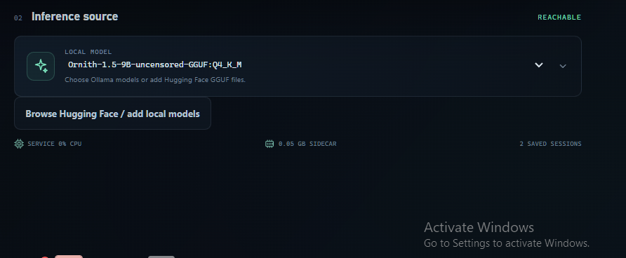
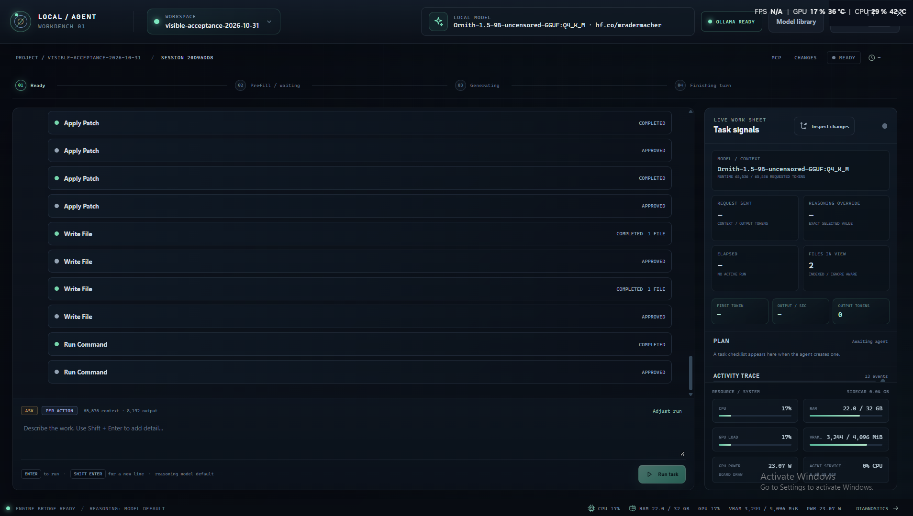

# Local Agent Workbench


**A local-first coding-agent desktop for using the models already on your machine to work on real projects.** It combines an Electron workspace with a bundled Python agent service, live tool activity, explicit approvals, and resumable project sessions.

> **Public beta:** active development; use version control and review changes. The app's project boundary applies to built-in file tools. Approved commands and MCP servers run with your Windows account permissions; approval is consent, not an operating-system sandbox.

## Get started

1. Download the Windows x64 **Setup.exe** from [GitHub Releases](https://github.com/MrNova420/local-agent-workbench/releases).
2. Install and open Workbench. The agent service is bundled; Python is not required on the target computer.
3. Connect a local inference runtime. For Ollama, install it from the [official Windows download](https://ollama.com/download/windows), start the service, and pull a model. The Home screen can reopen the installer page if Ollama is unavailable.
4. Select an installed model or use **Model library** to add a Hugging Face GGUF / local llama.cpp server.
5. Open a project, start a task, and review each requested file or command action. The model is not loaded when the app opens; it runs only after a task or explicit preload.

The first-run checklist in the app reports runtime, model, and workspace readiness. The app does not bundle Ollama or model weights: these are separate large downloads that you choose and manage. Current release artifacts target **Windows 10/11 x64**; macOS, Linux, and Windows ARM installers are not published yet.

## Screenshots

These saved historical screenshots are included to show earlier product states. They are not screenshots of the release candidate:



This saved capture shows a real project-development acceptance session. It predates the current updater and transcript-follow refinements, so it is historical workflow evidence rather than a current packaged-build screenshot:



The acceptance capture reflects one PC's GPU, memory, and timing readings; they are not expected performance figures for other systems.

Current release-candidate Home and chat screenshots will be refreshed after package verification. The release gallery intentionally excludes saved captures that show the known worksheet overlap or an empty loading skeleton.

## What is here

- **Local inference:** dynamically lists Ollama models and optional Hugging Face GGUFs through a selected llama.cpp server.
- **Model controls:** keeps context, output, temperature, and reasoning separate; preserves the model's reasoning default unless you choose an override. The current app defaults to 65,536 context and 8,192 output tokens and reports runtime-effective context where available.
- **Real project tools:** scoped file search/read/write/patch, Git review, plans, approved commands, skills, and local or remote MCP.
- **Reviewable operation:** streaming responses and tool events, expandable full output, explicit approval modes, cancellation choices, and a live activity worksheet.
- **Recoverable work:** app-wide and project-mirrored sessions, workspace history, checkpoints, and interrupted-run review.
- **Resource visibility:** waiting/generating phase, elapsed time, output rate, token count, CPU/RAM/GPU/VRAM, and provider-reported prompt-cache data.
- **Release updates:** installed Windows x64 builds check public GitHub releases and download updates in the background. Workbench never restarts to install one during an active task; applying an update requires the user's button click.

The target is broad Codex/OpenCode workflow parity with local implementations. This beta is not full parity or production-grade OS isolation. See the [core readiness and parity register](docs/CORE_HARNESS_READINESS.md), [acceptance log](docs/ACCEPTANCE_LOG.md), and [prioritized backlog](docs/PRODUCT_BACKLOG.md) for implemented scope and remaining gaps.

## Install and update behavior

The Windows installer uses Squirrel.Windows. Release assets include its `RELEASES` manifest and full `.nupkg`, which are required for automatic updates. Packaged x64 builds check the public repository feed; when an update is found it downloads in the background and waits for you to choose **Restart and update** in Settings. The app defers checks while a task is running, and the install action is disabled until the run ends. Development builds and unsupported platforms do not offer the updater.

For a clean Windows machine, install the app first, then install Ollama only if you want the Ollama provider. If the runtime is offline, the Home page provides a direct route to Ollama's official installer and a retry action. Model weights stay outside the app installer, so users can choose their own models and avoid an unexpected multi-gigabyte download.

## Build from source

Requirements: Windows 10/11 x64, Node.js 24, Python 3.12, and the paired [`local-agent-workbench-core`](https://github.com/MrNova420/local-agent-workbench-core) repository checked out next to this repository as `local-9b-dev-app`.

```powershell
npm ci
$env:LOCAL_AGENT_CORE_PATH = "..\local-9b-dev-app"
npm run typecheck
npm test
npm run make
```

`npm run make` builds the Python sidecar and creates the Squirrel installer and ZIP under `out/make/`. The installed app bundles its sidecar and does not depend on the sibling source checkout. Ollama is optional and is not started, stopped, or unloaded by app launch or request cancellation.

## Safety and privacy

- Model files and project content stay on the local machine unless you explicitly configure a remote MCP service or another networked tool.
- Built-in file tools stay under the captured workspace. Commands and MCP processes can access other paths and services available to your Windows account.
- Per-action approval is the default. Auto-approval does not create a sandbox.
- Keep MCP credentials in environment variables; do not commit secrets, `.env` files, session data, or model files.
- Review project diffs and run project-specific checks before applying important changes.

See [`SECURITY.md`](SECURITY.md) and [`CONTRIBUTING.md`](CONTRIBUTING.md).

## Project map

- `src/main.ts`, `src/preload.ts` — secured Electron process boundary, sidecar lifecycle, release update feed.
- `src/renderer/` — React desktop experience, chat, Home, model orbit, approvals, and activity worksheet.
- `sidecar/` — bundled Python JSON Lines worker and provider adapters.
- `tests/` — renderer, protocol, and Python worker regression suites.
- `docs/` — architecture, decisions, acceptance evidence, readiness, and backlog.
- `core-revision.txt` — exact paired Python engine revision.

## Verification

The 2026-10-31 live user acceptance completed a small website project in the disposable Workbench fixture. The user reported that planning, model interaction, tool use, and file completion all worked; it took roughly 2–3 hours on their PC. That is useful end-to-end evidence, not a benchmark or a claim that every workflow or platform is release-ready. The latest automated/package evidence is recorded in [`docs/ACCEPTANCE_LOG.md`](docs/ACCEPTANCE_LOG.md); new updater and UI changes still require the final verification pass before release.

## License

MIT — see [`LICENSE`](LICENSE).
