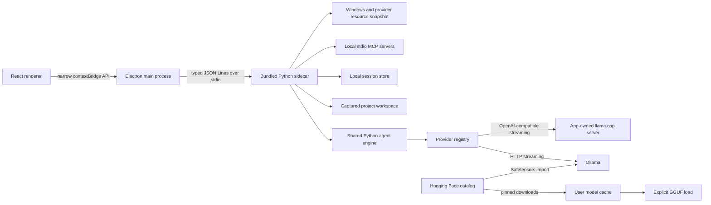

# Architecture and status

## Runtime map



The renderer owns display state only. The main process owns the sidecar process and exposes workspace selection, path reveal, and agent requests through `src/preload.ts`. The sidecar reads commands from stdin and writes JSON Lines responses/events to stdout. Model calls, MCP work, project scanning, and tools run on Python worker threads rather than the renderer.

## Isolation and request lifecycle

1. The user selects a project and starts or resumes a session.
2. The sidecar validates the canonical project path and session ownership.
3. `TurnContext.capture` freezes the project, session, model, context, permissions, approvals, and MCP tool list for the request.
4. One run is permitted at a time. The workspace selector and model selector lock while it runs.
5. Built-in file tools resolve paths inside the captured workspace and reject symbolic links. Write/command/MCP operations follow the chosen access and approval mode.
6. Stream events update the transcript and task activity sheet. Session persistence completes before a terminal event is relayed.
7. Cancel closes the active HTTP response only. It does not stop Ollama or stop a llama.cpp runtime unless that runtime was launched and owned by this app.

## Agent request and recovery data flow

```mermaid
sequenceDiagram
  participant UI as React UI
  participant Main as Electron main
  participant Worker as Python sidecar
  participant Engine as Agent engine
  participant Provider as Selected runtime
  participant Project as Captured project
  participant Store as App + project session stores
  UI->>Main: run_start (captured settings and project)
  Main->>Worker: JSONL command
  Worker->>Worker: Validate project/session and capture TurnContext
  Worker->>Project: Load instructions, skills, relevant files, tools
  Worker->>Store: Save running checkpoint and settings
  Worker->>Engine: Run one turn
  Engine->>Provider: Stream messages with selected context/output/reasoning
  Provider-->>Engine: reasoning/text/usage/phase events
  Engine-->>Worker: typed run events
  Worker-->>UI: JSONL events; persist full activity/results
  Engine->>Project: Project-scoped tool calls
  Worker->>Store: Checkpoint partial output and completed operations
  Worker-->>UI: terminal event after final save
```

### What a turn uses

- The captured session supplies its model/provider, context, output cap, temperature, reasoning override (unset means model default), access mode, approval mode, runtime options, and workspace. `TurnContext.capture` freezes those values and the MCP tool catalog for the run; switching UI projects cannot retarget a live turn.
- The model receives the app's general development system instruction, access policy, project instructions, relevant skill text when requested, selected conversation history, the current prompt, retrieved project excerpts, and the explicit built-in plus discovered MCP tool schemas. `ContextManager` budgets and compacts this input before each provider call. The requested context/output values are passed through as separate settings; memory pressure is reported as effective runtime context, never silently substituted.
- Built-in tools are `list_files`, `search_files`, `read_file`, `update_plan`, `skill`, `write_file`, `apply_patch`, and `run_command`; `git_diff` is also handled by the registry. MCP tools are namespaced and discovered from configured local stdio servers. Workspace paths are resolved under the captured root, and symlinks/junctions and parent traversal are rejected.
- Plan mode blocks writes/commands. Ask mode requests approval for writes/patches and all commands/MCP calls. Per-action and per-task approval are available, with run-scoped auto approval as an explicit setting. Commands use argv (no shell string), run in the captured project, and stream stdout/stderr into the same activity record as the tool result.

### Event and persistence lifecycle

- Provider text/reasoning and phase/usage events update the transcript and live metrics. Tool start, streamed output, final result, affected files, plan changes, approvals, and run failures share the session's ordered `activity_events` collection; the chat cards and Activity Trace render that same collection. Full tool output/results are stored; the UI reveals large output progressively rather than truncating it.
- A running session saves its run settings, prompt, partial text/reasoning, completed tool results, and a safe message checkpoint. Ordered run-event deltas are coalesced and fsynced to per-session JSONL journals in both stores; atomic JSON snapshots are written at operation boundaries and periodically. On resume, events newer than the snapshot cursor are replayed. App and project save health is reported independently.
- On reopening a session with an interrupted run, the app marks any in-flight operation uncertain and asks the user to continue, retry with a duplicate-action warning, or restore history only. It never replays a tool automatically. A partial token stream is retained as visibly interrupted text; in-flight model generation itself cannot be resumed.
- When context compaction omits older complete turns, a factual task checkpoint carries the goal, follow-up instructions, captured settings, current plan, completed operation references, changed files, verification, and latest assistant update. The complete transcript and tool results remain saved separately. The activity trace shows omitted/retained turn counts and whether the checkpoint was included in that request.
- App close during active work requires a choice: keep open, hide in the tray while work continues, or cancel and close after request shutdown/save. Cancel offers continue, cancel now, or finish the active operation and stop before another model call. These decision dialogs do not close on backdrop click or Escape.

See [Session Continuity Implementation](SESSION_CONTINUITY_IMPLEMENTATION.md) for current source status, queued fault-injection cases, and known verification gaps.

### Boundaries and known limits

- Project retrieval is selective and ignore-aware; it does not send every project file on every turn. File/tool safety bounds remain intentional (for example, large individual files are rejected and searches report when their scan/hit budget is reached); these are distinct from truncation of stored/displayed chat or operation results.
- A crash cannot establish whether a write or external MCP side effect completed unless its completion event was checkpointed. Such an operation is marked uncertain and requires workspace review.
- Provider/runtime logs may not expose the exact HTTP body after a run. Verify selected output caps through captured session settings and adapter payload tests; verify effective context independently from runtime-reported allocation.

## Package boundary

The development shell uses Python from `AGENT_PYTHON` (or `python`) and imports engine modules from `LOCAL_AGENT_CORE_PATH` (default: sibling `local-9b-dev-app`). `scripts/build-sidecar.ps1` freezes the worker and engine dependencies into `sidecar/dist/agent-worker.exe`; Forge copies it to Electron resources. The installed app launches that executable and has no runtime path to the original app folder.

## Decisions

- V1 is Electron + React + TypeScript with the current Python agent engine behind JSONL. A TypeScript engine rewrite is deferred.
- Ollama remains supported alongside an explicit llama.cpp GGUF provider and Ollama Safetensors imports. Reasoning defaults are preserved; overrides are sent only when supported by the selected capability contract.
- Context and output are independent explicit settings. Requests pass configured values unchanged; the UI shows reported runtime allocation separately and does not silently clamp values.
- App launch reads models and system state but does not issue inference or model load/unload requests.
- The default access mode is ask-before-write; shell and MCP calls are approved. Copy mode supports conflict-aware review before applying changes to the source.
- OpenCode configuration is outside this app's scope.

## Delivery status

### Implemented

- Independent Git repository and Electron Forge/Vite production packaging.
- Secure preload boundary, main-process sender checks, custom local scheme, and sidecar lifecycle supervision.
- Dynamic Ollama and llama.cpp model catalogs, capability-based reasoning controls, explicit Hugging Face GGUF and Safetensors workflows, requested/effective context visibility, elapsed phase, and system telemetry.
- Project and saved-session views, file listing, Git diff, copy review, context retrieval/compaction, approvals, local MCP settings, and request cancellation.
- Mocked provider/context/session/workspace/approval/MCP/UI-state checks.
- Windows Squirrel installer and ZIP output. The Hugging Face catalog and llama.cpp runtime implementation are present; expanded packaged acceptance is pending.

### Still open

- Visible packaged-app acceptance in a disposable empty project: greeting, coding task, reviewed/approved edits, test output, cancel, save, and resume, with workspace-path checks.
- One live exact-tag coding measurement after the visible workflow passes. Capture first-token delay, generation rate, effective context, and peak RAM/VRAM. Read and preserve Ollama's pre-existing loaded-model state; never unload a model the app did not start.
- Verify install/uninstall on a clean Windows profile and inspect the signed/release package later.
- Keep native Transformers checkpoints, cloud providers, the TypeScript engine rewrite, KV-cache experiments, and subagents in the deferred backlog.

Product-level follow-up work, including local lifetime/session/model analytics, richer Live Work Sheet telemetry, 64K/8K context-control verification, and process-correlated GPU investigation, is tracked in [PRODUCT_BACKLOG.md](PRODUCT_BACKLOG.md).
