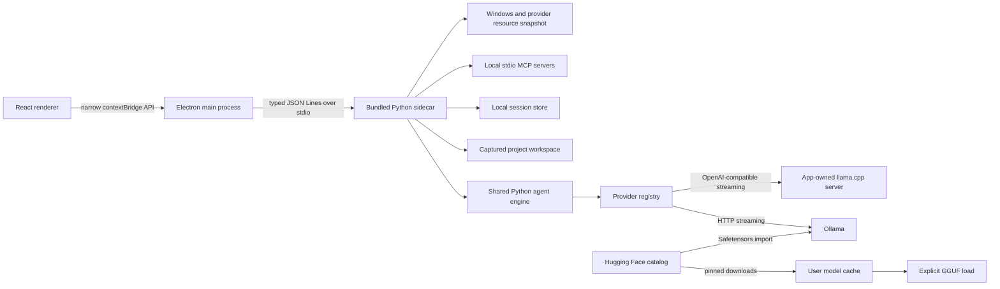

# Architecture and status

## Runtime map

The renderer owns display state only. The main process owns the sidecar process and exposes workspace selection, path reveal, and agent requests through `src/preload.ts`. The sidecar reads commands from stdin and writes JSON Lines responses/events to stdout. Model calls, MCP work, project scanning, and tools run on Python worker threads rather than the renderer.

## Isolation and request lifecycle

1. The user selects a project and starts or resumes a session.
2. The sidecar validates the canonical project path and session ownership.
3. `TurnContext.capture` freezes the project, session, model, context, permissions, approvals, and MCP tool list for the request.
4. One run is permitted at a time. The workspace selector and model selector lock while it runs.
5. Built-in file tools resolve paths inside the captured workspace and reject symbolic links. Write/command/MCP operations follow the chosen access and approval mode.
6. Stream events update the transcript and task activity sheet. Session persistence completes before a terminal event is relayed.
7. Cancel closes the active HTTP response only. It does not stop Ollama or stop a llama.cpp runtime unless that runtime was launched and owned by this app.

## Package boundary

The development shell uses Python from `AGENT_PYTHON` (or `python`) and imports engine modules from `LOCAL_AGENT_CORE_PATH` (default: sibling `local-9b-dev-app`). `scripts/build-sidecar.ps1` freezes the worker and engine dependencies into `sidecar/dist/agent-worker.exe`; Forge copies it to Electron resources. The installed app launches that executable and has no runtime path to the original app folder.

## Decisions

- V1 is Electron + React + TypeScript with the current Python agent engine behind JSONL. A TypeScript engine rewrite is deferred.
- Ollama remains supported alongside an explicit llama.cpp GGUF provider and Ollama Safetensors imports. Reasoning defaults are preserved; overrides are sent only when supported by the selected capability contract.
- Context and output are independent explicit settings. Requests pass configured values unchanged; the UI shows reported runtime allocation separately and does not silently clamp values.
- App launch reads models and system state but does not issue inference or model load/unload requests.
- The default access mode is ask-before-write; shell and MCP calls are approved. Copy mode supports conflict-aware review before applying changes to the source.
- OpenCode configuration is outside this app's scope.

## Delivery status

### Implemented

- Independent Git repository and Electron Forge/Vite production packaging.
- Secure preload boundary, main-process sender checks, custom local scheme, and sidecar lifecycle supervision.
- Dynamic Ollama and llama.cpp model catalogs, capability-based reasoning controls, explicit Hugging Face GGUF and Safetensors workflows, requested/effective context visibility, elapsed phase, and system telemetry.
- Project and saved-session views, file listing, Git diff, copy review, context retrieval/compaction, approvals, local MCP settings, and request cancellation.
- Mocked provider/context/session/workspace/approval/MCP/UI-state checks.
- Windows Squirrel installer and ZIP output. The Hugging Face catalog and llama.cpp runtime implementation are present; expanded packaged acceptance is pending.

### Still open

- Visible packaged-app acceptance in a disposable empty project: greeting, coding task, reviewed/approved edits, test output, cancel, save, and resume, with workspace-path checks.
- One live exact-tag coding measurement after the visible workflow passes. Capture first-token delay, generation rate, effective context, and peak RAM/VRAM. Read and preserve Ollama's pre-existing loaded-model state; never unload a model the app did not start.
- Verify install/uninstall on a clean Windows profile and inspect the signed/release package later.
- Keep native Transformers checkpoints, cloud providers, the TypeScript engine rewrite, KV-cache experiments, and subagents in the deferred backlog.

Product-level follow-up work, including local lifetime/session/model analytics, richer Live Work Sheet telemetry, 64K/8K context-control verification, and process-correlated GPU investigation, is tracked in [PRODUCT_BACKLOG.md](PRODUCT_BACKLOG.md).
