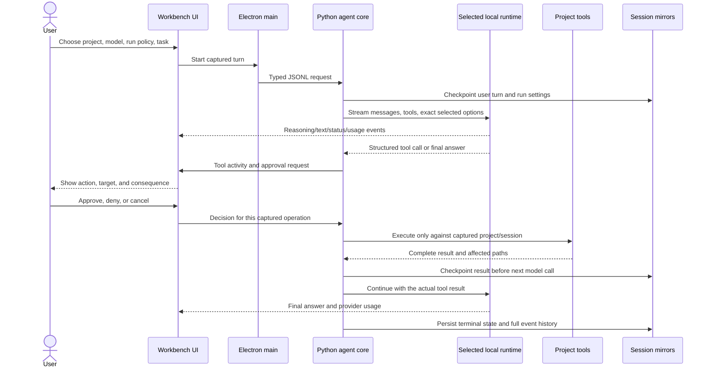

# Core harness readiness: audit, design, and execution gates

**Status: active work.** This document focuses on the agent loop and usable project-development workflow. Hero popovers, visual polish, usage analytics, extra dashboard customization, and other non-blocking interface work remain backlog items until the core acceptance gates pass.

## Product objective

Deliver feature parity with Codex and OpenCode for the full local coding-agent workflow: project understanding through edits, approved commands, verification, review, and resumable history. The parity target is the serious coding workflow, adapted for local runtimes and the actual capability of each model; it is not a claim that cloud-only providers or proprietary services are included. The model is one component of that system. A successful chat response alone is not proof that a file changed or a test ran.

## Codex / OpenCode parity map

The references below were reviewed directly from the official OpenCode documentation, the OpenAI Codex app-server repository, and OpenAI Developers. This matrix translates their documented user-facing capabilities into an implementation baseline for this app.

| Capability area | Codex / OpenCode baseline | Workbench status and parity requirement |
|---|---|---|
| Conversation and turns | Durable thread/session, multiple turns, stream events, interrupt/continue, recoverable state | Mirrored resumable sessions and events exist. Complete crash/failure/reopen acceptance and turn-level serialization remain required. |
| Model/provider identity | Provider-qualified model identity, per-turn model/options, runtime usage | Ollama and local llama.cpp/HF GGUF adapters exist. Make capability/unsupported states truthful and test both actual provider paths. |
| Context and instructions | Repository instructions, skill discovery/loading, project context, compaction and tool-result management | Project instructions/skills and retrieval exist. Need explain included context, improve retrieval and compaction evidence, and finish large-repo retrieval/paging. |
| File operations | List/glob, grep/search, read (including ranges), precise edit, write, patch | List/search/read/write/patch exist; read ranges and uncapped writes now exist. `edit`/precise replacement and continuation for capped listings/search are parity gaps. |
| Command execution | Real terminal command, working directory, live output, process lifecycle, approval policy | Argv commands and streamed output exist; process-tree cancellation is being hardened. OS-level sandbox is absent and is a release-critical gap for any broad auto-approval. |
| Permissions and approvals | Per-action allow/ask/deny, path/command-aware decisions, explicit approval events and decisions | Current access modes plus per-action/per-task/auto exist. Fine-grained rules and safe command matching are missing; auto remains opt-in, with project boundary enforced for host tools. |
| MCP and extensions | Local and remote MCP, custom tools, scopes/credentials, permissions, graceful startup/shutdown | Local stdio MCP exists. Remote MCP, tool permission rules, custom tool packaging, credential-safe settings, and failure isolation need acceptance/design. |
| Code intelligence | LSP diagnostics, definitions/references, symbols, code actions where available | No LSP client/tool in the current app; add capability-discovered language-server integration. |
| Planning and agents | Plan/build roles, custom agents, subagents, task delegation, todo/checklist tools | Plan tool exists. Agent profiles, read-only planning boundaries, subagents and delegation are queued after single-agent reliability, as previously agreed. |
| Review and Git | Changed-file summary, diff, file context, review requests, preserve user edits | Git diff and non-Git snapshots exist. Add Git status/branch awareness, untracked/rename/deletion review, diff navigation and safe conflict handling; never rewrite user history. |
| Workspace isolation | Project roots, worktrees, external-directory controls, distinct execution environment | Captured root/session prevents switching leaks; commands still run with user privileges. Add managed worktree flows and actual Windows process/filesystem/network containment. |
| Long-running UX | Waiting/generating, operation events, inline tool activity, approvals, steer/queue, interrupt, final/error status | Streaming worksheet and decision modal exist. Acceptance must prove command-child cancellation, no ghost run, and restored transcript/activity/status. |
| Setup and release | Runtime/model management, clear health/diagnostics, install/update/migrations | Inference/runtime setup is partial. Build a first-run/repair/upgrade path and reproducible installer only after core packaged acceptance. |

Parity is verified feature-by-feature, not inferred from visual similarity. Every row must end as implemented + tested, explicitly deferred with a reason, or incompatible with the local-only boundary. No row is declared complete on UI appearance alone.

### Core task path

## Findings from code and prior acceptance evidence

### Implemented foundations

- Electron main supervises the bundled Python worker using newline-delimited JSON; the renderer uses a narrow preload bridge.
- Ollama and an optional llama.cpp GGUF runtime are registered by provider identity. Ollama discovery is dynamic; Hugging Face GGUF files can be downloaded or selected locally for the llama.cpp path; supported Safetensors can be imported into Ollama.
- A run captures workspace, session, provider/model, context, output cap, reasoning, approvals, and MCP tools. Context and output remain independent values. Ollama's `num_ctx`, `num_predict`, and model-default reasoning omission are covered by provider tests.
- Tools include project list/search/read/write/patch, task plan, skills, command execution, MCP, and Git diff at the worker implementation level. Workspace paths reject traversal and symbolic links. Writes/commands are governed by access and approval modes.
- The engine streams reasoning and answer text, timestamps activity, saves complete tool results, mirrors sessions to app and project stores, and checkpoints in-flight runs for explicit crash recovery.
- Visible acceptance has already completed a disposable coding task with approval, command verification, save/resume, Markdown rendering, and project isolation at 65,536 context / 8,192 output / model-default reasoning. This is valuable evidence for that build and task, not general release acceptance.

### Defects reproduced and fixed in source during this work

- `git_diff` existed in the dispatcher but was absent from Ollama's advertised tool schema. Added the schema and a regression test.
- `list_files` silently stopped at 1,200 matches. It now marks that result as potentially incomplete; broader pagination is still desirable for large workspaces.
- Core `read_file` and `write_file` refused files over 300 KB, while disposable-copy review refused files over 500 KB. These arbitrary caps blocked legitimate project work. Removed those limits; `read_file` also supports explicit 1-based line ranges so large files can be inspected in sections.
- Approved command cancellation previously terminated only the direct process; a child could survive with stdout/stderr handles open, leaving the turn waiting. The command runner now tracks and terminates child processes and has a regression test for a child-held pipe.

### Remaining risks / work required

- **Run a fresh packaged end-to-end task against a disposable empty project.** Prior acceptance is not a substitute for verifying the current source/sidecar build after these fixes. Capture exact project, model, requested context/output/reasoning, actual runtime values, structured tool call, approvals, file contents, test output, final response, and resumed history.
- **Command isolation is weaker than the product boundary suggests.** Commands run with the user's Windows account and can access paths outside the selected project; the approval UI warns about this but approval alone is not OS sandboxing. This must be reflected in setup and confirmation language; implement a Windows sandbox boundary before any unattended or auto-approved command mode is treated as production-safe.
- **File listing/search have bounded scans.** Search reports its cap. Listing now reports its 1,200-match cap but needs cursor/paging and cancellation for very large repos.
- **No guarantee that every model uses tools well.** Runtime API support is distinct from model-template/tool competence. Show per-model tool support as observed/unknown and keep a small capability probe available without silently changing model settings.
- **Parity does not mean every provider supports every control.** OpenCode and Codex can expose cloud APIs with provider-specific capabilities. This workbench should surface every installed model/runtime the local adapters can use, preserve exact model IDs/options, and mark unsupported capabilities as such instead of fabricating compatibility.
- **Long task correctness needs event-level gates.** Verify each operation has start → approval (when needed) → output/progress → terminal status, and terminal status agrees with exit code / file hash / provider result. Never infer success from assistant prose.
- **Mirrored session recovery needs fault injection.** Test crashes before a tool starts, after an approved operation starts, after the effect but before completion is persisted, and between app/project mirror writes. Recovery must not replay completed or uncertain side effects automatically.
- **Packaging/source provenance must be explicit.** The bundled sidecar build currently resolves the Python engine from a sibling checkout by default or `LOCAL_AGENT_CORE_PATH`. Release packaging must pin a specific core revision and record it in build metadata; it must not accidentally package stale code from an arbitrary adjacent folder.
- **Test gates are not release gates.** Unit/renderer tests, sidecar tests, packaged app, visible UI task, runtime model, Windows install/upgrade, and public repository are separate evidence levels.

## Research-backed design decisions

1. **Expose actions as structured tools and make the host authoritative.** OpenCode's documented tool surface uses explicit tools and permission rules; Ollama's API distinguishes tool calls from the assistant's text. Therefore the workbench must never convert a sentence such as “May I run…” into an approval request by guessing the command. The model must issue a valid structured tool call; if it only narrates, surface that no action was requested/executed and offer a safe retry.
2. **Model capabilities are discovered, not guessed.** Ollama documents model-specific `think` values and defaults via `/api/show`; llama.cpp tool calling depends on its server/chat-template configuration. Show `unknown` where capability metadata is absent, and do not promise tool calls merely because the HTTP endpoint accepts a `tools` array.
3. **Separate consent from containment.** Per-tool approval improves user control, but it does not constrain a process once allowed. The current command runner uses the normal user account; keep auto-approval off by default and do not describe project-root execution as a sandbox. Prioritize a Windows containment design and tests before broad unattended command execution.
4. **Keep UI as a control plane over a durable agent loop.** Codex's public harness description highlights run state, events, tools, approvals, sandboxing, and recovery together. Keep the sidecar as the owner of turn execution and the Electron UI as the visible control/review surface; every event needs stable session/turn/operation identity and persistence.
5. **Retain complete evidence while managing prompt context explicitly.** Store full chat/tool results and let context budgeting select/compact input with visible explanations. Use line-range reads, search paging, and project-aware retrieval instead of silent file truncation or repeatedly sending the whole repo.

## Prioritized implementation and acceptance plan

### P0 — Correctness and safety of one turn

- Keep runtime identity, model reference, requested/effective context, output cap, reasoning, and actual request options visible and persisted for every turn.
- Validate structured tool arguments against their schemas before execution; return a typed failure result for malformed/unknown tools and continue or stop deterministically.
- Verify file writes atomically and record affected paths; make command stdout/stderr/exit code/cancel/timeout explicit and streamed.
- Ensure every approval corresponds to one concrete operation, cannot be dismissed by backdrop/Escape, and is bound to the captured workspace and policy. Run mode and auto-approval must be obvious in the transcript/session.
- Add a concise recovery path for model prose that describes a requested action without a tool call; do not infer arguments or execute anything based on prose.

### P1 — Reliable full-project workflow

- Add cursor-based file listing and search result continuation; preserve user-visible warnings for incomplete scans.
- Add robust large-file reads by line range and large structured file edits without arbitrary byte ceilings; keep previews lazy/virtualized and persisted outputs complete.
- Add stronger project retrieval for manifests, instructions, skills, import/reference graphs, and task-relevant source/tests; record what was included or excluded in each run.
- Add test/build command profiles with explicit command preview, project working directory, streamed output, and re-run after edits. Commands remain approved; sandboxing is a separate prerequisite to safe broad auto-approval.
- Make run completion require final answer or clear terminal reason after tool work. Detect “tool still running” and missing result states; never show a generic completed chip for an incomplete operation.
- Add concurrency guards so one session has one active turn and project/session switching cannot redirect a running tool.

### P2 — Reliability and runtime coverage

- Fault-inject cancellation, malformed model output, runtime disconnects, worker crash, read-only session mirror, conflict, partial write, and shutdown while waiting for first token.
- Make package creation deterministic: exact engine revision, dependency lock, signed or checksum-verifiable installer artifacts, migration checks, and clean-machine install/uninstall/upgrade test.
- Run a separate provider acceptance for Ollama and llama.cpp/Hugging Face GGUF; test a model that is known to support structured tools and one without tool-call support.
- Benchmark runtime changes only with fixed prompts and recorded hardware/context/output/reasoning; preserve the loaded-model state and settings around each measurement.

### P3 — Complete product parity after core stability

- Build a capability-based model/provider registry, including honest model tool-call probes and complete Hugging Face GGUF flow; retain the agreed Ollama and llama.cpp support and no implicit model load.
- Implement per-tool/per-path permissions, policy explanation, persistent approval scopes where the user chooses them, and Windows sandbox enforcement for commands.
- Add LSP-aware diagnostics/navigation, precise replace/edit tool, richer Git status/review, project commands/formatters, custom tool plugins, and local + remote MCP configuration as separately testable integrations.
- Add configurable primary agents (Build/Plan), agent profiles, subagent orchestration and child-task tracing only after single-agent run/recovery semantics are proven.
- Complete session lifecycle parity: rename, archive, export/import, fork/branch, search, move/rebind project safely, recover/migrate, and mirror conflict resolution.
- Complete workspace lifecycle parity: project roots, worktrees and cleanup review, startup tasks, setup profiles, and isolated disposable runs; avoid destructive cleanup of unrelated work.
- Finish app lifecycle and quality-of-life parity: keyboard navigation/commands, settings and permissions discovery, app setup/repair/update, diagnostics, local analytics, and the model-orbit popover and worksheet arrangement backlog.

## Core acceptance gate

Use one disposable, empty project and one visible packaged instance. Keep selected settings exactly as captured before the run. Execute: `hello` and confirm a normal streamed reply; then request a small real project (one-page website or equivalent) with tests; inspect the model's plan and structured tool events; approve each requested write/command; observe a real file appear in the selected fixture; approve and observe a test command with streamed stdout/stderr/exit code; review the Git/file diff; wait for the model's completion; save, close, reopen, and verify full Markdown, tool output, settings, plan, activity, project path, and final status. Finally test deny, cancel, project switch, and recovery in separate disposable turns. Record observed failures without cleaning them up silently.

The app is core-ready only when the packaged visible path passes and no known P0 issue remains. Benchmark quality or speed is reported separately and cannot substitute for workflow correctness.

## Official references

- OpenCode built-in tools and permissions: <https://docs.opencode.ai/docs/tools/> and <https://docs.opencode.ai/docs/permissions/>
- OpenCode agent roles, primary/subagents and per-agent tools: <https://docs.opencode.ai/docs/agents/>
- OpenCode local/remote MCP and tool cost in context: <https://docs.opencode.ai/docs/mcp-servers/>
- OpenCode skill discovery and on-demand loading: <https://docs.opencode.ai/docs/skills/>
- OpenCode model/provider configuration and reasoning variants: <https://docs.opencode.ai/docs/models/>
- OpenCode session export / CLI workflows: <https://docs.opencode.ai/docs/cli/>
- OpenAI Codex harness architecture (state, tools, events, approvals, sandbox, recovery): <https://developers.openai.com/blog/codex-as-a-platform>
- Codex app-server protocol and command approval requests/reconnect behavior: <https://github.com/openai/codex/blob/main/codex-rs/app-server/README.md>
- Codex app workflow (worktrees, queued/steering messages, diff review, goals and history): <https://developers.openai.com/blog/mastering-codex-remote-for-engineering>
- OpenAI Agents API overview of sessions, turns, environments, events, MCP, tools, resume: <https://developers.openai.com/api/docs/guides/agents-api/overview>
- Ollama structured tool calling: <https://docs.ollama.com/capabilities/tool-calling>
- Ollama thinking capabilities and exact supported values: <https://docs.ollama.com/capabilities/thinking>
- Ollama chat request fields and generation usage: <https://docs.ollama.com/api/chat>
- Ollama context configuration and CPU/GPU allocation interpretation: <https://docs.ollama.com/faq>
- llama.cpp server chat templates, tool calling, cache/context and runtime reporting: <https://github.com/ggml-org/llama.cpp/blob/master/tools/server/README.md>
- Hugging Face model loading and code-execution trust boundaries: <https://huggingface.co/docs/transformers/main/models>
