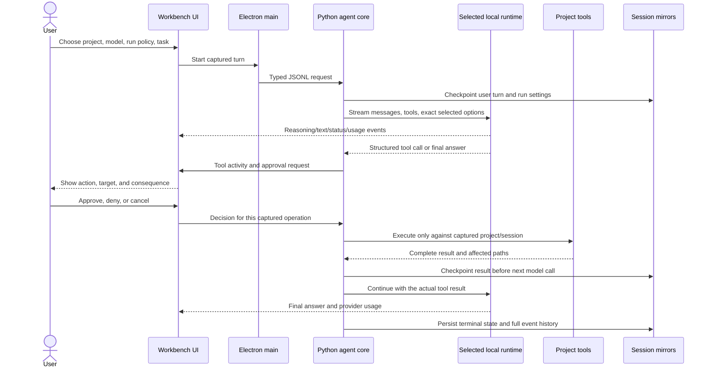

# Core harness readiness: audit, design, and execution gates

**Status: active work.** This document focuses on the agent loop and usable project-development workflow. Hero popovers, visual polish, usage analytics, extra dashboard customization, and other non-blocking interface work remain backlog items until the core acceptance gates pass.

## Product objective

Deliver **1:1 user-facing feature and workflow parity with Codex and OpenCode** for coding-agent use, with equivalent local implementations wherever those products depend on hosted services. This is the product target, not a reduced “small-model edition” or a claim based only on the core coding loop. It covers the complete discoverable product surface: project/workspace lifecycle, conversation and run controls, model/runtime configuration, context and instructions, tools and integrations, safety/approvals, code intelligence, review, recovery, customization, diagnostics, and packaging. Cloud accounts, proprietary model behavior, hosted compute, and remote services cannot be reproduced locally; each must have a clearly labeled local equivalent or a concrete incompatibility entry in the parity register. No capability may silently disappear from the target because it is difficult or currently absent. The model is one component of that system. A successful chat response alone is not proof that a file changed or a test ran.

## Codex / OpenCode parity map

The references below were reviewed directly from the official OpenCode documentation, the OpenAI Codex app-server repository, and OpenAI Developers. This matrix translates their documented user-facing capabilities into an implementation baseline for this app.

| Capability area | Codex / OpenCode baseline | Workbench status and parity requirement |
|---|---|---|
| Project onboarding and discovery | Open, initialize, inspect, resume, and switch projects; discover instructions and repository conventions | Project selection exists. Full onboarding, project switching/history, setup diagnostics, and instruction discovery need end-to-end acceptance. |
| Interaction surfaces | Desktop, terminal/CLI, editor integration, command palette, keyboard navigation, attention/notifications | Electron desktop exists. CLI and editor surfaces, complete shortcut map, command palette parity, and notifications need implementation or explicit product-equivalent decisions. |
| Conversation and turns | Durable thread/session, multiple turns, stream events, interrupt/continue, recoverable state | Mirrored resumable sessions and events exist. Complete crash/failure/reopen acceptance and turn-level serialization remain required. |
| Run orchestration | Queue/steer input, cancel/interrupt, retry, continue, background/reattach, side chats, long-running goals | Cancellation/recovery foundations exist; queue/steer, detach/reattach, side conversations, goals, and safe retry controls need parity work. |
| History management | Search, rename, archive, fork/branch, export/import, compare and resume conversations | Basic save/resume exists. Full history lifecycle and migration/import/export need parity work. |
| Model/provider identity | Provider-qualified model identity, per-turn model/options, runtime usage | Ollama and local llama.cpp/HF GGUF adapters exist. Make capability/unsupported states truthful and test both actual provider paths. |
| Model controls | Provider/model selection, model variants/reasoning controls, sampling and token/context settings, favorites/recents, capability discovery | Exact context/output/reasoning request fields exist for current adapters. Run configuration now saves to both session mirrors, including skill controls; selecting another model restores its model-default reasoning unless the user selects an override. Broader provider controls and per-model support/limits need parity tests; never silently rewrite user selections. |
| Context and instructions | Repository instructions, skill discovery/loading, project context, compaction and tool-result management | Project instructions and relevance retrieval exist. Workbench-owned per-session skill enablement and project/user source selection are now implemented and captured with immutable runs; disabled skills are omitted from model tools. Each actual request now emits a durable source manifest with message sizes, checkpoint/compaction status, instruction/retrieval paths, exact skill-catalog entries and tool/MCP names. Source-only and unverified; exact prompt-text preview, per-skill permission controls, and large-repo scan continuation remain open. |
| Multimodal input/output | Attachments and supported image/audio or other model inputs; generated artifacts where provider supports them | File/chat workflow is primarily text. Inventory supported local modalities and implement capability-based attachment/artifact flows without pretending unsupported models accept them. |
| File operations | List/glob, grep/search, read (including ranges), precise edit, write, patch | List/search/read/write/patch and exact-match `edit_file` exist; edits refuse missing/ambiguous matches unless replace-all is explicit, obey approval modes, and commit through atomic writes. Read ranges and uncapped writes exist. List/search support project-relative nested glob patterns, scoped roots, explicit offsets and page sizes; further scan caps remain visible. |
| Command execution | Real terminal command, working directory, live output, process lifecycle, approval policy | Direct argv and approved PowerShell command-string execution with streamed output and process-tree cancellation exist. OS-level sandbox is absent and is a release-critical gap for any broad auto-approval. |
| Permissions and approvals | Per-action allow/ask/deny, path/command-aware decisions, explicit approval events and decisions | Current access modes plus per-action/per-task/auto exist. Fine-grained rules, hard-deny precedence, and safe command matching are missing. Structured file tools are project-bound, but host commands are not contained by the project path. |
| MCP and extensions | Local and remote MCP, custom tools, scopes/credentials, permissions, graceful startup/shutdown | Local stdio and remote Streamable HTTP transports are implemented in source; remote endpoints require HTTPS (except loopback), secrets use environment references, and calls still require approval. Dispatched calls with an unconfirmed result are recorded as uncertain, stop the remainder of the current tool batch, and require inspection before retry. Discovery now reports unsupported argument-schema features in each affected tool description and Tool Catalog while runtime validation remains fail-closed. JSON Schema `format` remains annotation-only; formatted values are not validated. Packaged transport/schema tests, remote auth, timeout, failure, and shutdown acceptance remain pending. Tool-level permission rules and custom tool packaging remain open. |
| Skills, plugins, and reusable commands | Discoverable skills, lifecycle-managed plugins/hooks, project/global custom commands, extension compatibility | Project/user skill source filters and a Workbench enable switch exist and are saved with session settings. The request manifest records which skill names were included in the tool schema and which skill-load results remain in the actual request history. Plugin lifecycle, hooks, custom command UX, update/error isolation, and compatibility/import story need implementation. This is not yet UI-accepted. |
| Code intelligence | LSP diagnostics, definitions/references, symbols, code actions where available | No LSP client/tool in the current app; add capability-discovered language-server integration. |
| Planning and agents | Plan/build roles, custom agents, subagents, task delegation, todo/checklist tools | Auto, Discussion, Plan-only, and Implement task intents are now saved and passed to the engine; detected build requests and explicit Plan/Implement tasks start with a Workbench checklist before inference. The model can refine it through `update_plan`. Read-only access now omits write/command schemas and MCP tools. Terminal outcomes record project-change, post-change inspection, and approved-command evidence; implementation with no observed project change is labeled incomplete. Rich task-specific acceptance criteria remain open. Agent profiles and subagents/delegation stay queued after single-agent reliability. This source integration is unverified. |
| Review and Git | Changed-file summary, diff, file context, review requests, preserve user edits | Git diff and non-Git snapshots exist. Add Git status/branch awareness, untracked/rename/deletion review, diff navigation and safe conflict handling; never rewrite user history. |
| Workspace isolation | Project roots, worktrees, external-directory controls, distinct execution environment | Captured root/session prevents switching leaks; commands still run with user privileges. Add managed worktree flows and actual Windows process/filesystem/network containment. |
| Environment and remote work | Local/remote hosts, worktrees, background execution, reattachment, environment status | Local Windows only today. Keep local-first as default; comparable remote environment support requires a separately designed, secured transport and is not implied by local MCP. |
| Long-running UX | Waiting/generating, operation events, inline tool activity, approvals, steer/queue, interrupt, final/error status | Streaming worksheet and decision modal exist. Source preserves reader scroll position and uses compact expandable tool rows. Both streaming providers now show a transient, non-executable tool-call preparation cue with name and argument size before full arguments arrive. Acceptance must prove command-child cancellation, no ghost run, and restored transcript/activity/status. |
| Settings and customization | Project/global config, themes, keybindings, agents, permissions, formatters, LSP, notifications | App settings are partial. Implement discoverable settings with scope, validation, migration, and per-feature capability reporting. |
| Setup, health, and release | Runtime/model management, diagnostics, install/update/migrations, crash/support data | Source now includes first-run readiness, an Ollama recovery route, Squirrel launch-event handling, and a GitHub release updater for packaged Windows x64. Fresh package/install/upgrade acceptance remains open; model/runtime install and recovery are partial; macOS, Linux, Windows ARM, and signing are not supplied. |
| Scheduled and repeatable work | Custom slash commands, automations/scheduled tasks, reusable workflows | Custom commands/automations are not complete. Implement local scheduling only with clear machine-on/background behavior, logs, cancellation, and permissions. |

Parity is verified feature-by-feature, not inferred from visual similarity. **The target is all rows, not only P0/P1 or the first release slice.** Sequencing may defer implementation, but a deferred row remains an open parity requirement and cannot be described as 1:1-ready. Every row must end as implemented + tested, or have a documented, user-visible local equivalent/incompatibility with its consequence. No row is declared complete on UI appearance alone.

### Research cross-check and design implications

- OpenCode documents built-in tools plus custom tools and MCP, with per-tool allow/ask/deny rules and wildcard matching. Workbench should adopt the discoverable, extensible surface and granular policy model, while retaining explicit approval for risky actions by default. It should not copy OpenCode's defaults as if they were automatically safe for a local Windows account.
- OpenAI's documented tool surface includes function calling, web search, file search, tool search, remote MCP, skills, shell, and computer use. The managed Codex harness additionally covers sandboxed execution, event streams, approval, steering, compaction, durable sessions, and delegation. Workbench's equivalent should be an adapter/tool capability system: provider-specific features are advertised only when the runtime supports them; local integrations can extend tools through MCP; cloud-only services remain clearly identified as unavailable unless the user explicitly configures a compatible integration.
- Microsoft's AppContainer documentation describes an OS-enforced isolation boundary with explicitly granted file, registry, network, and process access. The current Workbench command approval and project working directory do not provide that boundary. Before broad auto-approval, add a real Windows execution backend with measured filesystem/network containment and a host-mode explanation; do not relabel approval as sandboxing.
- The practical target is extensibility rather than an impossible fixed inventory of “every tool”: versioned tool contracts, runtime/model capability discovery, dynamically loaded MCP definitions, tool-specific permission rules, and an integration directory that distinguishes available, configured, unsupported, and planned capabilities.

### Current core-loop audit (2026-10-31)

Official OpenCode references: [built-in tools and MCP](https://opencode.ai/docs/tools/), [allow/ask/deny permissions](https://opencode.ai/docs/permissions/), [Agent Skills discovery and loading](https://opencode.ai/docs/skills/), [tool dispatch source](https://github.com/anomalyco/opencode/blob/dev/packages/core/src/session/tools.ts), and [skill tool source](https://github.com/anomalyco/opencode/blob/dev/packages/core/src/tool/skill.ts). The local source was reviewed against those surfaces. This is a source audit; it is not packaged or live-model acceptance.

- **Already present in source:** iterative model/tool/model loop; structured tool results returned to the next model request; streamed text/reasoning and command output; project-scoped list/search/read/edit/write/patch; plans; Git status/diff/log; approvals; local and remote MCP; cancellation and stop-after-operation; activity/session persistence.
- **Skills improved in source:** optional metadata discovery is exposed to the model through the skill tool description; metadata is ranked against the current task and only as many descriptions as fit the selected input budget are sent, with the complete catalog available through `skill(action=list)`. Discovery walks the selected project to its Git worktree and configured user-global paths; supported locations include `.agents/skills`, `.claude/skills`, `.opencode/skills`, global OpenCode skills, and `~/.codex/skills`; skill bodies are no longer silently truncated. Bundled text resources can be read through a skill-relative, symlink/traversal-checked action. Legacy files without frontmatter remain discoverable. The desktop app now explicitly enables/disables skills and selects project/user sources per session; the engine captures these settings per run and omits the tool when disabled. Fine-grained per-skill allow/ask/deny, exact loaded-skill evidence, and prompt-source preview remain open. Workbench settings are independent of Codex/OpenCode configuration.
- **Context budget use improved in source:** relevant-file retrieval now uses the remaining request budget after full project instructions, the user prompt, tools, and output reservation are accounted for, instead of a fixed 18,000-token retrieval ceiling. Project instructions and loaded skills are no longer silently clipped. Skill descriptions and retrieved excerpts use only the remaining request budget; omitted relevant excerpts are disclosed when space permits. Bounded filesystem scans still report partial results.
- **Context reliability improved in source:** overflow pruning now builds a request-only context from complete prior user turns, preserving each retained assistant tool-call/result sequence. The canonical transcript stays intact in the session store. The model request receives an explicit omission notice and a persisted activity event with the number of omitted turns. It does not change the configured context or output limits. A generated semantic summary and provider-overflow retry remain future work.
- **Ollama tool-loop protocol corrected in source:** tool result messages now include Ollama's documented `tool_name` field, and streamed tool calls retain provider IDs/indexes and assemble JSON arguments before the next request. Older saved tool messages are normalized during resume. This fixes a protocol-level reliability defect that could interrupt model→tool→model continuation. Exact second-request payload verification remains queued for the final test gate.
- **Windows command capability expanded in source:** alongside direct argv, models can now request an approved PowerShell command string for pipelines, redirects, and Windows script wrappers common to developer tasks. It remains a host-permission operation, runs in the captured project directory, streams output, and can affect paths outside the project; project root is a working directory, not containment.
- **Project discovery improved in source:** `list_files` and `search_files` now accept nested project-relative glob patterns; search can be restricted to a safe project subdirectory and include pattern while preserving pagination and visible scan-budget status.
- **Tool argument validation added in source:** built-in and MCP calls are checked against advertised JSON Schema types, required fields, enums, numeric bounds, array item types, and extra-property rules before approval or execution. Invalid calls return actionable tool results and failed activity events instead of reaching a tool with malformed input. Full schema edge-case coverage remains queued.
- **Copy-mode warning corrected in source:** structured file operations stay in the disposable copy, but approved commands run with the Windows user account and can change files outside it. The model instructions now state this directly; this is not OS isolation and does not satisfy the sandbox gate.
- **Approval cancellation status corrected in source:** cancellation while waiting on a permission dialog is carried to the agent loop as cancellation, and the approval activity is saved as cancelled rather than denied. The app interaction and recovered event state remain part of final acceptance.
- **Highest-priority remaining core gaps:** no first-party LSP/browser/search/question/custom-tool adapters; no persistent per-tool/path/command permission rules or deny precedence; and no verified worktree/OS sandbox. These are capabilities, not visual polish, and stay ahead of analytics/orbit refinements.
- **Completion workflow improved in source:** implementation intent now gets at most one structured-tool continuation to start work and a separate continuation to perform a post-change inspection/check. Completion events and saved run state distinguish a successful post-change tool step from a changed but unverified result, and the app warns when edits have no recorded check. User-denied actions are not retried by the continuation. This remains evidence of a tool step, not proof of semantic correctness; replace the prompt heuristic with an explicit user-visible run intent and task-specific verification contract.
- **Structured tool-schema validation hardened in the shared engine:** nested object/array constraints, string constraints and patterns, composition (`allOf`/`anyOf`/`oneOf`/`not`), constants/enums with JSON-correct equality, non-finite number rejection, schema-valued `additionalProperties`, and local JSON Pointer `$ref` resolution are validated before any built-in or MCP action. Unknown types/keywords and external/missing references fail closed with a clear schema error. Regression cases are added and queued for final testing; this source change is committed in `local-agent-workbench-core` at `1d68312` and is now the paired engine revision. This is a supported JSON Schema subset, not full Draft 2020-12 support.
- **Tool outcomes are more truthful in source:** capped project searches/listings now show `PARTIAL`, while invalid file inspections and Git inspection failures show `FAILED`; failed reads no longer count as post-change verification. Engine and renderer regression cases are queued; the current packaged app predates these changes.
- OpenCode’s skill docs require descriptive frontmatter and dynamically surface skill name/description for on-demand selection. Its tool docs include shell, file, search, glob, LSP, skill, todo, web, and question tools. The Workbench preserves its safer explicit approval and local-process boundary, while parity work must add equivalent capability adapters without claiming that MCP or an approval dialog itself is sandboxing.

### Core task path

## Findings from code and prior acceptance evidence

### Implemented foundations

- Electron main supervises the bundled Python worker using newline-delimited JSON; the renderer uses a narrow preload bridge.
- Ollama and an optional llama.cpp GGUF runtime are registered by provider identity. Ollama discovery is dynamic; Hugging Face GGUF files can be downloaded or selected locally for the llama.cpp path; supported Safetensors can be imported into Ollama.
- A run captures workspace, session, provider/model, context, output cap, reasoning, approvals, and MCP tools. Context and output remain independent values. Ollama's `num_ctx`, `num_predict`, and model-default reasoning omission are covered by provider tests.
- A selectable small-model workflow profile adds concise, adaptive tool-use guidance for smaller local models. It allows useful read batching, chooses action sizes to suit the task, and explicitly preserves the full requested work. It is captured per run/session and does not alter provider, model, context, output cap, reasoning, sampling, access, or approval settings. Project Home now has a direct Home control.
- Agent orchestration no longer silently refuses tool actions after 16 calls in a model response or stops a turn after 32 model/tool iterations. The loop remains cancellable and runs under the captured workspace, access, and approval policy; regression tests cover 17 batched actions and 34 sequential tool turns.
- Tools include project list/search/read/write/patch, task plan, skills, command execution, MCP, and Git diff at the worker implementation level. Workspace paths reject traversal and symbolic links. Writes/commands are governed by access and approval modes.
- The engine streams reasoning and answer text, timestamps activity, saves complete tool results, mirrors sessions to app and project stores, and checkpoints in-flight runs for explicit crash recovery.
- The user now reports the previously slow disposable simple-website task completed successfully after about 2–3 hours on their PC, including planning, model interaction, tool work, and file completion. This is user-reported evidence and has not been independently audited as a benchmark or generalized to other projects. Earlier packaged checks also verified selected project paths and settings; full release acceptance remains separate.
- Ollama prompt-processing usage now retains provider-reported input tokens, cached input tokens, prompt-evaluation duration, model-load duration, output tokens, and decode duration; the live sheet exposes cache-hit percentage only when exact input and cached counts are supplied by the runtime. Missing provider fields remain unavailable rather than estimated.
- Explicit implementation requests that end after a plan/progress sentence now receive one controlled continuation through the same provider/tool/approval path. Explicit plan-only and read-only tasks do not trigger it; an automated continuation is not a substitute for the pending visible fresh-project acceptance.

### Defects reproduced and fixed in source during this work

- `git_diff` existed in the dispatcher but was absent from Ollama's advertised tool schema. Added the schema and a regression test.
- `list_files` silently stopped at 1,200 matches. It now marks that result as potentially incomplete; broader pagination is still desirable for large workspaces.
- Core `read_file` and `write_file` refused files over 300 KB, while disposable-copy review refused files over 500 KB. These arbitrary caps blocked legitimate project work. Removed those limits; `read_file` also supports explicit 1-based line ranges so large files can be inspected in sections.
- Approved command cancellation previously terminated only the direct process; a child could survive with stdout/stderr handles open, leaving the turn waiting. The command runner now tracks and terminates child processes and has a regression test for a child-held pipe.
- Smaller-model edit reliability: added a dedicated exact-text `edit_file` tool, with unique-match default, explicit replace-all, project/access checks, approval support, atomic replacement, and truthful activity status. Updated the agent guidance to prefer exact edits for focused changes, patches for structured/multi-file work, and whole-file writes only when appropriate.
- Retrieval quality: removed the fixed 80 KB file exclusion and replaced whole-file-prefix injection with bounded line-numbered excerpts around actual matches, path-aware relevance ranking, and explicit scan-limit reporting. This avoids missing a relevant implementation located deeper in a file and reduces unrelated prompt tokens.

### Remaining risks / work required

- **Run a fresh packaged end-to-end task against a disposable empty project.** Prior acceptance is not a substitute for verifying the current source/sidecar build after these fixes. Capture exact project, model, requested context/output/reasoning, actual runtime values, structured tool call, approvals, file contents, test output, final response, and resumed history.
- **Command isolation is weaker than the product boundary suggests.** Commands run with the user's Windows account and can access paths outside the selected project; the approval UI warns about this but approval alone is not OS sandboxing. This must be reflected in setup and confirmation language; implement a Windows sandbox boundary before any unattended or auto-approved command mode is treated as production-safe.
- **File listing/search have bounded scans.** Results are paged and scan limits are surfaced; add cancellation and broader large-repository acceptance.
- **No guarantee that every model uses tools well.** Runtime API support is distinct from model-template/tool competence. Show per-model tool support as observed/unknown and keep a small capability probe available without silently changing model settings.
- **Parity does not mean every provider supports every control.** OpenCode and Codex can expose cloud APIs with provider-specific capabilities. This workbench should surface every installed model/runtime the local adapters can use, preserve exact model IDs/options, and mark unsupported capabilities as such instead of fabricating compatibility.
- **Long task correctness needs event-level gates.** Verify each operation has start → approval (when needed) → output/progress → terminal status, and terminal status agrees with exit code / file hash / provider result. Never infer success from assistant prose.
- **Mirrored session recovery needs fault injection.** Test crashes before a tool starts, after an approved operation starts, after the effect but before completion is persisted, and between app/project mirror writes. Recovery must not replay completed or uncertain side effects automatically.
- **Packaging/source provenance must be explicit.** The bundled sidecar build currently resolves the Python engine from a sibling checkout by default or `LOCAL_AGENT_CORE_PATH`. Release packaging must pin a specific core revision and record it in build metadata; it must not accidentally package stale code from an arbitrary adjacent folder.
- **Test gates are not release gates.** Unit/renderer tests, sidecar tests, packaged app, visible UI task, runtime model, Windows install/upgrade, and public repository are separate evidence levels.
- **Updates depend on GitHub release assets.** The new updater is Windows x64/Squirrel-only in source. A public Release must expose a valid `RELEASES` file and the matching full `.nupkg`; updater discovery, user-controlled installation, and preservation through upgrade have not passed a fresh-package acceptance yet.
- **The current release is not cross-platform.** Existing packaging and the new release workflow publish only Windows x64. Model/runtime downloads are not bundled, and Windows binaries are not Authenticode-signed.

### Capability breadth and execution boundaries

- “Universal tools” means a discoverable, extensible capability system that reports what the selected provider/model, OS, workspace, and integrations can actually do. It does not mean promising an unavailable browser/debugger/LSP or claiming a selected-project root is a sandbox.
- Current agent tools cover project file discovery/search/read/write/edit/patch, plans/skills, Git review, approved direct commands, and configured stdio MCP. Built-in browser control, language-server diagnostics/navigation, dedicated debugger, and richer test-runner integrations remain gaps; users can add some capabilities through MCP, subject to each server's limits.
- The selected-model composer now shows Ollama `/api/show` tool capability as supported/unsupported/unknown. This is advertised metadata, not proof that a model will reliably call tools. GGUF/llama.cpp remains unknown until template metadata can be mapped safely; the engine still exposes its tool schemas and does not silently disable access based on an unknown status.
- Approval is consent, not OS containment. Approved commands and local MCP subprocesses still inherit the app user's Windows privileges. Copy workspace protects the built-in project editing path but does not contain those subprocesses. The activity/approval UI must keep that distinction explicit; don't enable unattended host-command execution by describing it as sandboxed.
- Repository discovery currently reports bounded scan limits but cannot continue past every ceiling. Add cancellable, resumable enumeration and search cursors with progress, per-project configurable budgets, and explicit “incomplete” status. Preserve reasonable safety/resource bounds rather than making a huge scan uninterruptible.
- MCP operation deadlines/health and process cleanup policies need per-server visibility and bounded recovery. Tools should be discoverable by capability and loaded relevantly for the turn, while access approval and project identity remain host-enforced.

### Live KV-cache telemetry contract

- **Implemented in source, final tests/package review pending:** the work sheet distinguishes cached prompt reuse from KV memory allocation. Ollama prompt counts are exact response metrics and arrive after each response; Ollama does not expose live KV allocation bytes or current cache occupancy through the inspected API. System VRAM is labeled system/device-wide, never presented as KV memory.
- The llama.cpp adapter now normalizes returned prompt/cache/timing counters and samples its public `/slots` endpoint without returning prompt text. The panel can show runtime-reported slot context token counts and capacity, while KV bytes/type/precision remain “not exposed” unless a future adapter can prove otherwise.
- Ollama describes `prompt_eval_cached_count` as prompt tokens read from cache and `prompt_eval_duration` as time spent evaluating uncached tokens. llama.cpp documents per-slot prompt/cache token metrics and response timing fields (`cache_n`, `prompt_n`, `predicted_n`); these support token-level measurements but do not by themselves establish KV allocation bytes.
- Do not change KV quantization, context, or model defaults as a side effect of displaying telemetry. llama.cpp cache-reuse via KV shifting remains a separate measured experiment; keep the documented default until explicit runtime controls and quality/performance acceptance exist.

References: [Ollama usage metrics](https://github.com/ollama/ollama/blob/main/docs/api/usage.mdx), [Ollama KV cache settings](https://github.com/ollama/ollama/blob/main/docs/faq.mdx), and [llama.cpp server slots, timings, and prompt cache](https://github.com/ggml-org/llama.cpp/blob/master/tools/server/README.md).

## Research-backed design decisions

### Performance and caching

- Keep prompt prefixes stable: model/system instructions, project instructions, tool schemas, and durable conversation content should precede the changing user turn and retrieved excerpts. Reordering or dynamically rewriting earlier prefix content reduces reuse opportunities.
- Provider caching designs make the same prefix-stability principle explicit: OpenAI documents automatic prompt-prefix caching, while Anthropic supports automatic caching or explicit cache breakpoints. These are provider-specific mechanisms and are references for adapter design, not settings to send to Ollama.
- Record runtime-provided cache counters and prompt-evaluation time before adjusting KV-cache settings. Ollama reports `prompt_eval_count` and `prompt_eval_duration`; the adapter retains `prompt_eval_cached_count` when present. A cache percentage is shown only when both total and cached counts are reported.
- llama.cpp documents prompt-prefix KV reuse (`cache_prompt`, enabled by default in current server docs) and optional cache-reuse via KV shifting. The latter defaults off; it stays an experiment behind a controlled A/B benchmark because the server documents possible nondeterministic output changes and reuse can depend on model/backend/context conditions.
- vLLM's automatic prefix caching is a useful serving-system reference for future runtime adapters, but is not a direct tuning knob for the current Ollama runner. Keep it on the compatibility roadmap rather than adding a misleading Ollama setting.
- Benchmark one variable at a time with identical model, prompt, context, output, reasoning, warm/cold state, and hardware sampling. Track first-token delay, prompt tokens cached, prompt-evaluation time, generation rate, peak RAM/VRAM, and correctness. Never trade model quality or silently change user-selected inference settings for a speed score.

Primary documentation reviewed: [Ollama chat API](https://docs.ollama.com/api/chat), [Ollama FAQ](https://docs.ollama.com/faq), [llama.cpp server](https://github.com/ggml-org/llama.cpp/blob/master/tools/server/README.md), [vLLM automatic prefix caching](https://docs.vllm.ai/en/latest/features/automatic_prefix_caching.html), [OpenAI prompt caching](https://developers.openai.com/api/docs/guides/prompt-caching), and [Anthropic prompt caching](https://platform.claude.com/docs/en/build-with-claude/prompt-caching).

1. **Expose actions as structured tools and make the host authoritative.** OpenCode's documented tool surface uses explicit tools and permission rules; Ollama's API distinguishes tool calls from the assistant's text. Therefore the workbench must never convert a sentence such as “May I run…” into an approval request by guessing the command. A single explicit-implementation continuation can ask the model to issue a structured tool call; only the real call enters the normal approval flow, and the app never claims an action ran without a tool result.
2. **Model capabilities are discovered, not guessed.** Ollama documents model-specific `think` values and defaults via `/api/show`; llama.cpp tool calling depends on its server/chat-template configuration. Show `unknown` where capability metadata is absent, and do not promise tool calls merely because the HTTP endpoint accepts a `tools` array.
3. **Separate consent from containment.** Per-tool approval improves user control, but it does not constrain a process once allowed. The current command runner uses the normal user account; keep auto-approval off by default and do not describe project-root execution as a sandbox. Prioritize a Windows containment design and tests before broad unattended command execution.
4. **Keep UI as a control plane over a durable agent loop.** Codex's public harness description highlights run state, events, tools, approvals, sandboxing, and recovery together. Keep the sidecar as the owner of turn execution and the Electron UI as the visible control/review surface; every event needs stable session/turn/operation identity and persistence.
5. **Retain complete evidence while managing prompt context explicitly.** Store full chat/tool results and let context budgeting select/compact input with visible explanations. Use line-range reads, search paging, and project-aware retrieval instead of silent file truncation or repeatedly sending the whole repo.

## Prioritized implementation and acceptance plan

### P0 — Correctness and safety of one turn

- Keep runtime identity, model reference, requested/effective context, output cap, reasoning, and actual request options visible and persisted for every turn.
- Validate structured tool arguments against their schemas before execution; return a typed failure result for malformed/unknown tools and continue or stop deterministically.
- Verify file writes atomically and record affected paths; make command stdout/stderr/exit code/cancel/timeout explicit and streamed.
- Ensure every approval corresponds to one concrete operation, cannot be dismissed by backdrop/Escape, and is bound to the captured workspace and policy. Run mode and auto-approval must be obvious in the transcript/session.
- Add a concise recovery path for model prose that describes a requested action without a tool call; do not infer arguments or execute anything based on prose.

### P1 — Reliable full-project workflow

- Test cursor-style file listing/search continuation on large and changing projects; preserve user-visible warnings when scan caps are reached.
- Add robust large-file reads by line range and large structured file edits without arbitrary byte ceilings; keep previews lazy/virtualized and persisted outputs complete.
- Add stronger project retrieval for manifests, instructions, skills, import/reference graphs, and task-relevant source/tests; record what was included or excluded in each run.
- Add test/build command profiles with explicit command preview, project working directory, streamed output, and re-run after edits. Commands remain approved; sandboxing is a separate prerequisite to safe broad auto-approval.
- Make run completion require final answer or clear terminal reason after tool work. Detect “tool still running” and missing result states; never show a generic completed chip for an incomplete operation.
- Add concurrency guards so one session has one active turn and project/session switching cannot redirect a running tool.

### P2 — Reliability and runtime coverage

- Fault-inject cancellation, malformed model output, runtime disconnects, worker crash, read-only session mirror, conflict, partial write, and shutdown while waiting for first token.
- Make package creation deterministic: exact engine revision, dependency lock, signed or checksum-verifiable installer artifacts, migration checks, and clean-machine install/uninstall/upgrade test.
- Run a separate provider acceptance for Ollama and llama.cpp/Hugging Face GGUF; test a model that is known to support structured tools and one without tool-call support.
- Benchmark runtime changes only with fixed prompts and recorded hardware/context/output/reasoning; preserve the loaded-model state and settings around each measurement.

### P3 — Remaining 1:1 product parity after core stability

- Build a capability-based model/provider registry, including honest model tool-call probes and complete Hugging Face GGUF flow; retain the agreed Ollama and llama.cpp support and no implicit model load.
- Implement per-tool/per-path permissions, policy explanation, persistent approval scopes where the user chooses them, and Windows sandbox enforcement for commands.
- Add LSP-aware diagnostics/navigation, precise replace/edit tool, richer Git status/review, project commands/formatters, custom tool plugins, and local + remote MCP configuration as separately testable integrations.
- Add configurable primary agents (Build/Plan), agent profiles, subagent orchestration and child-task tracing only after single-agent run/recovery semantics are proven.
- Complete session lifecycle parity: rename, archive, export/import, fork/branch, search, move/rebind project safely, recover/migrate, and mirror conflict resolution.
- Complete workspace lifecycle parity: project roots, worktrees and cleanup review, startup tasks, setup profiles, and isolated disposable runs; avoid destructive cleanup of unrelated work.
- Finish app lifecycle and quality-of-life parity: keyboard navigation/commands, settings and permissions discovery, app setup/repair/update, diagnostics, local analytics, and the model-orbit popover and worksheet arrangement backlog.
- Add the remaining cross-surface parity requirements: CLI/editor integration, history search/fork/archive/export/import, queued/steered and background runs, side conversations/goals, custom commands and automations, multimodal attachments/artifacts where supported, and remote environments where a safe local-first architecture can support them.
- Audit the complete public feature surface of both products before release and repeat the mapping on upstream changes. Keep an explicit parity register with source links, implementation status, test evidence, local equivalent, and known incompatibility for each capability.

## Core acceptance gate

Use one disposable, empty project and one visible packaged instance. Keep selected settings exactly as captured before the run. Execute: `hello` and confirm a normal streamed reply; then request a small real project (one-page website or equivalent) with tests; inspect the model's plan and structured tool events; approve each requested write/command; observe a real file appear in the selected fixture; approve and observe a test command with streamed stdout/stderr/exit code; review the Git/file diff; wait for the model's completion; save, close, reopen, and verify full Markdown, tool output, settings, plan, activity, project path, and final status. Finally test deny, cancel, project switch, and recovery in separate disposable turns. Record observed failures without cleaning them up silently.

The app is core-ready only when the packaged visible path passes and no known P0 issue remains. Benchmark quality or speed is reported separately and cannot substitute for workflow correctness.

## Official references

- OpenCode built-in tools and permissions: <https://docs.opencode.ai/docs/tools/> and <https://docs.opencode.ai/docs/permissions/>
- OpenCode agent roles, primary/subagents and per-agent tools: <https://docs.opencode.ai/docs/agents/>
- OpenCode local/remote MCP and tool cost in context: <https://docs.opencode.ai/docs/mcp-servers/>
- OpenCode skill discovery and on-demand loading: <https://docs.opencode.ai/docs/skills/>
- OpenCode model/provider configuration and reasoning variants: <https://docs.opencode.ai/docs/models/>
- OpenCode session export / CLI workflows: <https://docs.opencode.ai/docs/cli/>
- OpenAI Codex harness architecture (state, tools, events, approvals, sandbox, recovery): <https://developers.openai.com/blog/codex-as-a-platform>
- Codex app-server protocol and command approval requests/reconnect behavior: <https://github.com/openai/codex/blob/main/codex-rs/app-server/README.md>
- Codex app workflow (worktrees, queued/steering messages, diff review, goals and history): <https://developers.openai.com/blog/mastering-codex-remote-for-engineering>
- Codex managed harness capabilities (sessions, context compaction, skills, MCP, steering, delegation, resume): <https://developers.openai.com/api/docs/guides/agents-api/overview>
- OpenCode TUI workflow, command palette, session controls, context compaction, export and model controls: <https://docs.opencode.ai/docs/tui/>
- OpenCode configuration surface (custom commands, snapshots, formatters, LSP, plugins): <https://docs.opencode.ai/docs/config/>
- OpenCode keybindings and keyboard navigation: <https://docs.opencode.ai/docs/keybinds/>
- OpenCode LSP integration and diagnostics: <https://docs.opencode.ai/docs/lsp/>
- OpenAI Agents API overview of sessions, turns, environments, events, MCP, tools, resume: <https://developers.openai.com/api/docs/guides/agents-api/overview>
- OpenAI API tools catalog (function calling, web search, file search, tool search, remote MCP, shell, computer use, image generation): <https://developers.openai.com/api/docs/guides/tools>
- OpenAI MCP integration and approval guidance: <https://developers.openai.com/api/docs/guides/tools-connectors-mcp>
- Official MCP Python SDK HTTP transport (v1.30 API): <https://github.com/modelcontextprotocol/python-sdk/blob/v1.30.0/src/mcp/client/streamable_http.py>
- MCP Python SDK redirect credential-forwarding advisory and patched versions: <https://github.com/modelcontextprotocol/python-sdk/security/advisories/GHSA-5h93-6whr-6q8j>
- Microsoft AppContainer isolation and per-resource access: <https://learn.microsoft.com/en-us/windows/win32/secauthz/appcontainer-isolation>
- Microsoft Create Process in Sandbox API: <https://learn.microsoft.com/en-us/windows/win32/secauthz/createprocessinsandbox>
- Ollama structured tool calling: <https://docs.ollama.com/capabilities/tool-calling>
- Ollama thinking capabilities and exact supported values: <https://docs.ollama.com/capabilities/thinking>
- Ollama chat request fields and generation usage: <https://docs.ollama.com/api/chat>
- Ollama context configuration and CPU/GPU allocation interpretation: <https://docs.ollama.com/faq>
- llama.cpp server chat templates, tool calling, cache/context and runtime reporting: <https://github.com/ggml-org/llama.cpp/blob/master/tools/server/README.md>
- Hugging Face model loading and code-execution trust boundaries: <https://huggingface.co/docs/transformers/main/models>

#### Composer workflow toggle follow-up (2026-10-31)

A direct chat-composer toggle now switches between Standard and Small-model guidance and saves the choice per session and app-wide. It does not alter any inference parameters. Unit, sidecar, typecheck, and engine checks pass; packaged and visible acceptance remains open. Next package this Desktop clone, verify session restoration and the click path visually, then continue the end-to-end project task/cancel/reopen acceptance without changing selected model settings.

## 2026-10-31 core harness checkpoint and handoff

This checkpoint closes the current source implementation batch. It does not claim release readiness or complete Codex/OpenCode parity.

### Implemented and committed in source

- Corrected Ollama multi-turn tool results to include `tool_name`, preserved streamed tool-call IDs/indexes/arguments, and normalized legacy transcript results on resume.
- Kept the canonical session transcript intact while request-only compaction excludes complete old user-turn groups at safe tool-result boundaries; compaction is recorded and does not rewrite the configured context/output/reasoning settings.
- Replaced the fixed retrieval allowance with remaining-budget accounting after instructions, user text, tool schemas, and output reservation; project instructions and selected skill bodies are not silently clipped.
- Improved project/global skill discovery, metadata selection, relative skill resources, nested/scoped project search, and JSON Schema validation for built-in/MCP tool arguments.
- Added post-change check status reporting and surfaced unverified edits in the UI; preserved explicit denied-action and approval-cancellation outcomes.
- Added approved PowerShell command strings for ordinary Windows development workflows. They run with the user's Windows permissions; neither approval nor project working directory is an OS sandbox.

### Verification evidence (source only)

- Engine repository `local-9b-dev-app`: `python -m pytest -q` — **132 passed**, one existing Starlette `PendingDeprecationWarning`.
- App repository `electron-agent-workbench`: `npm test` — **9 Vitest files / 43 tests passed; Python sidecar tests 38 passed**, one existing Starlette `PendingDeprecationWarning`.
- App `npm run typecheck` — passed after fixing the completion-status type guard.
- Renderer `npx vitest run` after the final activity rendering/protocol edits — **9 files / 43 tests passed**.
- No source test here proves package behavior. No packaged installer was rebuilt/launched, no visible UI workflow was exercised in this checkpoint, and no live inference/model benchmark was run. Ollama was not asked to load, stop, or unload a model; app launch did not occur.

### Remaining core work, in order

1. Commit this checkpoint and keep both repos clean.
2. Re-run source verification from the committed tree if any post-check changes occur.
3. Build one Windows package and verify its bundled sidecar/protocol without starting inference.
4. In one visible app instance and a disposable project, exercise hello, a real bounded code task, approvals, diff/file review, command/test output, cancel/finish choices, hide/reopen, save/resume, and project switching. Verify workspace identity and persisted activity/output.
5. Run the previously approved exact-model live check only after package/UI gates. Preserve any model already loaded; measure first token, generation rate, effective context, and peak RAM/VRAM without changing the user's token/reasoning settings.
6. Continue the parity backlog: granular persistent tool/path/command policies with deny precedence; Windows OS containment; first-party LSP/browser/search/question/custom tools; robust workspace/session recovery and history; explicit task-specific verification contracts; provider capability and overflow handling; packaged MCP auth/failure/cleanup acceptance. UI polish, analytics/KV panel expansion, and orbit interactions remain queued behind core reliability.

Resume from the current two repository commits and this checklist. Do not treat the unrun package, visible, or live-model gates as passed.

### Current branch reconciliation note (2026-10-31)

The section above records an earlier checkpoint and its evidence; it is not the current release state. Beta.3 app source pins shared engine commit `e5158359cca2e780ca506cfd98e8b8015c63852a`; both repositories have been promoted to `main`. The newest source suites passed locally (140 engine, 53 renderer, 45 sidecar, typecheck), and beta.3 package/worker checks passed. GitHub Actions failed before steps started. Visible beta.3 acceptance remains pending because the prior package had an active task and was preserved; the actual installed updater cycle also remains pending. The full ordered handoff is in [MASTER_ROADMAP.md](MASTER_ROADMAP.md). No model/token/reasoning settings were changed for release preparation.

### Package and partial visible verification update (2026-10-31)

- Fresh Windows x64 `npm run make` completed. It generated the Squirrel Setup executable, full nupkg, RELEASES manifest, and ZIP. The bundled worker responded to startup, ping, and shutdown and exited 0; no inference request was sent.
- The packaged app Home visibly reported 20 installed models/markers, reachable Ollama, the selected exact mradermacher Ornith tag, 262,144 active context, and recent workspace history. A disposable workspace and its canceled session were opened. The saved context/output/reasoning, workspace path, canceled state, and five activity outcomes were displayed.
- Activity Trace was reachable by scrolling the Live Work Sheet and showed all five persisted cards; `Inspect changes` stayed in its own top header area. Activity is below the initial viewport, which is a discoverability tradeoff to retain for follow-up design review.
- This does not prove a fresh model response, file-write approval, command execution, active cancellation, crash recovery, llama.cpp/Hugging Face flow, or MCP against a real server. No token or reasoning setting was altered. No model was loaded, stopped, or unloaded by the UI check.

## 2026-10-31 user-reported project completion and release-preparation source

- The user confirmed the long disposable simple-website task eventually completed successfully after roughly 2–3 hours on their PC. They report that planning, model interaction, tool use, and file creation completed, while the resulting site's appearance was modest. This is one user-reported successful task, not general reliability, speed, or code-quality proof.
- Source now includes a first-run checklist, an official Ollama setup route, Squirrel startup-event handling, a GitHub release updater for packaged Windows x64, transcript following that respects scroll-up, compact expandable chat activity, and outside/Escape dismissal for the existing model-detail popover. The orbit's model markers are data-driven; fixed rings are decorative only.
- README/setup docs have been refreshed and the one available screenshot is retained as historical. Current release-candidate Home/chat/worksheet screenshots do not yet exist in the repo.
- Automated checks, typecheck, a fresh package, visible UI acceptance, installer upgrade, update discovery/application, release publication, and current screenshots remain open. Context/output/reasoning were not changed by these source edits.
