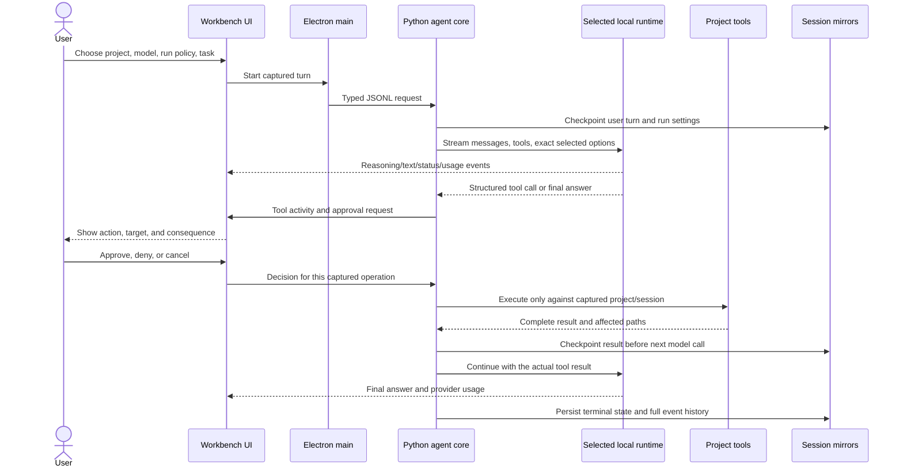

# Core harness readiness: audit, design, and execution gates

**Status: active work.** This document focuses on the agent loop and usable project-development workflow. The current paired source has focused engine runtime/loop/context/checkpoint tests, renderer and sidecar tests, and a passing TypeScript typecheck. Complete suites and current packaged/visible acceptance remain pending. Long-run model behavior, live runtime attribution, updater recovery, and broader parity remain open; a source test pass is not release readiness.

## Current parity research (2026-11-02)

The comparison is about observable harness behavior, not claiming identical implementations. OpenCode V1 documents separate filesystem/search/shell tools, resource-aware permissions, MCP/custom tools, and automatic compaction; V2 documents a unified tool contract, ordered action/resource permission rules, durable session operations, safe-boundary steering, session inbox, and resumable execution. V2 compaction retains a configurable recent token tail beside a rolling summary, keeps canonical history, can precompute summaries experimentally, and retries context overflow once. See [V1 tools](https://opencode.ai/docs/tools/), [V1 agents and permissions](https://opencode.ai/docs/agents/), [V1 compaction](https://opencode.ai/docs/config/), [V2 tools](https://dev.opencode.ai/v2/docs/tools), [V2 permissions](https://dev.opencode.ai/v2/docs/permissions/), [V2 compaction](https://dev.opencode.ai/v2/docs/compaction/), and the [V2 session contract](https://github.com/anomalyco/opencode/blob/dev/specs/v2/session.md).

OpenAI's current Agents API documentation describes durable sessions, streamed events, same-session steering/resume, approvals as interruptions on the same saved state, skills, MCP/tools, and a sandbox/environment boundary. This is evidence for Agents API behavior; it is not a one-to-one description of the Codex desktop or CLI. See [Agents API overview](https://developers.openai.com/api/docs/guides/agents-api/overview), [guardrails and approvals](https://developers.openai.com/api/docs/guides/agents/guardrails-approvals), and [sandbox agents](https://developers.openai.com/api/docs/guides/agents/sandboxes).

| Capability | Workbench evidence | Remaining parity work |
|---|---|---|
| Session continuation and steering | Same-task steering is persisted and applied at request boundaries; ordered two-update worker regression passes. | Crash/cancel/mirror-failure matrix and visible packaged acceptance remain open. |
| Tool access and activity | Structured file/Git/command/MCP tools, streamed call preparation, durable operation events and results. | Broaden capability adapters (LSP, web/browser, debugging/build profiles, custom tools); test all batch and failure paths. |
| Approval and permissions | Per-action/per-task/per-session controls and persistent resource rules exist in source. | Verify exact per-resource precedence, command decomposition, host-boundary reporting and real opt-in Windows containment. |
| Long-context work | Rolling task checkpoint, retained history, operation lookup, token-aware request compaction, output continuation and partial-response recovery. | Verify summary fidelity, interruptions, repeated compaction, save faults and prompt-cache behavior in end-to-end runs. |
| Recovery and review | Dual session copies, event journals, uncertain-operation review, persisted transcript rendering. | Complete crash/reopen/package tests and prove no replay or loss across project switches. |

**Design inference:** the highest-value parity gap is not adding more prompt instructions; it is proving one durable session state connects user input, provider requests, tool batches, permission decisions, saved events, and recovery. A local harness must also make clear that host-shell approval is not an OS sandbox. Preserve these as prioritized implementation and evidence gates rather than claiming feature parity from tool names alone.

## Current verification update (2026-11-02)

- **Approval-mode prompt accuracy:** engine `5ab814b2c8e4383867dd1e111957a5c6352b5b00` passes **9** focused instruction/injection cases. The model now receives the selected auto/per-action/per-task/per-session mode and persistent allow/ask/deny precedence; command schemas no longer claim manual approval is always required. Host enforcement and configured settings are unchanged. Current app pin verification passes; complete approval/cancel UI and packaged workflows remain open.
- **Same-chat steering:** `tests/test_worker.py -k steering` passes (**2**), and paired engine steering/checkpoint cases pass (**4**), including a regression where a user update arrives during a pending write approval. The write remains blocked until the decision; denial is preserved, no file is created, and the update is delivered with the denial result before the next model request. Crash/cancel during approval or an active operation, mirror failure, and visible packaged acceptance remain open.
- **Latest request context visibility:** the Live Work Sheet now shows provider-reported prompt tokens when available, otherwise a marked estimate, beside the request's manifest input budget; it also shows remaining budget and utilization without changing selected context/output values. `tests/request-context.test.ts`: **3 passed**; TypeScript typecheck and `git diff --check` passed. The paired engine context/budget and tool-batch checks pass (**21** and **4** respectively). Visual packaged acceptance remains open.
- **Concurrent-operation recovery:** with `LOCAL_AGENT_CORE_PATH` set to the pinned engine worktree, `tests/test_worker.py -k 'recovery_returns_every_uncertain_concurrent_operation or concurrent_operation'` passes (**1 passed**). It verifies both in-flight operations survive journal recovery and are presented as uncertain for review. The initial test invocation without the environment override failed collection because the test harness default points at a stale sibling path; app source pin verification with the explicit engine path passes. Broad crash/reopen, mirror-failure, and packaged recovery remain open.
- **Budget-aware explicit tool-catalog pages:** engine `e1d10aaf02d61a574b7df618adb2168ae2b98ad4` applies the remaining tool-response byte budget even when the model requests a specific `load_tools.limit`. Requested page sizes are honored when they fit; otherwise the response remains pageable through `next_offset`, with no global tool-count cap. If one schema alone cannot fit, the engine reports the required and available bytes instead of returning an oversized tool result. Pagination/overflow regressions: **3 focused cases passed**; Python compilation and `git diff --check` passed. Broader MCP/schema and low-context continuation verification remain open.

- **Renderer session event isolation:** the renderer now rejects session-scoped events unless their `sessionId` matches the selected session. The active session cursor is set on create/resume/recovery and cleared on project navigation. This closes a source-level route for delayed plan/activity events from an old run to contaminate the newly selected chat. Focused `tests/run-state.test.ts`: **22 passed**; TypeScript typecheck and `git diff --check` passed. Multi-project visible acceptance remains open.
- **Mirrored session snapshot lock recovery:** the app-side `_atomic_json` and engine `SessionStore.save` now retry transient Windows replacement locks with exponential backoff for up to 30 seconds and preserve the original save exception if temp cleanup also fails. The engine's project write helper uses the same file-lock duration and checks request cancellation. These are filesystem-write bounds, not inference deadlines. `tests/test_persistence.py`: **25 passed**; engine `tests/test_sessions.py tests/test_session_validation.py tests/test_operation_stream.py`: **54 passed**. App worker, transcript, pin and typecheck evidence from the previous paired revision remains, and the app is being advanced to the new engine pin; full mirror-failure, crash/reopen, package and visible acceptance remain open.
- **Mirrored activity journal lock recovery:** app `_append_jsonl` now retries transient sharing locks for up to 30 seconds. Its regression simulates nine failed opens then verifies the UTF-8 event is recorded exactly once. App `tests/test_persistence.py`: **25 passed**. Together with JSON snapshot retries, all three session persistence write paths now have longer lock handling; real mirror failures and packaged recovery remain unverified.
- **Workspace save sharing-lock recovery:** paired engine `251acf4` now retries transient Windows `PermissionError` replacement locks with bounded backoff up to 30 seconds, and the wait remains cancellable. This is only a filesystem replacement retry bound; it does not add an inference/runtime deadline. Focused `tests/test_operation_stream.py`: **41 passed**, including a lock lasting longer than the former retry burst and cancellation preserving the original file. Python compile and `git diff --check` passed. App is being repinned and paired source-level checks rerun; full suites, packaged save/reopen and visible acceptance remain pending.

- **Source startup pin guard:** unbundled runs now verify their engine checkout matches `core-revision.txt` before importing engine code. A mismatch is reported immediately through the app's service error instead of surfacing later as an import failure or generic timeout. Focused build-config tests: 8 passed; TypeScript typecheck and Python compile passed. Full suites, packaged startup, and visible acceptance remain open.

- **Inference header-timeout audit:** source-mode Ollama inference has a 10-second connection-establishment bound, then explicitly clears the socket timeout before dispatch; waiting for response headers and generated body data is unbounded until request-only cancellation. A fake local provider regression confirms the socket timeout is `None` when waiting for headers. `tests/test_cancel.py`: 5 passed, including delayed headers and cancellation. This establishes that current source does not impose the reported response-header deadline; it does not identify what emitted that string in the separate OpenCode run. No model or timeout setting was changed.

- **Earlier Windows cancellation attempt (superseded):** delayed-header testing first led to engine `b40f082` calling `CancelSynchronousIo`, but the corrected regression later showed it did not reliably interrupt the buffered read. Current behavior and evidence are recorded under “Corrected Windows request cancellation” below.

- **Corrected Windows request cancellation:** the corrected delayed-header regression showed the `CancelSynchronousIo` approach in `b40f082` did not reliably interrupt the blocking read by itself. Engine `cef092f` replaces buffered response reads with a small HTTP/1.x stream reader that polls the socket every 250 ms for request cancellation. This interval is only a cancellation poll, not an inference deadline: header and token waits remain unlimited. It supports streaming content-length and chunked responses. Focused cancellation/runtime verification: 25 passed across `tests/test_cancel.py`, `tests/test_llama_cpp_runtime.py`, and `tests/test_cancel_interrupts_blocked_read.py`; a separate chunked-body/trailer parser test brings the current cancellation module to 9 passing tests. Python compile and diff checks passed. Packaged and visible Cancel acceptance remain open.

- **Partial response recovery:** engine `b40f082` introduced preservation of fully received assistant reasoning/text on provider stream failures. Current engine `cef092f` retains that behavior: it adds received text to saved conversation history and flags the error event, excludes partial structured tool arguments, and preserves the partial marker through session restore while stripping it from provider requests. Current paired app restore evidence: transcript tests (6); source sidecar recovery tests are rerunning. Full suites and packaged session recovery remain queued.

- **Output-limit recovery:** current engine `cef092f` includes the same-task response continuation introduced at `b40f082`: when Ollama reports the selected output-token limit, it retains the current checkpoint and completed tool results without changing that cap. Repeated identical truncation ends visibly as `response_truncated` and offers checkpoint continuation; completed operations are not replayed. Earlier focused evidence: operation-stream module (39), workflow-outcome module (7), build-config tests (8), and app typecheck. Full suites, package, visible flow, and long-run behavior remain open.

- **Current paired source:** app `core-revision.txt` pins engine `26f1b73458bc2d34c4d6c41b0b3ce552e15285d8`. The app verifies the source checkout matches its pin before importing engine code. GGUF effort choices are discovered from the loaded llama.cpp template; unreported capabilities remain unknown. With reported effort levels, the explicit Off option is available. Compaction preserves the concrete next action after tool results and the first open step under a small checkpoint budget. Focused engine evidence includes operation/checkpoint/context/search/tool suites (**123**), cancellation/runtime (**26**), operation/session (**54**), operation-stream (**41**), and prompt-instruction (**6**) tests. App persistence (**25**), worker regressions (**4**), transcript rendering (**6**), source pin verification and TypeScript typecheck pass against this pin. Full suites, package, visible controls, long-run behavior, and actual runtime enforcement remain open.

## Earlier reasoning-budget verification (2026-11-02)

- **Earlier paired source:** `core-revision.txt` targeted engine `9f0af2756f08d46c3246d99ee76c6da10c1a043b`. Added a separate per-request llama.cpp thinking-token budget, default unlimited, stored in session/run/checkpoint settings, shown in run signals, and sent without changing the selected output cap. Ollama's advertised `think` mode/levels remain the control for that provider; no pretend token cap is sent. Focused engine coverage passes (90 tests across runtime/operation/context/checkpoint modules); app focused tests pass (model/workflow controls 15, sidecar integration 2), and TypeScript typecheck passes. Runtime enforcement depends on the server build and model template, so the UI reports the value as requested rather than confirmed effective. Package, visible UI, exact-runtime budget enforcement, full suites, and live-model checks remain pending.

- **Previous paired source:** `core-revision.txt` advanced from engine `b1981571c9a7680646cb1cef587fe4c384fae869` to add the reasoning budget summarized above. The engine loop correction gives repeated `update_plan`-only calls explicit outcomes across implementation, read-only, denied-action, and planning flows. Focused engine context, operation-stream, and checkpoint suites passed (79); focused renderer terminal-status tests passed (6), including same-checkpoint continuation for blocked outcomes.

- **Earlier continuity source:** app pin commit `a75d244` pointed to engine `eabf0679ef538c6409c45f0fa69004f15bd312a4`. The context manager keeps the full task checkpoint whenever it and the current conversation fit within the selected input budget; this evidence predates the current focused reasoning-budget tests. Context and output selections are unchanged. Full suites, packaged UI, visible project workflow, and long-run model behavior remain pending.
- The immediately preceding paired source `0f2820a`/`3db3adffb0193fe9089dd38c293ab04fc3f18fc3` corrected plan-only loops: plan expansion alone does not count as implementation progress; repeated `update_plan`-only tool calls get one handoff to the next open project step and then terminate explicitly as incomplete if the same state repeats. Actual project work clears the guard. Focused operation-stream and checkpoint tests passed (56), and are included again in the 76-test focused run above.
- **Previous paired-pin evidence:** engine `013909a838041edecb861046352f34aa4c358cdf` included external-folder project binding and the plan-result contract correction. Focused permission/tool tests: 50 passed; sidecar worker tests: 65 passed; renderer typecheck passed; checkpoint, operation-stream, and provider-stream files passed (62). These results are not a full-suite pass for the current pin. Full suites, packaged UI, and visible acceptance remain queued.
- Automatic responses without structured project actions still surface “No project operation recorded”; explicit Implement follow-up continues in the same chat without bypassing access or approval. No model request was resumed for this source work.
- Terminal paths for `response_missing`, incomplete implementation, interruption, cancellation, stop-after-operation, and generic failure now have a Workbench-authored summary inside the chat transcript. It identifies itself as Workbench status and points to saved checkpoint/activity; it does not impersonate a model response or claim unobserved work. The renderer restores the saved run outcome on session reopen, so it reconstructs the summary after resume. Three focused renderer tests and typecheck passed; packaged visual/reopen acceptance remains queued.

- The earlier `488a2b38495306c7594e55690ebd625bf7bcb6f6` engine revision fixed compaction's second-system-message failure for the selected Ornith Ollama chat template; its regression failed before the fix and its full suite passed: **251 passed**. That result predates the current engine pin and does not verify the new steering changes.
- First visible acceptance attempt used the exact selected model in an empty disposable project with unchanged settings: 65,536 requested context, 8,192 output, model-default reasoning, Small-model guidance off. Ollama returned HTTP 500 before any model token or workspace change because compaction added a second system message. The Ollama server log confirmed the template error. This is now fixed in source; the currently open package still contains the previous engine and must be rebuilt before retrying.
- The full packaged hello → project implementation → approvals → command/test → cancellation/save/resume acceptance remains in progress. No context/output/reasoning or runtime-placement setting was changed to make the request fit.
- The active app follow-up adds two separate elapsed-time measures: first non-plan structured operation and first successful structured file mutation. The latter only counts completed `write_file`, `append_file`, `edit_file`, or `apply_patch`; it does not infer file effects from shell commands. Both live state and event-journal recovery are wired. Worker and recovery regressions for the first-write timer are authored but queued. A separate focused renderer test passed for compact model-request summaries; no broad suite, typecheck, build, packaged UI, or model/runtime verification has been run for these follow-ups.
- Compact activity rows now identify each provider request by index and display reported total request duration, output-token count, and finish reason when available. Missing metrics remain absent rather than guessed. This makes cycles visible; it does not interrupt the model or make incomplete tool arguments executable. The focused test `tests/activity.test.ts` for this summary passed once; broader renderer and app acceptance remain open.

## Core loop review and steering requirements (2026-11-02)

### Same-task steering implementation status

- The renderer now defaults Enter during an active run to **Steer current task** and keeps **Queue next** separate. It shows pending, delivered, and undelivered updates in the transcript; pending text is restored from the durable checkpoint and can be explicitly reused after a run ends.
- Sidecar acceptance is bound to the active session and captured workspace, is saved before acknowledgment, and records a stable update ID in the current task checkpoint. The engine applies it only after a complete provider response/tool exchange and before its next request; a steer arriving during a final prose response causes the same task to continue. It does not create a new task ID, replay completed operations, interrupt active inference/tools, or approve actions.
- Provider serialization strips Workbench-only message metadata so turn/steering IDs remain durable in transcript history without being sent as unsupported Ollama message fields. A final-boundary close prevents accepting a steer after the task has already decided to complete. Undelivered updates remain persisted and visible after recovery.
- Focused engine operation/checkpoint/provider-stream tests now pass (62), including checkpoint idempotence, steering at a final-response boundary, plan expansion, and provider metadata filtering. Sidecar worker tests pass (65), including session/project binding and external-folder scope preservation for Copy runs. Renderer typecheck passes. There is not yet a dedicated component-level renderer test for live steering; packaged UI has not been rebuilt or opened for acceptance.

### Confirmed source behavior

- Before engine `39ff549`, the active composer only saved a queued follow-up and could not direct the active task. Current source uses Enter for same-task steering and keeps Queue next separate; the focused engine and worker evidence is summarized above.
- Inference and tool execution are serial in the local engine: it waits for a complete provider response, validates the structured tool call, then runs the operation and returns its result in a later request. The host must not act on unfinished reasoning or partial tool arguments. Thus a message can be accepted during reasoning, but can only influence the model at the next safe request boundary unless the user explicitly cancels.
- **Current OpenCode V2 comparison (development documentation, not stable V1 behavior):** V2 exposes durable session-inbox items with `steer` or `queue` delivery, cancellation of undelivered items, and durable enqueue/delivery events. Its event API also distinguishes reasoning/text/tool-input deltas, retry scheduling, operation outcomes, and compaction lifecycle. Workbench already persists same-task steering and a separate queued-next prompt, but does not yet expose one inspectable inbox with delivery-mode changes/cancel or equivalent retry lifecycle events. Evaluate those as a cohesive chat-flow upgrade, preserving the safe complete-response/tool boundary. Source: [OpenCode V2 API](https://dev.opencode.ai/v2/docs/api).
- OpenCode V2 documents summary-based compaction that retains a recent verbatim tail (about 15k tokens by default), updates prior summaries from later conversation, and preserves objective, decisions, completed/active work, blockers, and next steps. Workbench's canonical task checkpoint plus recent transcript tail is the corresponding local-first approach; its remaining risk is that the checkpoint is structured host evidence rather than a generated synthesis of all model reasoning. Keep this comparison and any checkpoint-summary enhancement in the compaction backlog; do not replace exact transcript or checkpoint history. Source: [OpenCode V2 compaction](https://dev.opencode.ai/v2/docs/compaction/).
- Automatic plan-to-implementation transition is host-owned after an actionable plan update (`04272e7`); it does not interrupt a long reasoning response or force execution from partial tool arguments. Full suites remain queued. The visible Flint run was canceled before it returned a tool call, so first-operation latency and task quality remain unmeasured for that run.
- Automatic intent currently starts without a host-authored checklist. The live worksheet can therefore lack task steps until the model calls `update_plan`. A model-generated plan is durable in the session checkpoint, but the user has deferred creating a project-root `plan.md`; do not add one as a prerequisite for implementation. A later concise `progress.md` summary is also deferred until the core loop is stable.
- **Auto-mode no-action ambiguity is partially addressed:** when Auto ends without a structured task mode, plan, or project action, the saved outcome is `no_action`; the composer exposes Auto/Discuss/Plan/Implement, and chat can prefill the prior user request as an explicit implementation follow-up in the same session. This is a truthful host-observed outcome, not automatic task-intent inference: it does not infer that every question is a build request or grant edits. The focused engine outcome test and renderer typecheck passed. Informational-question, explicit-plan, no-action recovery, and packaged interaction coverage remain queued with the final verification batch.

### OpenCode/Codex comparison

- OpenCode's documented surface includes a default Build agent and a distinct read-only Plan agent; provider/model controls; permission patterns; file/search/shell/patch/question/TODO/web/skill/custom/MCP tools; LSP; sessions; keybindings; and project/global config. The Workbench has much of the local project loop and MCP, but first-party web research/browser, LSP, mature custom-command/plugin lifecycle, history fork/export/import, managed worktrees, and OS-level containment remain gaps or unaccepted work. Sources: [OpenCode tools](https://docs.opencode.ai/docs/tools/), [agents](https://opencode.ai/docs/agents/), [permissions](https://opencode.ai/docs/permissions/), [providers](https://opencode.ai/docs/providers/), [MCP](https://opencode.ai/docs/mcp-servers/), [skills](https://opencode.ai/docs/skills/), [LSP](https://opencode.ai/docs/lsp/), [configuration](https://opencode.ai/docs/config/), and [TUI/session workflows](https://opencode.ai/docs/tui/).
- OpenCode does not generally impose a fixed iteration count: its optional max-step setting is absent by default. Repeated-identical-call protection is a separate safeguard. This supports the user's requirement for unbounded useful work while still detecting unchanged/no-progress loops; it does not justify a blanket tool, turn, runtime, context, or output cap. Auto must progress from planning to implementation, while explicit Plan remains read-only. Current Workbench source contains host-observed Auto continuation and expandable plans, but queued regressions and visible acceptance are still needed.
- OpenCode v2 development material describes a structured session inbox with safe-boundary `steer` versus idle-turn `queue`. It is a development-branch design reference, not proof of behavior in every stable release. The Workbench has its own durable steer/queue contract; a steer cannot alter a request already being generated. Sources: [OpenCode agents](https://opencode.ai/docs/agents/) and [development v2 session design](https://github.com/anomalyco/opencode/blob/dev/specs/v2/session.md).
- OpenCode v2 development compaction notes describe a model-produced summary plus a recent transcript tail (about 15K tokens by default), retaining older history in session storage and retrying once after overflow. That prompt summary is lossy. Workbench keeps canonical transcript/reasoning/tool results and sends a structured checkpoint plus recent complete exchanges, with older material recoverable from disk. This avoids an extra summarization request but can preserve less semantic rationale than a good summary. Design a bounded, source-attributed task brief that records decisions and rationale summaries, goal, files/operations, verification, and next action; expose provenance and omissions. Do not persist hidden chain-of-thought, create a project-root `plan.md`, or change selected inference settings. Source: [OpenCode v2 compaction development docs](https://dev.opencode.ai/v2/docs/compaction/).
- Codex's public app-server protocol models durable threads, turns, typed event streams, approval requests, interruption, and reconnection; its product also provides worktrees, review/diff workflows, skills/plugins, and hosted environments. Workbench counterparts exist for sessions/events, approvals, local skills/MCP, project review, and same-task steering, but conflict recovery, worktree UX, history operations, editor/CLI integrations, containment, and restored event acceptance remain open. Hosted compute and remote environments need truthful local equivalents; visual similarity alone is not parity. Sources: [Codex app-server](https://github.com/openai/codex/blob/main/codex-rs/app-server/README.md), [Codex protocol](https://github.com/openai/codex/blob/main/codex-rs/docs/protocol_v1.md), and [Codex Queue vs Steer](https://developers.openai.com/codex/blog/mastering-codex-remote-for-engineering).
- The target is full user-facing workflow parity, not reproduction of proprietary hosted models or cloud compute. Every parity row needs a tested local implementation or an explicit, visible incompatibility and consequence. The complete feature matrix below remains authoritative; no difficult or deferred row is dropped from scope.
- The Responses API's steering behavior has separate model/conversation/compaction constraints; do not assume hosted API steering can be copied directly into this local Ollama/llama.cpp runner. Define and test the Workbench's own durable mailbox and safe-boundary contract.

### Reasoning without project development: evidence and next diagnostics

- **Canceled Flint run:** saved history contains 23,477 characters of emitted reasoning and ended when the user canceled. It contains no structured tool call, final answer, approval request, or project write. This proves a long no-operation interval only. It does not prove the model could not code, that it completed the task, or what a completed response would have done. Keep the canceled run canceled.
- **Confirmed source boundary:** providers stream reasoning/text, but the engine validates and executes only complete structured tool calls after the provider response completes. A user steer can be saved while generation continues, but is applied at the next safe request boundary. The host must not execute incomplete tool arguments. This is safe but means a long local-model reasoning phase can delay both implementation and steering taking effect.
- **Unresolved causes:** selected output budget consumed by reasoning; the model's tool-use behavior; schemas available in that request; checkpoint/compaction payload; provider finish reason or interrupted stream; or an interaction among these. The canceled run has no completed response/finish reason, so current evidence cannot distinguish them. Device-wide CPU/GPU utilization is not causal evidence.
- **Prompt audit measurement:** the engine's assembled static system guidance is 6,550 characters in Standard and 8,172 with Small-model guidance, measured with empty project instructions and skills disabled. Real requests add project instructions, context, and tool schemas. That size alone does not establish the cause of prolonged reasoning. The small-model profile repeats some implementation-pacing guidance already present in the base prompt; a later prompt-efficiency change should deduplicate wording without dropping the full tool/workflow scope or imposing fixed limits, then compare prompt manifests and representative outcomes.
- **Next approved visible run evidence:** record request ID/index and exact selected settings; time to first reasoning/content token; response completion and provider finish reason; provider prompt/output counts; tool preparation/schema validation; time to first non-plan operation and first successful structured write; approval wait; operation result; next model request; compaction manifest/omissions; and terminal outcome. Measure planning duration and plan revisions separately from actual operations. Do not change context/output/reasoning or add a total deadline.
- **Workflow refinement:** retain the usable composer during reasoning; show the queued steer's durable state and explain it takes effect at a safe boundary; distinguish reasoning output from project progress; show each request's terminal state and provider metrics in compact activity rows; keep Auto's implementation obligation and open checklist through compaction/resume; continue after each safe tool result; and end only with verified completion, explicit user stop, or a concrete no-progress blocker. No exact assistant phrase should decide continuation. The request-row summary is implemented; safe-boundary steering and long-run continuity still need full acceptance.
- **Output-exhaustion correction:** Ollama returns `done_reason` with its response and the engine already records it, but prior loop logic could treat a response ending with `length` as complete if project state looked finished. The engine now continues that same task and settings, then marks identical repeated truncation as incomplete with a checkpoint continuation. This handles output exhaustion separately from response-header timeouts, request cancellation, and model reasoning defaults. The Ollama field is documented in the [chat API](https://docs.ollama.com/api/chat); OpenCode's V2 compaction reference also preserves durable history while recovering at a safe boundary: [Compaction](https://dev.opencode.ai/v2/docs/compaction/).

### Required core workflow, in order

1. **Same-task steering and queueing:** keep the current task ID, project, transcript, plan, completed operations, approvals, and checkpoint. Default a message sent while running to a durable steering input for this task; deliver it after the active model response or tool operation finishes, before the next model request. Keep “Queue next task” available separately. Never reset or replay completed work. Show accepted, waiting, delivered, and failed states; if the run ends or crashes before delivery, preserve the text and ask whether to apply it as a follow-up. Steering is not approval for a file, command, or MCP action.
2. **Action cadence and honest progress:** measure time to the first non-plan project operation, reasoning/planning duration, plan revisions, tool operations, and provider finish reason. Show a clear “reasoning; no project operation yet” state. After adequate scoping, prompt for an early structured checkpoint and next safe action; do not impose a fixed planning-pass, runtime, tool-count, context, or output limit. Distinguish a slow active response from a completed no-tool response and a provider `length` finish.
3. **Task continuity:** attach steering text as a user update to the existing checkpoint; preserve original goals and completed work unless the user explicitly replaces them. Reconcile new guidance against the current plan, record the change, and continue from the next safe step. Carry pending steering through compaction and crash recovery without duplicate delivery.
4. **Tool/action integrity:** ensure each advertised capability is actually in the request or discoverable, structured calls are validated before dispatch, parallel batches contain only independent safe operations, and full results return to the same task. File writes, commands, MCP, approvals, cancellation, partial effects, and verification must have truthful durable outcomes.
5. **Chat/activity/session integrity:** represent reasoning, plan updates, tool preparation, approvals, operation progress, results, and terminal status from a single ordered event source. Restore the same rendered transcript and activity after reopening. Keep the composer usable during generation and preserve viewport-follow behavior.
6. **Model/runtime truthfulness:** verify selected model, reasoning, context/output values, effective provider payload, cached/prompt tokens, finish reason, and process/resource attribution. Preserve user-selected settings. Separate provider-reported values from estimates and unavailable metrics.
7. **Full core acceptance:** after implementation stabilizes, run queued engine, sidecar, renderer, protocol, persistence/fault-injection, and packaged-app gates. Then perform one visible end-to-end task with steering during reasoning and tool work, queue-next behavior, approvals, cancellation, save/resume, and project switching. Do not claim parity or release readiness from source tests alone.

No plan/progress Markdown file is introduced in this phase. The session checkpoint remains the task-state source of truth; any later progress file should summarize decisions and milestones rather than duplicate the full append-only activity log.

## Product objective

Deliver **1:1 user-facing feature and workflow parity with Codex and OpenCode** for coding-agent use, with equivalent local implementations wherever those products depend on hosted services. This is the product target, not a reduced “small-model edition” or a claim based only on the core coding loop. It covers the complete discoverable product surface: project/workspace lifecycle, conversation and run controls, model/runtime configuration, context and instructions, tools and integrations, safety/approvals, code intelligence, review, recovery, customization, diagnostics, and packaging. Cloud accounts, proprietary model behavior, hosted compute, and remote services cannot be reproduced locally; each must have a clearly labeled local equivalent or a concrete incompatibility entry in the parity register. No capability may silently disappear from the target because it is difficult or currently absent. The model is one component of that system. A successful chat response alone is not proof that a file changed or a test ran.

## Historical source-batch notes (2026-11-01)

The following entries record implementation-time evidence and pending checks as they stood at that checkpoint. Current branch, pin, and verification status are maintained in the 2026-11-02 verification updates above; the development branches have since been pushed, but the work has not been promoted to a release.

- The source batch also includes earlier committed revisions and queued tests recorded below; use the current verification update above for the exact active pin and pass/fail state. App and engine changes are pushed to their dedicated development branches, remain isolated from the public beta, and are not release-accepted.
- This passing source run supersedes older “queued/unrun” notes for tests included in these exact suites, including prompt-driven plan continuation, checkpoint/journal recovery, tool-schema validation and selection, request-only cancellation, live tool-preparation activity, session conflict handling, and renderer state. Dated notes below remain historical records of when those checks were still pending. Package/visible acceptance, long-run model behavior, hardware attribution, updater recovery, sandbox boundaries, and the broader OpenCode/Codex parity register remain open.
- Engine continuation no longer parses assistant wording such as “I will…” or “may I run…” to infer pending work. It uses host-observed edits/commands, post-effect inspection, denial state, and open plan items. The full system prompt was retained; it was not shortened to target a particular small context. Regression coverage is committed and remains unrun by request.
- Home now distinguishes model-catalog loading, a confirmed empty inventory, and a failed catalog request. A failed refresh retains the last successful model list instead of resetting it to zero; dots are keyed to installed model IDs, so the same catalog renders the same orbit after restart and new models do not move existing markers. The user can persistently toggle slow orbit motion; reduced-motion preferences disable animation and opening a model card pauses the rings.
- Home workspace history and app-wide saved sessions have independent state from the currently open project's session list and are refreshed independently. Home lists every saved session in a scrollable recent-session area, flags conflicts/recovery work/unavailable projects, and resumes only when the project identity can be resolved; a moved project can be matched using its saved workspace identity. Returning Home reloads the app-wide list; a failed session query no longer discards a successful workspace-history result; outdated overlapping search responses cannot replace a newer query. Empty-history UI waits for the first successful history response, and transient failures retain the last visible entries. Malformed/unreadable workspace-history files now raise a visible error instead of masquerading as empty; the original file is preserved, and opening a valid project is not blocked by failure to update its history record.
- The idle window-control hotspot is restricted to the far top-right 20×14 area, expanding around the controls only when revealed. Keyboard focus and packaged overlap behavior still need acceptance.
- Orbit, catalog-state, and stable-slot regression cases are authored but intentionally unrun. No typecheck, package, app launch, UI interaction, model, context, output, or reasoning setting was changed in this source batch.
- The Ollama request adapter now prevents generic runtime options from silently overriding selected context, output-token, and temperature controls. Conflicts are recorded in request provenance and called out in activity details. A regression is queued; settings were not changed and no inference was run.
- Cancelled, partial, uncertain, and otherwise incomplete commands now produce an explicit incomplete-verification outcome even when other project files changed. Their run result stays in the evidence record; no command is labeled as a passing test from exit status alone. Regression coverage is queued.
- Oversized checkpoints now have a budgeted inference-only summary. The full checkpoint remains on disk; the summary preserves the active goal/plan and latest progress and reports any history categories omitted. The Activity Trace displays these counts. Regression coverage is queued and unrun.
- Workbench-authored starter checklists now reflect host-observed project inspection, implementation operations, and final inspection/check outcomes. If the model publishes its own plan, that plan becomes authoritative and host progress will not rewrite it; ownership survives task resume. Acceptance criteria are preserved across progress events. Regression coverage is queued and unrun.
- App-wide persistent per-tool allow/ask/deny rules now support project-relative path globs and command prefixes. Deny takes precedence over allow and run auto-approval, while absent rules preserve existing behavior. The Settings editor, sidecar persistence, per-run snapshot, and engine enforcement are implemented in unpublished source; regression and packaged workflow verification are queued. This does not provide OS process containment.
- Wildcard command rules require an argv-token prefix so the same rule can be evaluated for both direct argv execution and shell commands; shell-specific rules may use a text prefix. Parser and UI tests are queued.
- Invalid or unreadable saved permission policy now falls back to no persistent overrides without overwriting the original file, and the app surfaces a startup warning. The selected per-run approval mode still applies. Recovery tests are queued.
- Provider request metadata, usage, tool batches/results, and plans now force the durable event journal but not a full JSON session snapshot for each event. Full snapshots remain periodic and are forced at compaction, approval, and terminal boundaries. Replay coverage is queued; lock/fault acceptance remains pending.
- Small-model guidance now resumes from checkpoints without a fixed action/runtime cap, and treats plans as expandable: the model can append independent workstreams and criteria or revise/resequence plans as evidence changes. Completed work and decisions remain in place unless the plan is intentionally replaced. Engine regressions are queued.
- Engine file retrieval, listing, and search no longer apply implicit repository-wide file/byte scan ceilings by default. Explicitly configured scan budgets remain reportable; result pages still follow the selected inference context and retain continuation paths. Large-repository responsiveness and cancellable search are queued.
- Safe, fully schema-validated batches containing only independent read-only project/Git operations now execute concurrently. Per-operation completion is checkpointed as each read finishes; mixed batches, writes, commands, MCP, and permission-sensitive operations retain ordered execution. Engine concurrency/order regressions are queued.
- A paged `read_task_checkpoint` tool now recovers complete saved plan, decisions, user updates, operation references, changed files, verification, and prior-task details omitted from an inference copy. Project search reads incrementally, and project retrieval/list/search/read operations observe request cancellation; regressions are queued.
- A paged `read_conversation_history` tool now recovers saved user/assistant/tool transcript—including emitted assistant reasoning—when prior turns were omitted from the active prompt. It excludes the system prompt and remains project-read-only. Transcript recovery regressions are queued.
- Tool-result excerpts are now allocated from the remaining selected input budget after the prompt, tool schemas, assistant call, and prior batch results are accounted for; oversized complete results remain in operation history with recovery IDs. This replaces the earlier fixed one-eighth-per-call allocation. Context-boundary regressions are queued.
- Host-observed starter-plan progress now updates the durable checkpoint's `next_action` to the first unfinished plan step, keeping compaction continuity aligned with the visible Plan section. Engine coverage is queued.
- Replayed Plan events now rebuild that checkpoint `next_action` from the restored items as well, preserving agent-authored plan continuity across a crash. Persistence coverage is queued.
- Small-model anti-loop guidance is explicitly scoped to implementation tasks; Discussion and Plan-only intent still prohibit implementation. Prompt coverage is queued.
- `update_plan` can now persist concise design decisions and assumptions in the durable task checkpoint; these summaries survive compaction and journal replay without storing hidden chain-of-thought. Engine, sidecar, and recovery regressions are queued.
- Non-Git project snapshot review excludes `.agent-workbench`. In Git projects, review follows explicit Git tracking choices, so a project opting session files into Git can inspect those changes. Engine context retrieval still excludes `.agent-workbench` regardless of tracking. Regression cases cover both paths and are queued with the full verification pass.
- New source changes add progressive rendering for long activity timelines, separate Ollama/llama.cpp worker CPU/RAM and NVIDIA worker-process VRAM from device-wide GPU readings, and remove the approved-command default of 120 seconds and one-hour ceiling. Standalone operation-result retrieval now works from engine memory when no app session store is available.
- The cancel chooser now waits for a positive sidecar acknowledgment and stays open on transport failure; a stale click after a run ended is reported as no active run rather than success.
- The app-close chooser now also waits for Electron's accepted choice; cancel-and-close verifies the sidecar accepted cancellation and waits for the run to become idle before shutdown. This source behavior remains unverified in a packaged UI.
- Streamed tool-call preparation is now a durable activity row keyed by turn/request/call. Only provider, tool name, and argument character count are persisted; partial arguments remain hidden until the engine validates and dispatches the complete call. A completed model tool batch changes the preparation row to `assembled`; a request failure changes it to `interrupted`. Activity journal replay restores these states after relaunch. The paired engine emits the request index on each tool batch.
- Regression coverage has been added but **not run** for these changes. The earlier verification numbers below describe their historical commits only, not this active source pair. Final engine/app tests, typecheck, package, visible workflow, installer/update, and live-model/hardware acceptance remain queued.
- Structured `ask_user` clarification is now implemented in unpublished source: a run can pause on a material missing requirement, present a required non-dismissible answer dialog, journal the exchange, and return the user’s answer to the model. It remains separate from file/command approval and preserves answered versus unanswered state during recovery. Paired regression cases are queued and unrun.
- Checkpoint compaction now budgets the inference copy to its assigned space. Expandable plan details and long prose may be summarized in that copy with explicit omission counts; canonical saved task history is unchanged and recoverable by pages. This removes the fixed assistant-update character cutoff. Regression cases are queued and unrun.
- The compact checkpoint envelope and omission parser also handle very small projection budgets, while directing the model to recover omitted sections through the paged checkpoint tool. The tiny-budget regression is queued and unrun.
- No model, inference setting, OpenCode configuration, or loaded runtime was changed during this source work.

## Codex / OpenCode parity map

The references below were reviewed directly from the official OpenCode documentation, the OpenAI Codex app-server repository, and OpenAI Developers. This matrix translates their documented user-facing capabilities into an implementation baseline for this app.

### OpenCode V1 versus V2 tool surface (reviewed 2026-11-02)

V1 below means the current stable documentation at [docs.opencode.ai](https://docs.opencode.ai/docs/tools/); V2 means the separate development documentation at [dev.opencode.ai/v2](https://dev.opencode.ai/v2/docs/tools/). V2 is explicitly tracked as forward-looking reference, not a stable-release promise. Agent and compaction behavior were also compared in the [V1 agent docs](https://docs.opencode.ai/docs/agents/), [V2 agent docs](https://dev.opencode.ai/v2/docs/agents/), [V2 compaction docs](https://dev.opencode.ai/v2/docs/compaction/), and [V1 permissions](https://docs.opencode.ai/docs/permissions/) / [MCP docs](https://docs.opencode.ai/docs/mcp-servers/). Actual model/provider support and configured permissions can hide or constrain tools in both versions.

| Area | Stable V1 documented surface | V2 development documented surface | Workbench source comparison and remaining gap |
|---|---|---|---|
| File discovery and reading | `glob`, regex `grep`, `read` with line ranges | `glob`, `grep`, `read` with offset/limit and media attachments | `list_files`, literal `search_files`, ranged/continuable `read_file`, paged saved-result/history/checkpoint reads. Add regex search and image/PDF attachment ingestion; retain explicit paging and no silent truncation. |
| File mutations | Exact-match `edit`, `write`, `apply_patch` | `edit`, `write`, multi-file `patch`; V2 documents model-dependent patch availability | `edit_file`, `write_file`, ordered `append_file`, `apply_patch`; approval and project boundaries are host enforced. Formatter-after-write integration and model-capability-specific patch schema are gaps. |
| Commands and background work | `bash` in project environment | `shell` with workdir, optional timeouts and background execution; large output can be retained and fetched | `run_command` argv and `run_shell` PowerShell, approval-gated and without an overall response deadline. No durable background process/reattach API yet; process containment is not provided. |
| Plans and user interaction | `todowrite`, `question` | `question` with multiple-choice/freeform, plus agent/permission-driven orchestration | Expandable structured `update_plan` and `ask_user` question flow exist. Chat steering and queue-next are implemented in source. Agent-generated final summaries are retried once; new chat-side Workbench terminal summaries cover missing/failed/incomplete responses. Integration/reopen acceptance remains open. |
| Web and code intelligence | `webfetch`; `websearch` only with supported provider/environment; experimental `lsp` | `webfetch`, `websearch`, browser namespace; V2 tool page does not list V1's experimental LSP tool | No built-in browser, first-party websearch/webfetch, or LSP. MCP can supply some functions but is not equivalent to built-in discovery, permissions, or UX. |
| Reusable extensions | Skills, custom tools, MCP servers | Skills and MCP tools/namespaces; V2 extends Code Mode namespaced tools | Skills and local/remote MCP exist in source; Workbench-owned tool/plugin lifecycle, custom-tool packaging, and compatibility workflow remain gaps. |
| Automation and parallelism | Custom tools/MCP; default agent can iterate until it stops or user interrupts; configurable `steps` is optional | `execute` Code Mode can combine tool calls and parallel independent reads; `subagent` supports foreground/background child sessions; namespaced session and worktree utilities | Workbench can accept model-issued batches and concurrently run validated independent read-only calls; writes, commands, approval-sensitive, and MCP operations remain ordered. No JS Code Mode, child-agent sessions, or session/worktree management tools. No fixed turn/runtime cap; no-progress detection is separate and must remain resumable. |
| Browser and images | Browser is not in the V1 built-in tool list; image generation is not in that list | Desktop-attached browser controls, and experimental `experimental_image_generate` when an image model is connected | No built-in browser automation or image-generation tool; evaluate model/runtime capabilities before promising either. |
| Permissions | Ordered `allow`/`ask`/`deny`, wildcard resource matching and agent overrides; V1 `--auto` changes asks but explicit denies still apply | Ordered action/resource/effect rules and per-agent policy; nested tools enforce their own policy | Workbench has separate access mode, per-action/task/session approval, persistent tool/path/command rules and hard deny. OS-level containment and external-directory/reference parity remain open. |

**Productivity conclusion:** OpenCode's documented Build agent is the default full-tool primary agent; Plan is a separate restricted mode, and subagents are optional. Its optional `steps` limit is unset by default, so it can continue until the model stops or the user interrupts. Workbench should preserve adaptive Auto as the normal flow, let structured plan state progress into implementation, ask a required question only for materially blocking missing choices, and otherwise use sound defaults. No-action, no-progress, and provider failures must produce a durable terminal explanation and a same-chat recovery path; they must not be “fixed” by word-matching, silently granting permission, or imposing arbitrary step/runtime limits. The V2 `execute` and child-session patterns are strong later design references for batching and delegation, but introduce orchestration/context overhead that must be measured for small local models before adoption.

| Capability area | Codex / OpenCode baseline | Workbench status and parity requirement |
|---|---|---|
| Project onboarding and discovery | Open, initialize, inspect, resume, and switch projects; discover instructions and repository conventions | Project selection exists. Full onboarding, project switching/history, setup diagnostics, and instruction discovery need end-to-end acceptance. |
| Interaction surfaces | Desktop, terminal/CLI, editor integration, command palette, keyboard navigation, attention/notifications | Electron desktop exists. CLI and editor surfaces, complete shortcut map, command palette parity, and notifications need implementation or explicit product-equivalent decisions. |
| Conversation and turns | Durable thread/session, multiple turns, stream events, interrupt/continue, recoverable state | Mirrored resumable sessions and events exist. Complete crash/failure/reopen acceptance and turn-level serialization remain required. |
| Run orchestration | Queue/steer input, cancel/interrupt, retry, continue, background/reattach, side chats, long-running goals | Same-task steering and explicit queue-next are implemented in source and persisted at safe boundaries; cancel/stop choices and interrupted-operation review are also implemented in source. Broad tests and packaged acceptance remain queued. Durable background process reattach, side chats, goal tracking, and richer retry/fork controls remain gaps. |
| History management | Search, rename, archive, fork/branch, export/import, compare and resume conversations | Basic save/resume exists. Full history lifecycle and migration/import/export need parity work. |
| Model/provider identity | Provider-qualified model identity, per-turn model/options, runtime usage | Ollama and local llama.cpp/HF GGUF adapters exist. Make capability/unsupported states truthful and test both actual provider paths. |
| Model controls | Provider/model selection, model variants/reasoning controls, sampling and token/context settings, favorites/recents, capability discovery | Exact context/output/reasoning request fields exist for current adapters. Run configuration now saves to both session mirrors, including skill controls; selecting another model restores its model-default reasoning unless the user selects an override. Broader provider controls and per-model support/limits need parity tests; never silently rewrite user selections. |
| Context and instructions | Repository instructions, skill discovery/loading, project context, compaction and tool-result management | Project instructions and relevance retrieval exist. Workbench-owned per-session skill enablement and project/user source selection are now implemented and captured with immutable runs; disabled skills are omitted from model tools. Each actual request now emits a durable source manifest with message sizes, checkpoint/compaction status, instruction/retrieval paths, exact skill-catalog entries and tool/MCP names. Source-only and unverified; exact prompt-text preview, per-skill permission controls, and large-repo scan continuation remain open. |
| Multimodal input/output | Attachments and supported image/audio or other model inputs; generated artifacts where provider supports them | File/chat workflow is primarily text. Inventory supported local modalities and implement capability-based attachment/artifact flows without pretending unsupported models accept them. |
| File operations | List/glob, grep/search, read (including ranges), precise edit, write, patch | List/search/read/write/patch and exact-match `edit_file` exist; edits refuse missing/ambiguous matches unless replace-all is explicit, obey approval modes, and commit through atomic writes. Read ranges and uncapped writes exist. List/search support project-relative nested glob patterns, scoped roots, explicit offsets and page sizes; further scan caps remain visible. |
| Command execution | Real terminal command, working directory, live output, process lifecycle, approval policy | Direct argv and approved PowerShell command-string execution with streamed output and process-tree cancellation exist. Commands now have no implicit timeout or fixed one-hour ceiling; explicit positive timeouts remain optional. OS-level sandbox is absent and is a release-critical gap for any broad auto-approval. |
| Permissions and approvals | Per-action allow/ask/deny, path/command-aware decisions, explicit approval events and decisions | Current access modes plus per-action/per-task/auto exist. Persistent per-tool allow/ask/deny rules support project-relative path globs and command prefixes; deny takes precedence over allow and auto-approval. Structured file tools are project-bound, but host commands are not contained by the project path. |
| MCP and extensions | Local and remote MCP, custom tools, scopes/credentials, permissions, graceful startup/shutdown | Local stdio and remote Streamable HTTP transports are implemented in source; remote endpoints require HTTPS (except loopback), secrets use environment references, and calls require approval by default unless a matching persistent allow rule applies. Dispatched calls with an unconfirmed result are recorded as uncertain, stop the remainder of the current tool batch, and require inspection before retry. Discovery reports unsupported argument-schema features in each affected tool description and Tool Catalog while runtime validation remains fail-closed. Common conditional, dependency, property-name, and modern array constraints are validated; `format` remains annotation-only. Per-tool permission rules are implemented in source. Packaged transport/schema tests, remote auth, timeout, failure, and shutdown acceptance remain pending; custom tool packaging is open. |
| Skills, plugins, and reusable commands | Discoverable skills, lifecycle-managed plugins/hooks, project/global custom commands, extension compatibility | Project/user skill source filters and a Workbench enable switch exist and are saved with session settings. The request manifest records which skill names were included in the tool schema and which skill-load results remain in the actual request history. Plugin lifecycle, hooks, custom command UX, update/error isolation, and compatibility/import story need implementation. This is not yet UI-accepted. |
| Code intelligence | LSP diagnostics, definitions/references, symbols, code actions where available | No LSP client/tool in the current app; add capability-discovered language-server integration. |
| Planning and agents | Plan/build roles, custom agents, subagents, task delegation, todo/checklist tools | Auto, Discussion, Plan-only, and Implement task intents are saved and passed to the engine. Explicit Plan/Implement intents start with a Workbench checklist; Automatic mode uses the agent-authored live plan and observed structured project operations, creates a checklist before a structured write if needed, and records a structured discussion/plan/implement task mode. Nonempty agent-authored `plan` phases in Automatic mode remain implementation obligations until the host observes project work; restored Workbench implementation checklists also re-establish their obligation. Explicit Workbench Plan-only remains read-only. Substantive plan additions, status changes, acceptance-criteria changes, and newly saved decisions count as progress; identical replans do not. Unknown plan statuses remain open and are used for the saved next action. These regressions are queued and unrun. No prompt keyword matching drives continuation. Read-only access omits write/command schemas and MCP tools. Terminal outcomes record project-change, post-change inspection, and approved-command evidence; implementation with no observed project change is labeled incomplete. A durable `implementation_requested` obligation survives Auto follow-ups, compaction, and session recovery; explicit Discuss/Plan follow-ups clear it. In Auto, a structured `plan_only` follow-up clears it only before project effects start; later changes still require inspection. Rich task-specific acceptance criteria remain open. Agent profiles and subagents/delegation stay queued after single-agent reliability. This source integration is unverified. |
| Review and Git | Changed-file summary, diff, file context, review requests, preserve user edits | Git diff and non-Git snapshots exist. Add Git status/branch awareness, untracked/rename/deletion review, diff navigation and safe conflict handling; never rewrite user history. |
| Workspace isolation | Project roots, worktrees, external-directory controls, distinct execution environment | Captured root/session prevents switching leaks; commands still run with user privileges. Add managed worktree flows and actual Windows process/filesystem/network containment. |
| Environment and remote work | Local/remote hosts, worktrees, background execution, reattachment, environment status | Local Windows only today. Keep local-first as default; comparable remote environment support requires a separately designed, secured transport and is not implied by local MCP. |
| Long-running UX | Waiting/generating, operation events, inline tool activity, approvals, steer/queue, interrupt, final/error status | Streaming worksheet and decision modal exist. Long activity timelines render progressively with older entries still accessible. Both streaming providers show the same transient, non-executable tool-call preparation cue in chat and Activity Trace. The shared engine can compact a single long task at complete tool-exchange boundaries and retrieve omitted saved output by session-scoped operation ID. Model and approved-command execution have no implicit response deadline; user cancellation remains available. Source acceptance must prove continuation, cancellation, no ghost run, and restored transcript/activity/status. |
| Settings and customization | Project/global config, themes, keybindings, agents, permissions, formatters, LSP, notifications | App settings are partial. Implement discoverable settings with scope, validation, migration, and per-feature capability reporting. |
| Setup, health, and release | Runtime/model management, diagnostics, install/update/migrations, crash/support data | Source now includes first-run readiness, an Ollama recovery route, Squirrel launch-event handling, and a GitHub release updater for packaged Windows x64. Fresh package/install/upgrade acceptance remains open; model/runtime install and recovery are partial; macOS, Linux, Windows ARM, and signing are not supplied. |
| Scheduled and repeatable work | Custom slash commands, automations/scheduled tasks, reusable workflows | Custom commands/automations are not complete. Implement local scheduling only with clear machine-on/background behavior, logs, cancellation, and permissions. |

Parity is verified feature-by-feature, not inferred from visual similarity. **The target is all rows, not only P0/P1 or the first release slice.** Sequencing may defer implementation, but a deferred row remains an open parity requirement and cannot be described as 1:1-ready. Every row must end as implemented + tested, or have a documented, user-visible local equivalent/incompatibility with its consequence. No row is declared complete on UI appearance alone.

### Research cross-check and design implications

- OpenCode documents built-in tools plus custom tools and MCP, with per-tool allow/ask/deny rules and wildcard matching. Workbench should adopt the discoverable, extensible surface and granular policy model, while retaining explicit approval for risky actions by default. It should not copy OpenCode's defaults as if they were automatically safe for a local Windows account.
- OpenAI's documented tool surface includes function calling, web search, file search, tool search, remote MCP, skills, shell, and computer use. The managed Codex harness additionally covers sandboxed execution, event streams, approval, steering, compaction, durable sessions, and delegation. Workbench's equivalent should be an adapter/tool capability system: provider-specific features are advertised only when the runtime supports them; local integrations can extend tools through MCP; cloud-only services remain clearly identified as unavailable unless the user explicitly configures a compatible integration.
- Microsoft's AppContainer documentation describes an OS-enforced isolation boundary with explicitly granted file, registry, network, and process access. The current Workbench command approval and project working directory do not provide that boundary. Before broad auto-approval, add a real Windows execution backend with measured filesystem/network containment and a host-mode explanation; do not relabel approval as sandboxing.
- The practical target is extensibility rather than an impossible fixed inventory of “every tool”: versioned tool contracts, runtime/model capability discovery, dynamically loaded MCP definitions, tool-specific permission rules, and an integration directory that distinguishes available, configured, unsupported, and planned capabilities.

### Current core-loop audit (2026-10-31)

Official OpenCode references: [built-in tools and MCP](https://opencode.ai/docs/tools/), [allow/ask/deny permissions](https://opencode.ai/docs/permissions/), [Agent Skills discovery and loading](https://opencode.ai/docs/skills/), [tool dispatch source](https://github.com/anomalyco/opencode/blob/dev/packages/core/src/session/tools.ts), and [skill tool source](https://github.com/anomalyco/opencode/blob/dev/packages/core/src/tool/skill.ts). The local source was reviewed against those surfaces. This is a source audit; it is not packaged or live-model acceptance.

- **Already present in source:** iterative model/tool/model loop; structured tool results returned to the next model request; streamed text/reasoning and command output; project-scoped list/search/read/edit/write/patch; plans; Git status/diff/log; approvals; local and remote MCP; cancellation and stop-after-operation; activity/session persistence.
- **Skills improved in source:** optional metadata discovery is exposed to the model through the skill tool description; metadata is ranked against the current task and only as many descriptions as fit the selected input budget are sent, with the complete catalog available through `skill(action=list)`. Discovery walks the selected project to its Git worktree and configured user-global paths; supported locations include `.agents/skills`, `.claude/skills`, `.opencode/skills`, global OpenCode skills, and `~/.codex/skills`; skill bodies are no longer silently truncated. Bundled text resources can be read through a skill-relative, symlink/traversal-checked action. Legacy files without frontmatter remain discoverable. The desktop app now explicitly enables/disables skills and selects project/user sources per session; the engine captures these settings per run and omits the tool when disabled. Fine-grained per-skill allow/ask/deny, exact loaded-skill evidence, and prompt-source preview remain open. Workbench settings are independent of Codex/OpenCode configuration.
- **Context budget use improved in source:** relevant-file retrieval now uses the remaining request budget after full project instructions, the user prompt, tools, and output reservation are accounted for, instead of a fixed 18,000-token retrieval ceiling. Project instructions and loaded skills are no longer silently clipped. Skill descriptions and retrieved excerpts use only the remaining request budget; omitted relevant excerpts are disclosed when space permits. Bounded filesystem scans still report partial results.
- **Context reliability improved in source:** overflow pruning now builds a request-only context from complete prior user turns, preserving each retained assistant tool-call/result sequence. The canonical transcript stays intact in the session store. The model request receives an explicit omission notice and a persisted activity event with the number of omitted turns. It does not change the configured context or output limits. A generated semantic summary and provider-overflow retry remain future work.
- **Ollama tool-loop protocol corrected in source:** tool result messages now include Ollama's documented `tool_name` field, and streamed tool calls retain provider IDs/indexes and assemble JSON arguments before the next request. Older saved tool messages are normalized during resume. The focused test `tests/test_tool_validation.py -k ollama_second_request_uses_documented_tool_name_result` passed against the current engine, inspecting the actual second HTTP request payload. The broader streamed/batched/error/recovery protocol matrix remains queued.
- **Windows command capability expanded in source:** alongside direct argv, models can now request an approved PowerShell command string for pipelines, redirects, and Windows script wrappers common to developer tasks. It remains a host-permission operation, runs in the captured project directory, streams output, and can affect paths outside the project; project root is a working directory, not containment.
- **Project discovery improved in source:** `list_files` and `search_files` now accept nested project-relative glob patterns; search can be restricted to a safe project subdirectory and include pattern while preserving pagination and visible scan-budget status.
- **Tool argument validation added in source:** built-in and MCP calls are checked against advertised JSON Schema types, required fields, enums, numeric bounds, array item types, and extra-property rules before approval or execution. Invalid calls return actionable tool results and failed activity events instead of reaching a tool with malformed input. Full schema edge-case coverage remains queued.
- **Copy-mode warning corrected in source:** structured file operations stay in the disposable copy, but approved commands run with the Windows user account and can change files outside it. The model instructions now state this directly; this is not OS isolation and does not satisfy the sandbox gate.
- **Approval cancellation status corrected in source:** cancellation while waiting on a permission dialog is carried to the agent loop as cancellation, and the approval activity is saved as cancelled rather than denied. The app interaction and recovered event state remain part of final acceptance.
- **Highest-priority remaining core gaps:** no first-party LSP/browser/search/question/custom-tool adapters and no verified worktree/OS sandbox. Persistent permission rules and project-bound external-folder scopes now have focused source regressions; packaged permission/cross-workspace acceptance remains pending. The OpenCode V2 inbox and retry lifecycle are design references for improving active-run communication, not a claim that this branch has those API features. These are capabilities, not visual polish, and stay ahead of analytics/orbit refinements.
- **Earlier completion workflow (superseded):** implementation intent used a fixed single continuation to start work and another to inspect changes. That could stop after repeated plan/progress-only replies. Current source compares the agent-owned plan, operation fingerprints, changed files, and verification evidence; it continues while those advance and reports an explicit incomplete outcome when the same no-progress state repeats. There is no fixed continuation count or runtime deadline. Regressions and packaged acceptance remain queued.
- **Structured tool-schema validation hardened in the shared engine:** nested object/array constraints, string constraints and patterns, composition (`allOf`/`anyOf`/`oneOf`/`not`), constants/enums with JSON-correct equality, non-finite number rejection, schema-valued `additionalProperties`, and local JSON Pointer `$ref` resolution are validated before any built-in or MCP action. Unknown types/keywords and external/missing references fail closed with a clear schema error. Regression cases are added and queued for final testing; this source change is committed in `local-agent-workbench-core` at `1d68312` and is now the paired engine revision. This is a supported JSON Schema subset, not full Draft 2020-12 support.
- **Tool outcomes are more truthful in source:** capped project searches/listings now show `PARTIAL`, while invalid file inspections and Git inspection failures show `FAILED`; failed reads no longer count as post-change verification. Engine and renderer regression cases are queued; the current packaged app predates these changes.
- OpenCode’s skill docs require descriptive frontmatter and dynamically surface skill name/description for on-demand selection. Its tool docs include shell, file, search, glob, LSP, skill, todo, web, and question tools. The Workbench preserves its safer explicit approval and local-process boundary, while parity work must add equivalent capability adapters without claiming that MCP or an approval dialog itself is sandboxing.

### Core task path

## Findings from code and prior acceptance evidence

### Implemented foundations

- Electron main supervises the bundled Python worker using newline-delimited JSON; the renderer uses a narrow preload bridge.
- Ollama and an optional llama.cpp GGUF runtime are registered by provider identity. Ollama discovery is dynamic; Hugging Face GGUF files can be downloaded or selected locally for the llama.cpp path; supported Safetensors can be imported into Ollama.
- A run captures workspace, session, provider/model, context, output cap, reasoning, approvals, and MCP tools. Context and output remain independent values. Ollama's `num_ctx`, `num_predict`, and model-default reasoning omission are covered by provider tests.
- A selectable small-model workflow profile adds concise, adaptive tool-use guidance for smaller local models. It allows useful read batching, chooses action sizes to suit the task, and explicitly preserves the full requested work. It is captured per run/session and does not alter provider, model, context, output cap, reasoning, sampling, access, or approval settings. Project Home now has a direct Home control.
- Agent orchestration no longer silently refuses tool actions after 16 calls in a model response or stops a turn after 32 model/tool iterations. The loop remains cancellable and runs under the captured workspace, access, and approval policy; regression tests cover 17 batched actions and 34 sequential tool turns.
- Tools include project list/search/read/write/patch, task plan, skills, command execution, MCP, and Git diff at the worker implementation level. Workspace paths reject traversal and symbolic links. Writes/commands are governed by access and approval modes.
- The engine streams reasoning and answer text, timestamps activity, saves complete tool results, mirrors sessions to app and project stores, and checkpoints in-flight runs for explicit crash recovery.
- The user now reports the previously slow disposable simple-website task completed successfully after about 2–3 hours on their PC, including planning, model interaction, tool work, and file completion. This is user-reported evidence and has not been independently audited as a benchmark or generalized to other projects. Earlier packaged checks also verified selected project paths and settings; full release acceptance remains separate.
- Ollama prompt-processing usage now retains provider-reported input tokens, cached input tokens, prompt-evaluation duration, model-load duration, output tokens, and decode duration; the live sheet exposes cache-hit percentage only when exact input and cached counts are supplied by the runtime. Missing provider fields remain unavailable rather than estimated.
- Explicit implementation requests continue through the normal provider/tool/approval path while plan, operation, or verification evidence advances. Plan-only, discussion, clarification, and denied-action paths retain their existing behavior. A repeated identical no-progress state ends with an explicit incomplete outcome and resumable checkpoint; there is no fixed continuation count or runtime deadline. Regressions and visible fresh-project acceptance remain pending.

### Defects reproduced and fixed in source during this work

- `git_diff` existed in the dispatcher but was absent from Ollama's advertised tool schema. Added the schema and a regression test.
- `list_files` paginates results by caller-selected page size and context budget. Its former default repository scan ceiling is removed; large-workspace progress/cancellation remains queued.
- Core `read_file` and `write_file` refused files over 300 KB, while disposable-copy review refused files over 500 KB. These arbitrary caps blocked legitimate project work. Removed those limits; `read_file` also supports explicit 1-based line ranges so large files can be inspected in sections.
- Approved command cancellation previously terminated only the direct process; a child could survive with stdout/stderr handles open, leaving the turn waiting. The command runner now tracks and terminates child processes and has a regression test for a child-held pipe.
- Smaller-model edit reliability: added a dedicated exact-text `edit_file` tool, with unique-match default, explicit replace-all, project/access checks, approval support, atomic replacement, and truthful activity status. Updated the agent guidance to prefer exact edits for focused changes, patches for structured/multi-file work, and whole-file writes only when appropriate.
- Retrieval quality: removed the fixed 80 KB file exclusion and replaced whole-file-prefix injection with bounded line-numbered excerpts around actual matches, path-aware relevance ranking, and explicit scan-limit reporting. This avoids missing a relevant implementation located deeper in a file and reduces unrelated prompt tokens.

### Remaining risks / work required

- **Run a fresh packaged end-to-end task against a disposable empty project.** Prior acceptance is not a substitute for verifying the current source/sidecar build after these fixes. Capture exact project, model, requested context/output/reasoning, actual runtime values, structured tool call, approvals, file contents, test output, final response, and resumed history.
- **Command isolation is weaker than the product boundary suggests.** Commands run with the user's Windows account and can access paths outside the selected project; the approval UI warns about this but approval alone is not OS sandboxing. This must be reflected in setup and confirmation language; implement a Windows sandbox boundary before any unattended or auto-approved command mode is treated as production-safe.
- **File listing/search paginate result output and have no implicit scan ceiling by default.** Explicit caller budgets can still produce an incomplete marker; add cancellation/progress and large-repository acceptance.
- **No guarantee that every model uses tools well.** Runtime API support is distinct from model-template/tool competence. Show per-model tool support as observed/unknown and keep a small capability probe available without silently changing model settings.
- **Parity does not mean every provider supports every control.** OpenCode and Codex can expose cloud APIs with provider-specific capabilities. This workbench should surface every installed model/runtime the local adapters can use, preserve exact model IDs/options, and mark unsupported capabilities as such instead of fabricating compatibility.
- **Long task correctness needs event-level gates.** Verify each operation has start → approval (when needed) → output/progress → terminal status, and terminal status agrees with exit code / file hash / provider result. Never infer success from assistant prose.
- **Mirrored session recovery needs fault injection.** Test crashes before a tool starts, after an approved operation starts, after the effect but before completion is persisted, and between app/project mirror writes. Recovery must not replay completed or uncertain side effects automatically.
- **Packaging/source provenance must be explicit.** The bundled sidecar build currently resolves the Python engine from a sibling checkout by default or `LOCAL_AGENT_CORE_PATH`. Release packaging must pin a specific core revision and record it in build metadata; it must not accidentally package stale code from an arbitrary adjacent folder.
- **Test gates are not release gates.** Unit/renderer tests, sidecar tests, packaged app, visible UI task, runtime model, Windows install/upgrade, and public repository are separate evidence levels.
- **Updates depend on GitHub release assets.** The new updater is Windows x64/Squirrel-only in source. A public Release must expose a valid `RELEASES` file and the matching full `.nupkg`; updater discovery, user-controlled installation, and preservation through upgrade have not passed a fresh-package acceptance yet.
- **The current release is not cross-platform.** Existing packaging and the new release workflow publish only Windows x64. Model/runtime downloads are not bundled, and Windows binaries are not Authenticode-signed.

### Capability breadth and execution boundaries

- “Universal tools” means a discoverable, extensible capability system that reports what the selected provider/model, OS, workspace, and integrations can actually do. It does not mean promising an unavailable browser/debugger/LSP or claiming a selected-project root is a sandbox.
- Current agent tools cover project file discovery/search/read/write/edit/patch, plans/skills, Git review, approved direct commands, and configured stdio MCP. Built-in browser control, language-server diagnostics/navigation, dedicated debugger, and richer test-runner integrations remain gaps; users can add some capabilities through MCP, subject to each server's limits.
- The selected-model composer now shows Ollama `/api/show` tool capability as supported/unsupported/unknown. This is advertised metadata, not proof that a model will reliably call tools. GGUF/llama.cpp remains unknown until template metadata can be mapped safely; the engine still exposes its tool schemas and does not silently disable access based on an unknown status.
- Approval is consent, not OS containment. Approved commands and local MCP subprocesses still inherit the app user's Windows privileges. Copy workspace protects the built-in project editing path but does not contain those subprocesses. The activity/approval UI must keep that distinction explicit; don't enable unattended host-command execution by describing it as sandboxed.
- Repository discovery has no hidden default file/byte scan ceiling. Continue with cancellable, resumable enumeration/search cursors, progress reporting, and optional user-configured budgets; any deliberate budget must produce an explicit incomplete status and a usable continuation path.
- MCP operation deadlines/health and process cleanup policies need per-server visibility and bounded recovery. Tools should be discoverable by capability and loaded relevantly for the turn, while access approval and project identity remain host-enforced.

### Live KV-cache telemetry contract

- **Implemented in source, final tests/package review pending:** the work sheet distinguishes cached prompt reuse from KV memory allocation. Ollama prompt counts are exact response metrics and arrive after each response; Ollama does not expose live KV allocation bytes or current cache occupancy through the inspected API. Device VRAM remains device-wide; separate NVIDIA worker-process VRAM is shown only when PID attribution is available and is not represented as selected-model allocation or KV memory.
- The llama.cpp adapter now normalizes returned prompt/cache/timing counters and samples its public `/slots` endpoint without returning prompt text. The panel can show runtime-reported slot context token counts and capacity, while KV bytes/type/precision remain “not exposed” unless a future adapter can prove otherwise.
- Ollama describes `prompt_eval_cached_count` as prompt tokens read from cache and `prompt_eval_duration` as time spent evaluating uncached tokens. llama.cpp documents per-slot prompt/cache token metrics and response timing fields (`cache_n`, `prompt_n`, `predicted_n`); these support token-level measurements but do not by themselves establish KV allocation bytes.
- Do not change KV quantization, context, or model defaults as a side effect of displaying telemetry. llama.cpp cache-reuse via KV shifting remains a separate measured experiment; keep the documented default until explicit runtime controls and quality/performance acceptance exist.

References: [Ollama usage metrics](https://github.com/ollama/ollama/blob/main/docs/api/usage.mdx), [Ollama KV cache settings](https://github.com/ollama/ollama/blob/main/docs/faq.mdx), and [llama.cpp server slots, timings, and prompt cache](https://github.com/ggml-org/llama.cpp/blob/master/tools/server/README.md).

## Research-backed design decisions

### Performance and caching

- Keep prompt prefixes stable: model/system instructions, project instructions, tool schemas, and durable conversation content should precede the changing user turn and retrieved excerpts. Reordering or dynamically rewriting earlier prefix content reduces reuse opportunities.
- Provider caching designs make the same prefix-stability principle explicit: OpenAI documents automatic prompt-prefix caching, while Anthropic supports automatic caching or explicit cache breakpoints. These are provider-specific mechanisms and are references for adapter design, not settings to send to Ollama.
- Record runtime-provided cache counters and prompt-evaluation time before adjusting KV-cache settings. Ollama reports `prompt_eval_count` and `prompt_eval_duration`; the adapter retains `prompt_eval_cached_count` when present. A cache percentage is shown only when both total and cached counts are reported.
- llama.cpp documents prompt-prefix KV reuse (`cache_prompt`, enabled by default in current server docs) and optional cache-reuse via KV shifting. The latter defaults off; it stays an experiment behind a controlled A/B benchmark because the server documents possible nondeterministic output changes and reuse can depend on model/backend/context conditions.
- vLLM's automatic prefix caching is a useful serving-system reference for future runtime adapters, but is not a direct tuning knob for the current Ollama runner. Keep it on the compatibility roadmap rather than adding a misleading Ollama setting.
- Benchmark one variable at a time with identical model, prompt, context, output, reasoning, warm/cold state, and hardware sampling. Track first-token delay, prompt tokens cached, prompt-evaluation time, generation rate, peak RAM/VRAM, and correctness. Never trade model quality or silently change user-selected inference settings for a speed score.

Primary documentation reviewed: [Ollama chat API](https://docs.ollama.com/api/chat), [Ollama FAQ](https://docs.ollama.com/faq), [llama.cpp server](https://github.com/ggml-org/llama.cpp/blob/master/tools/server/README.md), [vLLM automatic prefix caching](https://docs.vllm.ai/en/latest/features/automatic_prefix_caching.html), [OpenAI prompt caching](https://developers.openai.com/api/docs/guides/prompt-caching), and [Anthropic prompt caching](https://platform.claude.com/docs/en/build-with-claude/prompt-caching).

1. **Expose actions as structured tools and make the host authoritative.** OpenCode's documented tool surface uses explicit tools and permission rules; Ollama's API distinguishes tool calls from the assistant's text. Therefore the workbench must never convert a sentence such as “May I run…” into an approval request by guessing the command. A single explicit-implementation continuation can ask the model to issue a structured tool call; only the real call enters the normal approval flow, and the app never claims an action ran without a tool result.
2. **Model capabilities are discovered, not guessed.** Ollama documents model-specific `think` values and defaults via `/api/show`; llama.cpp tool calling depends on its server/chat-template configuration. Show `unknown` where capability metadata is absent, and do not promise tool calls merely because the HTTP endpoint accepts a `tools` array.
3. **Separate consent from containment.** Per-tool approval improves user control, but it does not constrain a process once allowed. The current command runner uses the normal user account; keep auto-approval off by default and do not describe project-root execution as a sandbox. Prioritize a Windows containment design and tests before broad unattended command execution.
4. **Keep UI as a control plane over a durable agent loop.** Codex's public harness description highlights run state, events, tools, approvals, sandboxing, and recovery together. Keep the sidecar as the owner of turn execution and the Electron UI as the visible control/review surface; every event needs stable session/turn/operation identity and persistence.
5. **Retain complete evidence while managing prompt context explicitly.** Store full chat/tool results and let context budgeting select/compact input with visible explanations. Use line-range reads, search paging, and project-aware retrieval instead of silent file truncation or repeatedly sending the whole repo.

## Prioritized implementation and acceptance plan

### P0 — Correctness and safety of one turn

- Keep runtime identity, model reference, requested/effective context, output cap, reasoning, and actual request options visible and persisted for every turn.
- Validate structured tool arguments against their schemas before execution; return a typed failure result for malformed/unknown tools and continue or stop deterministically.
- Verify file writes atomically and record affected paths; make command stdout/stderr/exit code/cancel/timeout explicit and streamed.
- Ensure every approval corresponds to one concrete operation, cannot be dismissed by backdrop/Escape, and is bound to the captured workspace and policy. Run mode and auto-approval must be obvious in the transcript/session.
- Add a concise recovery path for model prose that describes a requested action without a tool call; do not infer arguments or execute anything based on prose.

### P1 — Reliable full-project workflow

- **Reasoning depth and action cadence:** current source exposes exact model/runtime-advertised reasoning choices and preserves Model default. llama.cpp additionally accepts an optional per-request thinking-token budget, blank/unlimited by default; the UI reports it as requested because the template/server may ignore it. Ollama has no separate per-request reasoning-token budget. Recommendation: keep model-native depth as the default, let users choose reported effort levels or an optional supported budget, and improve the agent cycle by encouraging useful inspect/plan/implement tool calls between reasoning requests. Do not interrupt an active reasoning stream, apply an arbitrary time/turn cap, infer hidden reasoning, or describe an unenforced budget as guaranteed. Same-task steering is delivered at the next safe request boundary. Acceptance must cover default preservation, every reported level, budget omitted/unlimited and exact custom value, provider capability gaps, reasoning-only waits, steering, and continued tool work after a reasoning response.
- Test cursor-style file listing/search continuation on large and changing projects; preserve user-visible warnings when scan caps are reached.
- Add robust large-file reads by line range and large structured file edits without arbitrary byte ceilings; keep previews lazy/virtualized and persisted outputs complete.
- Add stronger project retrieval for manifests, instructions, skills, import/reference graphs, and task-relevant source/tests; record what was included or excluded in each run.
- Add test/build command profiles with explicit command preview, project working directory, streamed output, and re-run after edits. Commands remain approved; sandboxing is a separate prerequisite to safe broad auto-approval.
- Make run completion require final answer or clear terminal reason after tool work. Detect “tool still running” and missing result states; never show a generic completed chip for an incomplete operation. A blank final response now requests a user-visible summary, then records `response_missing` with preserved operation evidence if the state repeats without progress; regressions remain queued.
- Add concurrency guards so one session has one active turn and project/session switching cannot redirect a running tool.

### P2 — Reliability and runtime coverage

- Fault-inject cancellation, malformed model output, runtime disconnects, worker crash, read-only session mirror, conflict, partial write, and shutdown while waiting for first token.
- Make package creation deterministic: exact engine revision, dependency lock, signed or checksum-verifiable installer artifacts, migration checks, and clean-machine install/uninstall/upgrade test.
- Run a separate provider acceptance for Ollama and llama.cpp/Hugging Face GGUF; test a model that is known to support structured tools and one without tool-call support.
- Benchmark runtime changes only with fixed prompts and recorded hardware/context/output/reasoning; preserve the loaded-model state and settings around each measurement.

### P3 — Remaining 1:1 product parity after core stability

- Build a capability-based model/provider registry, including honest model tool-call probes and complete Hugging Face GGUF flow; retain the agreed Ollama and llama.cpp support and no implicit model load.
- Implement per-tool/per-path permissions, policy explanation, persistent approval scopes where the user chooses them, and Windows sandbox enforcement for commands.
- Add LSP-aware diagnostics/navigation, precise replace/edit tool, richer Git status/review, project commands/formatters, custom tool plugins, and local + remote MCP configuration as separately testable integrations.
- Add configurable primary agents (Build/Plan), agent profiles, subagent orchestration and child-task tracing only after single-agent run/recovery semantics are proven.
- Complete session lifecycle parity: rename, archive, export/import, fork/branch, search, move/rebind project safely, recover/migrate, and mirror conflict resolution.
- Complete workspace lifecycle parity: project roots, worktrees and cleanup review, startup tasks, setup profiles, and isolated disposable runs; avoid destructive cleanup of unrelated work.
- Finish app lifecycle and quality-of-life parity: keyboard navigation/commands, settings and permissions discovery, app setup/repair/update, diagnostics, local analytics, and the model-orbit popover and worksheet arrangement backlog.
- Add the remaining cross-surface parity requirements: CLI/editor integration, history search/fork/archive/export/import, queued/steered and background runs, side conversations/goals, custom commands and automations, multimodal attachments/artifacts where supported, and remote environments where a safe local-first architecture can support them.
- Audit the complete public feature surface of both products before release and repeat the mapping on upstream changes. Keep an explicit parity register with source links, implementation status, test evidence, local equivalent, and known incompatibility for each capability.

## Core acceptance gate

Use one disposable, empty project and one visible packaged instance. Keep selected settings exactly as captured before the run. Execute: `hello` and confirm a normal streamed reply; then request a small real project (one-page website or equivalent) with tests; inspect the model's plan and structured tool events; approve each requested write/command; observe a real file appear in the selected fixture; approve and observe a test command with streamed stdout/stderr/exit code; review the Git/file diff; wait for the model's completion; save, close, reopen, and verify full Markdown, tool output, settings, plan, activity, project path, and final status. Finally test deny, cancel, project switch, and recovery in separate disposable turns. Record observed failures without cleaning them up silently.

The app is core-ready only when the packaged visible path passes and no known P0 issue remains. Benchmark quality or speed is reported separately and cannot substitute for workflow correctness.

## Official references

- OpenCode built-in tools and permissions: <https://docs.opencode.ai/docs/tools/> and <https://docs.opencode.ai/docs/permissions/>
- OpenCode agent roles, primary/subagents and per-agent tools: <https://docs.opencode.ai/docs/agents/>
- OpenCode local/remote MCP and tool cost in context: <https://docs.opencode.ai/docs/mcp-servers/>
- OpenCode skill discovery and on-demand loading: <https://docs.opencode.ai/docs/skills/>
- OpenCode model/provider configuration and reasoning variants: <https://docs.opencode.ai/docs/models/>
- OpenCode session export / CLI workflows: <https://docs.opencode.ai/docs/cli/>
- OpenAI Codex harness architecture (state, tools, events, approvals, sandbox, recovery): <https://developers.openai.com/blog/codex-as-a-platform>
- Codex app-server protocol and command approval requests/reconnect behavior: <https://github.com/openai/codex/blob/main/codex-rs/app-server/README.md>
- Codex app workflow (worktrees, queued/steering messages, diff review, goals and history): <https://developers.openai.com/blog/mastering-codex-remote-for-engineering>
- Codex managed harness capabilities (sessions, context compaction, skills, MCP, steering, delegation, resume): <https://developers.openai.com/api/docs/guides/agents-api/overview>
- OpenCode TUI workflow, command palette, session controls, context compaction, export and model controls: <https://docs.opencode.ai/docs/tui/>
- OpenCode configuration surface (custom commands, snapshots, formatters, LSP, plugins): <https://docs.opencode.ai/docs/config/>
- OpenCode keybindings and keyboard navigation: <https://docs.opencode.ai/docs/keybinds/>
- OpenCode LSP integration and diagnostics: <https://docs.opencode.ai/docs/lsp/>
- OpenAI Agents API overview of sessions, turns, environments, events, MCP, tools, resume: <https://developers.openai.com/api/docs/guides/agents-api/overview>
- OpenAI API tools catalog (function calling, web search, file search, tool search, remote MCP, shell, computer use, image generation): <https://developers.openai.com/api/docs/guides/tools>
- OpenAI MCP integration and approval guidance: <https://developers.openai.com/api/docs/guides/tools-connectors-mcp>
- Official MCP Python SDK HTTP transport (v1.30 API): <https://github.com/modelcontextprotocol/python-sdk/blob/v1.30.0/src/mcp/client/streamable_http.py>
- MCP Python SDK redirect credential-forwarding advisory and patched versions: <https://github.com/modelcontextprotocol/python-sdk/security/advisories/GHSA-5h93-6whr-6q8j>
- Microsoft AppContainer isolation and per-resource access: <https://learn.microsoft.com/en-us/windows/win32/secauthz/appcontainer-isolation>
- Microsoft Create Process in Sandbox API: <https://learn.microsoft.com/en-us/windows/win32/secauthz/createprocessinsandbox>
- Ollama structured tool calling: <https://docs.ollama.com/capabilities/tool-calling>
- Ollama thinking capabilities and exact supported values: <https://docs.ollama.com/capabilities/thinking>
- Ollama chat request fields and generation usage: <https://docs.ollama.com/api/chat>
- Ollama context configuration and CPU/GPU allocation interpretation: <https://docs.ollama.com/faq>
- llama.cpp server chat templates, tool calling, cache/context and runtime reporting: <https://github.com/ggml-org/llama.cpp/blob/master/tools/server/README.md>
- Hugging Face model loading and code-execution trust boundaries: <https://huggingface.co/docs/transformers/main/models>

#### Composer workflow toggle follow-up (2026-10-31)

A direct chat-composer toggle now switches between Standard and Small-model guidance and saves the choice per session and app-wide. It does not alter any inference parameters. Unit, sidecar, typecheck, and engine checks pass; packaged and visible acceptance remains open. Next package this Desktop clone, verify session restoration and the click path visually, then continue the end-to-end project task/cancel/reopen acceptance without changing selected model settings.

## 2026-10-31 core harness checkpoint and handoff

This checkpoint closes the current source implementation batch. It does not claim release readiness or complete Codex/OpenCode parity.

### Implemented and committed in source

- Corrected Ollama multi-turn tool results to include `tool_name`, preserved streamed tool-call IDs/indexes/arguments, and normalized legacy transcript results on resume.
- Kept the canonical session transcript intact while request-only compaction excludes complete old user-turn groups at safe tool-result boundaries; compaction is recorded and does not rewrite the configured context/output/reasoning settings.
- Replaced the fixed retrieval allowance with remaining-budget accounting after instructions, user text, tool schemas, and output reservation; project instructions and selected skill bodies are not silently clipped.
- Improved project/global skill discovery, metadata selection, relative skill resources, nested/scoped project search, and JSON Schema validation for built-in/MCP tool arguments.
- Added post-change check status reporting and surfaced unverified edits in the UI; preserved explicit denied-action and approval-cancellation outcomes.
- Added approved PowerShell command strings for ordinary Windows development workflows. They run with the user's Windows permissions; neither approval nor project working directory is an OS sandbox.

### Verification evidence (source only)

- Engine repository `local-9b-dev-app`: `python -m pytest -q` — **132 passed**, one existing Starlette `PendingDeprecationWarning`.
- App repository `electron-agent-workbench`: `npm test` — **9 Vitest files / 43 tests passed; Python sidecar tests 38 passed**, one existing Starlette `PendingDeprecationWarning`.
- App `npm run typecheck` — passed after fixing the completion-status type guard.
- Renderer `npx vitest run` after the final activity rendering/protocol edits — **9 files / 43 tests passed**.
- No source test here proves package behavior. No packaged installer was rebuilt/launched, no visible UI workflow was exercised in this checkpoint, and no live inference/model benchmark was run. Ollama was not asked to load, stop, or unload a model; app launch did not occur.

### Remaining core work, in order

1. Commit this checkpoint and keep both repos clean.
2. Re-run source verification from the committed tree if any post-check changes occur.
3. Build one Windows package and verify its bundled sidecar/protocol without starting inference.
4. In one visible app instance and a disposable project, exercise hello, a real bounded code task, approvals, diff/file review, command/test output, cancel/finish choices, hide/reopen, save/resume, and project switching. Verify workspace identity and persisted activity/output.
5. Run the previously approved exact-model live check only after package/UI gates. Preserve any model already loaded; measure first token, generation rate, effective context, and peak RAM/VRAM without changing the user's token/reasoning settings.
6. Continue the parity backlog: granular persistent tool/path/command policies with deny precedence; Windows OS containment; first-party LSP/browser/search/question/custom tools; robust workspace/session recovery and history; explicit task-specific verification contracts; provider capability and overflow handling; packaged MCP auth/failure/cleanup acceptance. UI polish, analytics/KV panel expansion, and orbit interactions remain queued behind core reliability.

Resume from the current two repository commits and this checklist. Do not treat the unrun package, visible, or live-model gates as passed.

### Current branch reconciliation note (2026-10-31)

The section above records an earlier checkpoint and its evidence; it is not the current release state. Beta.3 app source pins shared engine commit `e5158359cca2e780ca506cfd98e8b8015c63852a`; both repositories have been promoted to `main`. The newest source suites passed locally (140 engine, 53 renderer, 45 sidecar, typecheck), and beta.3 package/worker checks passed. GitHub Actions failed before steps started. Visible beta.3 acceptance remains pending because the prior package had an active task and was preserved; the actual installed updater cycle also remains pending. The full ordered handoff is in [MASTER_ROADMAP.md](MASTER_ROADMAP.md). No model/token/reasoning settings were changed for release preparation.

### Package and partial visible verification update (2026-10-31)

- Fresh Windows x64 `npm run make` completed. It generated the Squirrel Setup executable, full nupkg, RELEASES manifest, and ZIP. The bundled worker responded to startup, ping, and shutdown and exited 0; no inference request was sent.
- The packaged app Home visibly reported 20 installed models/markers, reachable Ollama, the selected exact mradermacher Ornith tag, 262,144 active context, and recent workspace history. A disposable workspace and its canceled session were opened. The saved context/output/reasoning, workspace path, canceled state, and five activity outcomes were displayed.
- Activity Trace was reachable by scrolling the Live Work Sheet and showed all five persisted cards; `Inspect changes` stayed in its own top header area. Activity is below the initial viewport, which is a discoverability tradeoff to retain for follow-up design review.
- This does not prove a fresh model response, file-write approval, command execution, active cancellation, crash recovery, llama.cpp/Hugging Face flow, or MCP against a real server. No token or reasoning setting was altered. No model was loaded, stopped, or unloaded by the UI check.

## 2026-10-31 user-reported project completion and release-preparation source

- The user confirmed the long disposable simple-website task eventually completed successfully after roughly 2–3 hours on their PC. They report that planning, model interaction, tool use, and file creation completed, while the resulting site's appearance was modest. This is one user-reported successful task, not general reliability, speed, or code-quality proof.
- Source now includes a first-run checklist, an official Ollama setup route, Squirrel startup-event handling, a GitHub release updater for packaged Windows x64, transcript following that respects scroll-up, compact expandable chat activity, and outside/Escape dismissal for the existing model-detail popover. The orbit's model markers are data-driven; fixed rings are decorative only.
- README/setup docs have been refreshed and the one available screenshot is retained as historical. Current release-candidate Home/chat/worksheet screenshots do not yet exist in the repo.
- Automated checks, typecheck, a fresh package, visible UI acceptance, installer upgrade, update discovery/application, release publication, and current screenshots remain open. Context/output/reasoning were not changed by these source edits.

- Git change review now explicitly labels omitted untracked files when the bounded preview reaches its file or size guard. The existing guard remains to keep the review UI responsive; this is not a complete-diff claim. Regression coverage is added and queued.

- Large project-file reads now page to a per-run budget derived from selected context/output, with resumable line/column offsets and explicit incomplete-result markers. No fixed provider deadline or selected inference limit changed. Regression and live model acceptance are queued.

- File listing and text search now paginate to the run's context-derived tool-output budget. Oversized matching lines identify the exact file/line for complete read_file retrieval; offsets preserve remaining results. Regression coverage remains queued.

- Large command, MCP, search, and other tool results are retained in full for the UI/session while model input receives a context-budgeted beginning/end excerpt with a precise read_operation_result cursor. This prevents one oversized operation result from terminating compaction; verification remains queued.

# 2026-11-01 — Session-scoped follow-up queue (unverified)

- The active chat composer can save follow-up prompts while inference continues. Queue changes are mirrored and bound to the saved session's workspace; a project mismatch or run-finalization race reports an error rather than redirecting the prompt.
- Entries remain reviewable after resume and require explicit user selection to start. Consumption validates the saved ID and text and persists queue removal with the new run snapshot, preventing automatic duplicate replay after a crash. Queueing does not interrupt inference or change model/context/output/reasoning settings.
- Sidecar and renderer regression cases are queued; this source change has not been tested, typechecked, packaged, or visibly accepted.

# 2026-11-01 — Long-file writes, chat approval, model picks, and cache truth (unverified)

- Added ordered `append_file` for files larger than a model's selected per-response output. Each chunk uses the selected project path and ordinary access/approval rules, is atomically assembled without loading the entire prior file into memory, and appears as a write operation for recovery and post-change inspection. The model is instructed to continue chunking and inspect the finished file; the output setting is unchanged.
- Added optional per-session action approval. The user explicitly approves the first requested action for the saved chat, the grant is mirrored before release, rule-based deny/ask still overrides it, and switching away from per-session revokes it. Saved grants are validated as booleans; older sessions default to no grant. On restore, a grant is trusted only when both session mirrors contain the same grant and matching session content; divergent, missing, or unreadable mirrors fail closed.
- Model Library now derives its featured rows from exact locally installed tags in the requested order; it includes observed quantization metadata and leaves other installed models and Hub search available. Selecting a recommendation does not load or download it.
- Prompt-reuse metrics now distinguish provider-reported, partial, and unavailable cached-token counts. The llama.cpp worksheet displays the current slot's cached prompt-token count when `/slots` returns it. Prompt evaluation time is labeled separately from cache hits. Actual cache allocation and precision remain unavailable where the runtime exposes no values; this is not evidence of a successful live cache hit.
- Regression tests are queued. No test, typecheck, package build, UI, app update, or inference check was run for these edits.

# 2026-11-01 — Context-adaptive tool schemas (unverified)

- The paired engine now prioritizes the core project read/write/plan/command workflow against the currently selected input budget, then adds other built-in and MCP schemas when they fit. Deferred schemas remain visible in request provenance and can be paged by `load_tools`; the default page is derived from the available response budget, with no fixed catalog count. Selecting an exact schema adds it to the next request without granting permission. Plan mode only exposes its read-only catalog. A required core or explicitly selected schema that cannot fit returns a visible budget error and leaves context/output unchanged.
- The Ollama payload uses the actual per-request schema list; validation and batch dispatch use the same list. Provider usage and the saved prompt manifest carry selected and deferred tool names; restored Activity Trace renders both groups.
- The existing safe-read batch can run independent operations concurrently without an arbitrary call-count cutoff; commands, writes, MCP, and approval-sensitive calls remain ordered to preserve side-effect and approval semantics.
- Added engine, sidecar, and request-provenance regressions, all queued. No tests, typecheck, package, visual UI, or provider check has run. This is a source implementation checkpoint, not proof that every 4K–8K prompt/model combination can fit its configured output and complete a task; hard context/output values are never silently changed. Current paired engine pin: `e6dea3fb31d1699d9cea214357797440a5036d02`.
- The updater now refuses to issue a duplicate check while downloading or after an update is ready, preventing a periodic check from overwriting the install-ready state. Release workflow coverage asserts beta SemVer releases stay visible to Electron's public updater. Electron docs confirm `checkForUpdates()` downloads the available build and should not be called twice concurrently; GitHub-marked prereleases are excluded by the public service. Installed update acceptance remains queued.

## 2026-11-01 active composer, plan retention, and live progress (source only)

- The queue transport was already project/session-bound and persisted through the sidecar. UI now clearly exposes a follow-up draft while the active task continues, guards duplicate submission, and does not treat IME Enter or Shift+Enter as queue submission. Starting a run no longer clears a same-task checklist before a new authoritative plan event arrives.
- Worksheet default priority now puts Plan and Activity Trace ahead of secondary metrics, and migrates only the exact old built-in layout; customized panel order/sizing is preserved. A compact active-run line distinguishes waiting, reasoning, structured tool preparation, and host-observed activity, with elapsed time and labeled input estimate.
- Source inspection confirms compaction runs before a provider request and only at complete conversation/tool boundaries; it does not interrupt a live reasoning stream or reduce the active request. No request deadline or token/reasoning setting was changed.
- Regression coverage was added but deliberately not run. Full tests, typecheck, package, visible UI flow, and exact live-model acceptance remain queued until implementation is complete.

- The paired Ollama runtime rejects EOF without `done: true` as a streaming failure, preventing incomplete reasoning from being fed back as a completed turn. Received partial content remains visible and checkpointed. Source regression added; execution is queued.

## 2026-11-01 live Flint acceptance checkpoint

- The current visible acceptance uses `hf.co/unsloth/flint-GGUF:UD-IQ2_XXS` at 65,536 context and 8,192 output with reasoning left at model default. The request manifest recorded 26,084 estimated input tokens. The runtime process was actively consuming CPU; later events confirmed reasoning, stream completion, and a started `update_plan` operation. No file writes were present at the latest checkpoint.
- The packaged app's accessibility state lagged behind the durable session/event journal: it still showed the earlier wait state and empty plan. Root-cause and a corrected visible re-test are required before calling live activity/plan UX accepted. This observation does not establish a model stall.
- Engine prompt-manifest checkpoint provenance fix is pinned in `core-revision.txt` at `48403b4822f5218c3e3a168b72854ee470029601`; its focused regression passes. Full engine/sidecar/renderer suites and the rebuilt packaged-app acceptance remain open.

## 2026-11-01 continuation and live-render recovery update

- The initial screenshot mismatch later caught up in the same packaged UI: the current plan and later request activity became visible. Treat this as a transient display lag with cause unconfirmed, not a proven dropped-event defect or model stall.
- Repeated `update_plan` calls were seen in the live Flint session. The engine returned only “Plan updated.” after each tool invocation, so the model could not confirm the current checklist from the tool result. Engine commit `bad701cbc49b4d6fdeaa09174c19c77746d3e766` now returns the full current structured plan, task mode, criteria, and durable decisions. Focused task-checkpoint and operation-stream suites pass (48 tests); no hard plan-pass or item limit was added.
- App-source snapshot reconciliation now recovers active plan/activity/live text and reasoning from a session/workspace-bound sidecar snapshot; if a terminal event is missed it can restore the saved transcript, and divergent mirrors remain a user choice. Sidecar snapshot tests pass (4), focused renderer tests pass (22), and TypeScript typecheck passes. This source is not in the running package yet.
- Live acceptance remains active, not complete: request 8 had headers and was emitting reasoning, the six-step plan remained visible, and no Fieldnote files had been written at the latest recorded state. Selected model/settings remain Flint UD-IQ2_XXS, 65,536 context, 8,192 output, model-default reasoning. Do not cancel or restart the active run to package these changes.

## 2026-11-01 source-suite and pin synchronization update

- App renderer tests: **15 files / 88 passed**; sidecar Python tests: **96 passed** with the pinned engine and sidecar Python paths; TypeScript typecheck passed. One existing Starlette deprecation warning remains. The initial test command had an invocation/environment error and was corrected before reporting these results.
- A renderer guard now prevents a delayed phase event from an older turn from advancing the current turn's live-text revision cursor. The visible acceptance session is still active and has not yet written website files; it remains the next package-level gate.
- CI and Windows release workflows now pin the same engine commit as `core-revision.txt` (`bad701cbc49b4d6fdeaa09174c19c77746d3e766`). These source changes are not yet in the active packaged application.

## 2026-11-01 full-suite and Flint acceptance update

- `npm test`: **15 Vitest files / 88 passed** and **96 sidecar Python tests passed**; `npm run typecheck` passed. Engine `python -m pytest -q --durations=10`: **252 passed**, one existing Starlette deprecation warning. The first full engine run had one header-cancel timeout; the focused test, its module, and the full rerun all passed, so retain it as a transient under-load observation.
- Upstream [Flint model card](https://huggingface.co/unsloth/flint-GGUF/blob/main/README.md) confirms multi-turn tool use and reasoning; it recommends 32,768+ output tokens for hard tasks including reasoning, with prompt and output sharing context. Current live test remains at the explicitly selected 8,192 output and model-default reasoning. This may be a budget constraint but is not yet a proven cause; no runtime settings were changed.
- The current packaged acceptance is still active with Flint UD-IQ2_XXS at 65,536 / 8,192. The model is composing HTML in reasoning, but no project write has occurred yet; packaged completion and the subsequent rebuilt-app check remain open.

### 2026-11-01 engine stream interoperability regression

The engine now has a passing regression for model-default reasoning followed by a structured file tool call in one Ollama response. The complete engine suite passes **253 tests** (one existing Starlette deprecation warning). The app source pin and both engine-checkout workflows are synchronized to engine commit `605dc14935f3e1125a7a9397a34edbdd1437d748`. This is source/test evidence only; the current packaged Flint task is still active and has not yet demonstrated an end-to-end write or completion.

### 2026-11-01 measured Flint placement during active acceptance

Ollama 0.40.13's runner log for the active `hf.co/unsloth/flint-GGUF:UD-IQ2_XXS` process records 28/50 layers offloaded to the GTX 1650 SUPER. It reports 857.30 MiB CUDA model buffers, 10,443.81 MiB CUDA-host model buffers, and 946 MiB of CUDA KV buffers at the selected 65,536 context. The app sampled 26–30% device GPU load and about 91% system CPU; Ollama worker CPU summed to 443–554% in those snapshots. Thus this model does use GPU, but most weight memory remains host-side. `ollama ps`'s 90% CPU / 10% GPU is a placement split, not utilization. These snapshots do not establish sustained utilization or a speed/quality comparison with Ornith. No placement, context, output, reasoning, or cache setting was changed.

### 2026-11-01 interrupted Flint acceptance and implementation pace

The user intentionally cancelled the visible Flint request while taking a break and asked source work to continue in the background. The exact session records the cancelled request and preserves its partial reasoning; no website writes occurred. The source now adds an implementation-pacing preference to act after a sufficient initial plan and reuse the last authoritative checkpoint, while keeping scope, planning, tools, iterations, and runtime uncapped. Its regression and final source/package acceptance are still pending.

### 2026-11-01 plan-to-action and output stop diagnostics

The engine now returns authoritative plan-change state, next open item, and access/intent-aware structured-operation guidance after plan updates. The selected model retains full freedom to extend plans and work; no fixed pass or runtime limit was added. Ollama and llama.cpp completion reasons are also retained through session storage and shown in request activity. Regression cases are authored but remain unrun pending the requested final verification batch. The current Flint task was intentionally cancelled by the user before any project write and does not count as full visible acceptance.

## 2026-11-02 safe continuation and access-boundary audit

- A terminal status entry now offers **Continue from saved checkpoint** for failed, incomplete, interrupted, canceled, stopped, and missing-response turns. It prefills (but never submits) a new message in the same chat, carries the saved task goal, and asks the agent to inspect checkpoint and workspace state before proceeding. Completed effects must not be repeated; uncertain side effects must be inspected and approved under current settings. This uses the ordinary run path and does not change selected model settings or mark recovery state resolved automatically.
- Focused helper tests passed (4), and renderer typecheck passed. Session-reopen visuals and packaged acceptance remain queued.
- Access audit: built-in file search/read/write/patch tools resolve inside the captured project or an explicitly granted concrete external directory and reject symlinks/junctions. Each external-directory grant is bound to the selected project identity and is filtered again by the engine against the original source root for disposable-copy runs. `run_command` and PowerShell `run_shell` launch in that project directory but retain Windows-user privileges and can reach other locations; approvals are not OS containment. An opt-in Windows containment backend remains separate work; do not describe cwd or approval as a sandbox.

### 2026-11-02 recoverable tool retry regression

- Engine commit `2c3acd3f4c8cdb9331d3a4d4fdf7a4dfa1c84b9b` adds a mocked same-task test: a failed file read is returned in the next model request, the agent retries with a corrected path, the successful result is preserved, and the task completes. Focused pytest: 1 passed, 29 deselected. This verifies existing continuation behavior; it does not add unsafe automatic replay. The app engine pin is synchronized. Full engine suite remains queued.

## 2026-11-02 scoped external-folder access source update

- The Run configuration permission editor adds a project-bound `external_directory` rule with **Ask** selected by default. Users can change the exact folder rule to Ask, Allow, or Deny; nested deny precedence remains enforced by the engine. Absolute paths are restricted to this external-directory rule type and the root must be a concrete folder scope.
- The folder picker is exposed through trusted Electron main/preload IPC with context isolation intact. Legacy app-global external grants are disabled with a repair warning and are not silently assigned to whichever project happens to be open. Engine commit `8f2afe62671af4235b2150ab4f80a9c2af8828a7` enforces project identity and is pinned in `core-revision.txt`. Focused engine suites passed (50), sidecar worker tests passed (64), and renderer typecheck passed. Full suites and packaged visual approval checks remain queued.
- Copy access intentionally blocks structured writes to external folders because those writes cannot be staged into the copy-review workflow. Shell/PowerShell and MCP are separate host-user capabilities and are not OS-sandboxed. Stable OpenCode documents `external_directory` scopes and per-tool decisions: https://docs.opencode.ai/docs/permissions/ .

### Windows containment research checkpoint

- Stable OpenCode V1 documents per-tool allow/ask/deny rules and a separate `external_directory` scope that applies to path-taking tools. The current Workbench path scopes are modeled on that permission behavior, with a picker and Ask default. Source reviewed: https://docs.opencode.ai/docs/permissions/ .
- Codex's current Windows implementation is a distinct native execution boundary: its sandbox manager chooses a restricted-token backend and applies filesystem policy overrides before spawning; Codex's Windows-specific control code tracks sandbox lifecycle and modes. This is materially beyond a Python `cwd` setting or approval modal. Source reviewed: https://github.com/openai/codex/blob/main/codex-rs/sandboxing/src/manager.rs and https://github.com/openai/codex/blob/main/codex-rs/core/src/windows_sandbox.rs .
- Microsoft AppContainer setup requires a per-user profile/SID and explicit capabilities, so adopting it means native process launch, ACL/capability management, child-process inheritance, toolchain compatibility, network behavior, and clean failure handling. Source: https://learn.microsoft.com/en-us/windows/win32/api/userenv/nf-userenv-createappcontainerprofile . Do not mark host commands contained until those controls are implemented and fault-tested.
