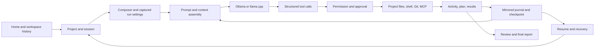

+# Full Product Parity Audit

**Reviewed:** 2026-11-04  
**Repositories:** Electron Workbench `829d860` (`workbench/core-chat-activity`); paired engine `535f99049ea1a5e97a28bcb7d74e37cc901cf4ec` (`workbench/approval-tool-continuation`)
**Purpose:** compare the whole user-facing product and agent workflow with OpenCode and Codex, then keep implementation priorities tied to observable source behavior.

This is a product capability comparison, not source-level equivalence. OpenCode's public documentation is the reference for shipped V1 behavior. OpenCode V2 documentation is development reference and is not treated as shipped V1. Codex CLI is open source; Codex desktop behavior is documented selectively, so this audit does not infer private implementation details from the public Agents API.

## Product workflow

## Capability comparison

| Product area | OpenCode and Codex reference | Workbench source evidence | Gap and priority |
|---|---|---|---|
| Home, workspaces, navigation | OpenCode offers project/session/model/agent/command navigation. Codex adds project/session organization, worktrees, side chats, archives and remote hosts. | Electron Home, workspace history, model orbit, project screen, sessions, settings, and updater. | **P1:** packaged Home/session restore and project switching are not accepted on current source. Remote hosts are outside local-first V1. |
| Chat and run control | Streaming sessions, queued follow-ups/steering, reasoning display, command palette, resume; Codex also documents side questions, goals, forks and review. | Live text/reasoning, draft during run, same-task steering/queue, structured user questions, plan/activity feed, cancel decisions, transcript restore. | **P0:** visibly verify chat and worksheet use the same durable events and resume preserves transcript formatting, activity, plan and terminal outcome. |
| Models and runtime | OpenCode has providers, models, variants and provider options. Codex provides hosted models and environment profiles. | Dynamic Ollama models; Ollama and llama.cpp providers; HF GGUF/Safetensors workflows; capability-driven reasoning; independent context/output; optional model warm action. | **P1:** packaged settings fidelity remains open. Native Transformers and cloud providers are not supported; do not imply otherwise. |
| Context, compaction, continuity | OpenCode V1 auto-compaction and prune/reserved controls; V2 rolling summaries are development reference. Codex exposes context status/compaction and resumable sessions. | Canonical transcript/reasoning, task checkpoint, durable plan/activity, paged result/history recovery, request compaction, prompt provenance. | **P0:** actual long-run compaction and reopen remain unproven. Compare exact request manifest/checkpoint across multiple compactions. |
| Built-in development tools | OpenCode V1 includes shell, file read/write/edit, list/glob/grep, patch, todo, question, skill, web search/fetch and LSP; Codex offers shell/files/patch/search and tool/MCP catalogs. | Paged list/search/read, write/append/edit/patch, Git status/diff/log, shell/argv, plan/checkpoint/history/result retrieval, skills and MCP; tool schemas can be loaded by page. | **P1:** first-party web retrieval and capability discovery; **P2:** optional LSP, debugger, formatter, and test/build profiles. |
| Batch calls and agent continuation | Both products execute tool cycles and resume after results; Codex additionally documents multi-agent delegation and steering. | Multi-call batches, safe parallel reads, ordered approval for writes, cancellation, output continuation and evidence-based retries. | **P0:** grouped protocol/batch/failure/cancel suites and one visible real task must prove no calls disappear, hang or replay after uncertain effects. |
| Permissions and OS boundaries | OpenCode has resource/command scoped allow/ask/deny. Codex separates approval from actual OS sandbox and network policy. | Per-action/task/session/auto approval, persistent resource rules, project-scoped file tools; shell disclosure says commands use the Windows account and are not OS-contained. | **P0 security:** implement/verify opt-in Windows containment before claiming sandbox parity. An approval dialog is not containment. |
| Undo, diff and review | OpenCode snapshots file state around model steps and supports conversation/file undo-redo; Codex offers review and worktree isolation. | Git status/diff/log and copy-mode review/transactional apply; no general per-turn undo/redo system found in current engine/UI. | **P1:** design safe reversible run checkpoints with dirty-worktree protection; measure large-repo overhead before choosing storage. |
| Sessions and recovery | OpenCode has session list/resume/fork/rename/share, streamed events and undo; Codex adds archive, goals and worktree-bound sessions. | App/project mirrored sessions, journals, checkpoints, uncertain-operation classification, paged transcript/result recovery, conflict and move handling. | **P0:** test real close/reopen and recovery; add session fork/archive/search/repair UX after current failures are fixed. |
| MCP, skills and extensions | OpenCode has stdio/remote MCP, OAuth, custom tools, plugins/hooks, on-demand skills and project/global instructions. Codex supports local/remote MCP and skills/plugins. | MCP stdio/streamable HTTP lifecycle, schema validation, persistent rules, Workbench-owned skills/source controls, instructions and prompt provenance. | **P1:** packaged MCP/skill lifecycle acceptance. **P2:** OAuth/elicitation, custom command/plugin lifecycle and hooks. Never claim MCP subprocesses inherit containment unless implemented. |
| Large repositories | OpenCode has list/grep/glob and optional LSP; Codex has repo search and context recovery. | Lazy pageable project inventory/search with offsets, cursors, regex/case options and progress; no global result ceiling. | **P1:** verify large-project UI responsiveness and ignore/invalidation behavior. A page size is not a project size cap. |
| Web/browser/research | OpenCode supports web search/fetch; newer product paths include browser automation. Codex availability depends on product/runtime. | No first-party browser/web tool found in the current engine schema; MCP can provide external capabilities. | **P2:** capability-gated web retrieval with source attribution and explicit network/origin policy; browser automation separately. |
| Performance, cache, telemetry | Both products expose runtime/context controls; cache and execution details vary by provider. OpenCode documents snapshot/LSP tradeoffs. | Provider token/timing fields, cache-count plumbing, runtime telemetry and worker correlation where available; some GPU readings are device-wide. | **P1:** prove prompt-prefix reuse via repeated identical-prefix requests; distinguish cached tokens from KV allocation and device-wide GPU use. |
| Configuration and workflows | OpenCode has layered config, agents, commands, formatter, watcher, permissions, providers, themes and keybinds. Codex has profiles, approval/sandbox policy, skills, MCP, project instructions and app controls. | Run settings, task intent, approval, permissions, skill source, model/context/output/reasoning, harness profile and app preferences. | **P2:** effective-setting precedence/import-export and command/agent profiles; every run must show its captured settings. |
| Packaging, setup, updates | Both ecosystems support releases/installers and update workflows. | Electron Forge Windows Squirrel installer/ZIP, GitHub release updater, README/runbook. | **P0 release:** exact-pin package, install/update/restart/recovery on Windows; resolve unsigned installer/trust; do not publish until acceptance. |
| Accessibility and presentation | OpenCode has command palette/keybinds/themes. Codex has desktop keyboard flows, tabs and inline review. | Original Electron interface, Markdown/highlighting, activity disclosures, basic composer shortcuts. | **P2:** keyboard traversal, scaling, high contrast and responsive panel acceptance; orbit/layout refinements remain queued. |

## Findings and implementation order

The Workbench has a substantial local-first tool and recovery core; the immediate risk is end-to-end wiring and proof. The beta.3 failure occurred before provider dispatch, while the latest source fixes are not in the installed build. Source features do not establish that UI, sidecar, persistence and provider work as one reliable product.

Highest-impact gaps:

1. **P0 reliability:** grouped current-pin protocol/persistence/UI tests, exact-pair packaging, then visible hello + small coding task with approval/activity/close/reopen.
2. **P0 security:** real opt-in Windows containment, with shell, MCP and network boundaries accurately represented.
3. **P1 recovery/review:** safe per-run undo/redo, session fork/archive/search, and project-mirror repair.
4. **P1 development capability:** web retrieval, optional LSP, formatter, debugger, and richer test/build workflows with capability discovery and per-tool permission.
5. **P1 performance evidence:** live compaction, prompt-cache reuse, truthful runner-attributed GPU/CPU/RAM and KV status.
6. **P2 extensibility/product polish:** reusable commands, agent profiles, plugin hooks, keyboard/accessibility and remaining Home/work-sheet/orbit work.

These do not justify lowering context/output settings or changing reasoning defaults. Keep the Python engine for V1. Do not treat V2 documentation or API contracts as shipped desktop behavior.

## Agent loop mechanics: OpenCode compared with Workbench

OpenCode V1 separates the session prompt loop from a stream processor. The processor receives provider stream events, persists text/reasoning/tool-call state, applies permission checks, tracks snapshots, and returns a control result (`continue`, `stop`, or `compact`) to the outer loop. It captures a filesystem snapshot before starting the provider stream because tool execution may happen before the stream emits its step-start event. The prompt loop owns session execution and compaction/retry transitions. Its processor includes a `DOOM_LOOP_THRESHOLD` for repeated identical tool/input calls and requests a separate `doom_loop` permission decision. See the [V1 prompt loop](https://github.com/anomalyco/opencode/blob/dev/packages/opencode/src/session/prompt.ts) and [V1 stream processor](https://github.com/anomalyco/opencode/blob/dev/packages/opencode/src/session/processor.ts).

Workbench's Python `AgentEngine.run` is currently a single explicit request/tool-result loop. It composes the model request and prompt manifest, streams provider output, validates structured tool calls, runs safe independent read batches while keeping mutations/commands/MCP ordered, records results and task checkpoints, then decides whether to continue, compact, finish, or expose a blocker. The sidecar owns captured session/workspace identity, event mirroring, queued prompts, steering, approval and recovery. This separation has a practical strength for local runtimes: tool batches and host effects remain visible and are validated outside the provider adapter. The loop additions now cover repeated structured actions and known transient provider failures; the sidecar also fails queue admission when neither session copy can persist it. Full interaction and failure-injection verification remain open.

**Implemented from this comparison:** engine `ed39ccd` detects three consecutive completed calls with the same tool, exact arguments, and identical result. Before a fourth identical execution, it requests a fresh one-action review even under Auto mode. Duplicate calls in the same model batch are serialized so prior results are observable. Declining blocks that exact fingerprint until a newer user steer; a different tool/argument remains available. This does not impose a total iteration/runtime cap. The renderer explains the repeat and offers “Allow this attempt” or “Decline this repeat.” The app now marks the approval as unavailable and prevents the action if neither session mirror can save the pending decision. Regressions exist in `tests/test_engine_tool_batch.py`; they remain unrun for the grouped verification pass, and the paired packaged interaction is unverified.

**Loop work in progress:** engine `535f990` captures transport retry metadata for Ollama and llama.cpp. It retries standard transient HTTP statuses and connection-level failures with a cancelable exponential wait, honoring numeric or HTTP-date `Retry-After`; there is no attempt or task deadline. It does not replay a response after visible text, reasoning, or tool-call progress has started. The app now forces the retry attempt/phase into both event journal and session snapshot before waiting. Provider retries and crash recovery now need grouped fault-injection and UI verification.

**Remaining loop parity work:** the current Workbench checkpoint and event journal are not a single session inbox/runner coordinator. Review safe-boundary admission and idempotency for user prompt, steering, queue, cancel, approval and recovery; keep model activity and durable state coherent when the UI reattaches. Then compare context assembly and compaction boundaries, tool-call error transitions, response finish reasons, permission-denied recovery, and terminal-result delivery with the OpenCode processor. Adopt the state-machine semantics where they improve reliability; do not copy assumptions that add arbitrary task/runtime limits or rely on cloud-only services.

## Sources and evidence limits

- [OpenCode built-in tools and permissions](https://docs.opencode.ai/docs/tools/)
- [OpenCode agents and resource-scoped permissions](https://opencode.ai/docs/agents/)
- [OpenCode MCP: stdio/remote, auth and tool enablement](https://docs.opencode.ai/docs/mcp-servers/)
- [OpenCode V1 config: compaction, watcher, MCP, plugins, instructions and providers](https://opencode.ai/docs/en/config/)
- [OpenCode TUI sessions, undo/redo, reasoning display and updates](https://docs.dev.opencode.ai/docs/tui/)
- [OpenCode V2 tool/runtime reference](https://dev.opencode.ai/v2/docs/tools/) — development reference, not assumed shipped V1.
- [Codex product workflows: worktrees, side chats, steering, review, skills and plugins](https://developers.openai.com/blog/mastering-codex-remote-for-engineering)
- [Codex self-hosted executor and sandbox requirements](https://developers.openai.com/api/docs/guides/agents-api/environments/self-hosted)
- [Codex automatic review and separation from sandbox/network policy](https://developers.openai.com/api/docs/guides/agents-api/sessions/approvals)
- [Codex open-source sandbox/approval implementation](https://github.com/openai/codex/blob/main/codex-rs/core/src/tools/sandboxing.rs)

The Codex Agents API documents a managed harness contract, not all Codex desktop/CLI behavior. These products change; recheck this date-stamped matrix before release decisions.

