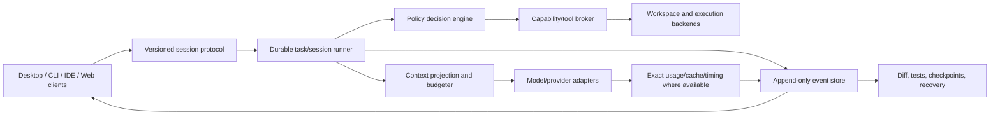

# Separate Agentic Development Platform — From-Scratch Product Design

**Status:** Draft v1 for design review; no code/framework has been selected or started.
**Product:** a new platform distinct from Local Agent Workbench.
**Research basis:** prior project discussions plus source-backed preliminary reviews of Codex, Claude Code, Gemini CLI, OpenCode, Pi, Aider, Cline, Kilo, Cursor, GitHub Copilot, OpenHands, Deep Agents Code, Goose, Open Interpreter, IDE agents, and hosted builders. See `new-platform-from-scratch-brief.md` for the research protocol and the user-supplied 100-candidate catalog.
**Evidence note:** cited sources document product behavior; they do not prove quality, security, or reliability. Hands-on verification remains future work.

## 1. Vision

Create a professional agentic software-development environment where a person can move from a goal to a verified, reviewable software change, using the models and execution environments they choose. The product should make autonomy understandable and controllable: show what the agent knows, what it is doing, what it changed, what it verified, what it cannot safely do, and how to recover.

**Working positioning:** *A development workspace where agents do real work—and every action, result, and recovery path stays understandable and under your control.*

This is an original concept, not a re-skin of ChatGPT, Codex, OpenCode, Cline, Kilo, or the existing Workbench.

## 2. Users and jobs

### Primary
- **Independent developer:** delegate a feature/bug/task, supervise meaningful decisions, inspect a coherent diff, and verify tests without babysitting every token.
- **Local-model developer:** use Ollama/llama.cpp or another local runtime with truthful context/cache/runtime status and low avoidable prompt cost.
- **Project owner:** keep durable project instructions, model/tool policy, history, and review state across tasks.

### Secondary hypotheses
- **Team lead:** coordinate isolated parallel work and review agent-produced changes in a shared policy environment.
- **Application builder/designer:** use preview/browser interaction and visual feedback as part of task verification.
- **Agent/tool developer:** extend the platform with trusted, scoped tools and task-specific agent workflows.

Validate which of these groups is truly in scope before architecture selection; serving all at launch may create a sprawling product.

## 3. Goals and non-goals

### Goals
1. End-to-end project task loop: understand → plan → act → inspect → verify → review/handoff.
2. Durable, resumable task state; no silent lost, duplicated, or automatically replayed uncertain side effects.
3. Model/runtime flexibility, including local-first operation and honest capability reporting.
4. Low, explainable model-request overhead: stable cacheable inputs, explicit context budget, on-demand tools, visible token/timing/cache metrics.
5. Useful autonomy with risk-aware approval and an actual containment boundary where claimed.
6. A strong, original visual workspace for simultaneous conversation, operations, diffs, checks, and previews.
7. Reversible development: task checkpoints independent of the user's Git history, with safe apply/restore and preservation of intervening human edits.
8. Interoperability through explicit, versioned protocols rather than dependence on one client or one model provider.

### Non-goals for the first design slice
- Build a catalog of 100 integrations before validating the core workflow.
- Promise universal support for every model, editor, operating system, or MCP server.
- Assume remote/cloud execution is required; compare it with local-first options.
- Treat model chain-of-thought as user-visible progress or store private reasoning as durable project memory.
- Copy competitor implementations, visual assets, proprietary wording, or unverified claims.
- Replace the existing Workbench or merge this product into its implementation branch.

## 4. Product principles

1. **One task, one durable truth.** UI panels, model prompts, event logs, and recovery derive from a canonical task record; no parallel state machines that silently drift.
2. **Every model request is a projection.** Canonical transcript/effects remain durable; prompt context is a versioned, budgeted projection with provenance, omissions, and cache-stability rules.
3. **Safe by execution boundary, not by tone.** Approval is consent; sandboxing is enforcement. Each tool reports its real boundary.
4. **Evidence before completion.** Assistant prose is not proof of a file change, test, or successful command. Completion reports observed evidence and gaps.
5. **Reversible but not magical.** Rollback states exactly what it restores and what external effects it cannot undo.
6. **Local-first with explicit network edges.** Model calls, MCP, web/browser access, telemetry, and hosted execution are separately visible/configured.
7. **Progress over token theater.** Show phase, elapsed time, pending user decision, and verified work; distinguish reasoning from action and waiting.
8. **Capabilities are declared and tested.** Provider/model/OS/workspace/integration capabilities may be supported, unsupported, or unknown.
9. **Fast by default, never silently smaller.** Reduce redundant requests/context and exploit stable prefixes; do not lower selected context/output/reasoning or weaken policy without user choice.
10. **Add complexity only for proven work.** Subagents, automation, and plugin ecosystems follow reliable single-task execution and recovery.

## 5. Original interaction concept

### Proposed workspace, to test against alternatives

```text
┌ Projects / workspaces ─┬──────────── Active task ───────────────┬ Evidence rail ┐
│ project switcher       │ Goal · model/runtime · access mode   │ Plan/criteria │
│ recent / pinned        ├───────────────────────────────────────┤ Operations   │
│ branches/worktrees     │ Conversation + compact action cards  │ Diff/checks  │
│ sessions               │ user steer · approvals · final report│ Preview      │
│ integrations           ├───────────────────────────────────────┤ Recovery     │
│                        │ composer · queue/steer · run controls │ Context/cache│
└────────────────────────┴───────────────────────────────────────┴──────────────┘
```

**Design hypothesis:** the memorable element should be the live “work ledger”: one time-ordered stream of model requests, tool proposals, policy decisions, effects, tests, and user steering, linked to a continuously inspectable project diff. The conversation remains readable, but is not the sole representation of progress.

Test at least three competing layouts before choosing:
- **Conversation-first** (ChatGPT-style): low learning cost, but risks burying operations/evidence.
- **IDE-first** (Cline/Cursor-style): strong code locality, but can make task/session/recovery state secondary.
- **Work-ledger workspace** (proposed): explicit task/evidence panels, but risks visual density and needs responsive/accessible hierarchy.

### Core flow
1. Open/create a project. Show detected instructions, Git/worktree state, runtime readiness, and permission boundary before task start.
2. Select task goal and optional acceptance criteria. Choose model/runtime and access profile; display capabilities and exact settings.
3. Start task. The session runner durably admits the message and captures immutable run configuration.
4. Agent gathers context, then proposes a plan only when useful. Plan mode is enforced read-only; Build/Discuss are explicit intents, not inferred from keywords.
5. For each model step, show phase and cost. For each proposed action, show exact target, effect, policy reason, and containment boundary before approval.
6. Execute in an isolated task workspace by default; stream operation output and record completed/uncertain results.
7. Verify changed files and requested checks. Show a task diff/check report with evidence and failed/unrun tests.
8. User applies, commits, opens PR, continues, or restores a checkpoint. Recovery never replays uncertain operations automatically.

### Failure and recovery flow
- Provider disconnect: preserve complete received output as partial; discard incomplete tool arguments; expose retry/resume.
- App/worker crash: replay durable events after the last snapshot; mark started-without-completion effects uncertain; ask user to inspect before retry.
- Context pressure: compact a derived prompt view at safe boundaries, preserve canonical history, record omitted sections, and provide retrieval paths.
- Permission denial: record decision; continue only with unrelated safe work; never reinterpret prose as approval.
- Checkpoint restore: preview affected files and conflicts with human changes; choose files-only or task/session restore; clearly list external effects that cannot roll back.

## 6. Proposed logical architecture (framework-neutral)



### Component responsibilities
- **Session/task runner:** owns admission, idempotency, event ordering, steering/queue safe boundaries, cancellation, terminal state, and recovery. It should be a durable state machine, not UI-owned logic.
- **Versioned protocol:** typed request/event/result schema with stable thread/task/turn/request/tool IDs; client reconnect and replay; compatibility/migration policy.
- **Context projection:** builds provider-specific model input from canonical history, project context, instructions, memories, tool schemas, and results. Records exact sources/sizes, cache-stable prefix boundary, and omissions.
- **Provider adapters:** normalize streaming, tool calls, capability declarations, exact usage counters, cache/timing metrics, retries, and cancellation. No unsupported field is fabricated.
- **Policy engine:** evaluates action/resource/effect rules and explains the result; separate from sandbox enforcement.
- **Tool broker:** validates schemas, scopes capabilities, applies quotas, starts/observes effects, records output, and classifies completed/failed/uncertain results.
- **Execution backends:** local workspace, isolated worktree, OS sandbox/container, remote environment. Boundary is explicit per action.
- **Event store:** append-only task evidence plus snapshots/checkpoints; exportable, integrity checked, retention user controlled.
- **Review/recovery service:** diffs, tests, previews, checkpoint/restore, conflict-safe apply, and resumable handoffs.

### Architecture options and provisional evaluation

1. **Local session server + clients (leading hypothesis):** a local service owns tasks/runtime/tools; desktop is first client, CLI/IDE can follow. Strong session ownership and reuse; needs local IPC security, process lifecycle, migration, and single-instance design.
2. **Desktop-integrated runtime:** one native desktop app owns local task execution. Simpler first-run/ownership UX; raises coupling and makes CLI/IDE access harder.
3. **Hosted task control plane + local/remote worker:** centralized task organization with user-selected local or sandbox worker. Strong cross-device async flow; higher privacy, availability, and service-operations cost.
4. **Editor extension as primary:** native code editing; fragmented UX and recovery across editors.

**Provisional direction:** prototype the local session server with desktop-first client, but do not select it until comparing the failure/security model with the integrated desktop option. No framework/language/runtime is selected yet.

## 7. Agent loop and request-flow design

```text
user event -> durable admission -> capture task settings -> build context projection
      -> model request -> validated tool proposals -> policy + sandbox checks
      -> parallelize only independent safe operations -> persist results/effects
      -> append context delta -> verification -> next request or terminal handoff
```

Design requirements:
- One model request may return multiple validated tool calls; execution policy may parallelize safe independent reads and explicitly approved independent writes only when ordering and rollback semantics are defined.
- Runtime remains stateless where required, but the harness owns durable session state. Resend only the necessary projection; stable prefix and deterministic schema ordering enable provider cache reuse. Do not claim the payload itself is not resent.
- Tool schemas are discovered/paged by task capability and context budget; when a tool is loaded, it must be present in the next model request. Cache changes are surfaced.
- Continue based on structured task state/evidence and useful next actions, not phrases or arbitrary step/time caps. Detect no-progress loops and stop with a recoverable blocker, never false success.
- Background commands/subagents are later capability tiers; each needs identity, logs, cancellation, reattachment, resource limits, and uncertain-effect recovery.
- Prefer one model request per useful reasoning/action boundary, not one request per trivial tool. Measure request count and task success, not only tokens/sec.

## 8. Safety and trust model

### Threats
Prompt injection in repositories/web/MCP; malicious or compromised MCP/extension; destructive or exfiltrating shell command; cross-project/session leakage; secret exposure in prompts/logs; model/provider returning malformed tools; crash after side effect but before persistence; package/update supply-chain compromise; shared-machine hostile process.

### Required layers
1. **Identity and scope:** immutable project/task/turn identity; canonical paths; symlink/junction checks; no cross-session result lookup.
2. **Capability policy:** ordered allow/ask/deny by tool and resource, deny precedence, exact command/path preview, auditable reason.
3. **OS boundary:** default sandbox for command/MCP/web workers; explicit host mode only when required; workspace read/write and network allowlists; process-tree lifecycle containment. Approval is not sandboxing.
4. **Secrets:** secret broker injects scoped credentials into approved tool processes; never serialize secrets into prompts, events, crash reports, or model-visible errors.
5. **Effect ledger:** every side effect has requested/approved/started/completed/failed/uncertain state; uncertain effects require inspection, never auto-retry.
6. **Recovery:** crash-safe journals, snapshots, idempotent admission, conflict detection, migration, and user-confirmed restore.
7. **Extensions:** signed/provenanced packages where possible; isolated processes; explicit permissions, version pinning, timeout/resource limits, revocation and audit logs.
8. **Supply chain:** reproducible build metadata, dependency lock, signed artifacts, retained immutable candidates, and staged update/rollback plan.

## 9. Product capability tiers and roadmap

### Foundation — reliable single task
Durable runner/protocol, local workspace, provider adapters, stable context projection, schemas/tools, permissions, streaming, diff/checks, recovery, accessibility, observable state.

### Developer workspace
Worktrees/checkpoints, browser preview, test/build profiles, repository map/index, MCP, skills, extension SDK, import/export/searchable sessions, desktop + CLI clients.

### Team and async
Shared policy, team libraries, delegated agents, background tasks, PR/ticket integrations, remote sandbox workers, audit/retention/admin controls.

### Advanced ecosystem
IDE adapters, multimodal artifacts, scheduler/automation, marketplace, analytics, custom workflow engine. Only pursue if research/user validation shows sustained demand.

### Acceptance gates
- **G0 Research/design:** primary-source dossiers, alternatives and tradeoffs, threat model, original UI flows, evidence/unknowns matrix.
- **G1 Core loop:** local model task end-to-end, exact phase/cache/token visibility, multi-tool result continuation, no silent context truncation.
- **G2 Safety/recovery:** permission matrix, sandbox escape tests, crash after each effect boundary, no duplicate/lost requests, checkpoint restore preserving human changes.
- **G3 Quality:** representative coding tasks across model sizes/providers; tests/lint/diff evidence; compare baseline and improvements.
- **G4 Product:** usability/accessibility, fresh install/update, project migration/export, privacy/data deletion, support diagnostics.

## 10. Current-workbench learning transfer (not implementation commitments)

Carry forward as lessons: exact request/provenance telemetry; no false cache metrics; context/output separation; durable mirrored event records; uncertain effects never replay automatically; approvals are not containment; cache stable-prefix design; immutable package provenance; preserve user model state. Re-evaluate, rather than automatically inherit: Electron/Python architecture, `AgentService` controller shape, current UI layout, old permission defaults, existing session format, and current tool inventory.

Do not move existing Workbench requirements into the new product silently. Maintain a traceability table during design: requirement, origin (user/project/market), keep/adapt/drop, why, and acceptance criteria. User-approved scope is not lost merely because the new design chooses a different implementation.

## 11. Decisions still open

- Primary user: solo local-first developer, broad software team, or app builder?
- Product shell: local server, native desktop, IDE-first, hosted-first, or hybrid?
- Execution default: direct workspace, worktree, OS sandbox, or user-selectable tier?
- Model strategy: fully BYOK/provider-neutral vs managed fast paths; cost/quota and privacy model?
- Session/task/artifact identity and how multiple users/clients attach to one task.
- How much autonomy is default and which decisions always require a human?
- Whether project indexing is local-only, optional hosted, or pluggable; exact data deletion/retention.
- How browser/UI verification and external integrations are contained and evidenced.

These are product decisions for the eventual design review; do not invent user agreement. The next research step is to fill each platform dossier, validate status/primary sources, then synthesize requirements and competing interaction/architecture options before recommending one.